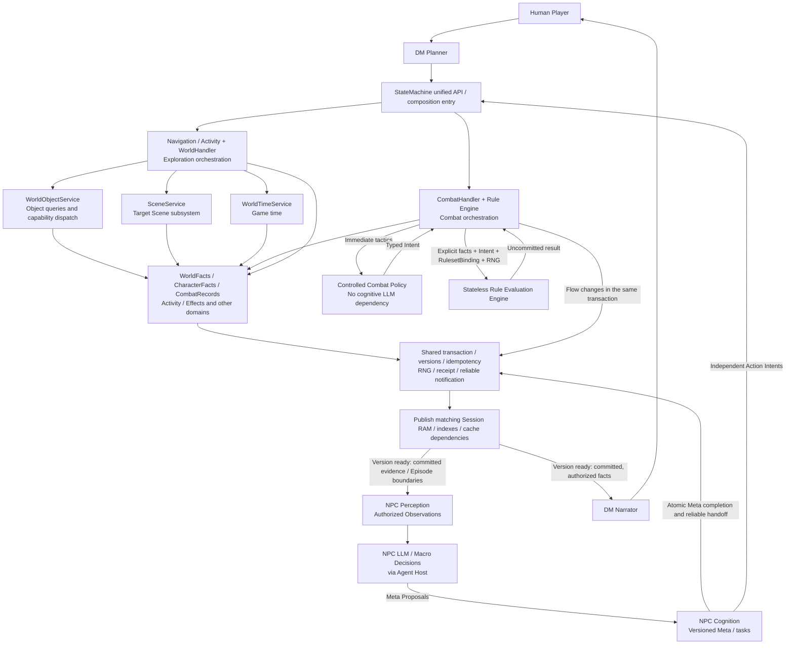

# Agentic TRPG

## 2026-10-27 当前源码与说明维护入口

本批基线为文档 `88bb8dd`、SM `b9ae704`、RE `7bb02b9`（均已 fetch 核对）。
SM 当前 main 已包含 Session RAM、持久提交后发布、运行实例字段及通路反向索引的
受限实现；容器重量／机关索引跨命令复用已有生产接线。当前依据是源码和既有
[实例归属证据](docs/reviews/RUNTIME_INSTANCE_OWNERSHIP.md)，不再把下方 10 月 21 日的
NOT IMPLEMENTED 或“仅配套分支”当作当前 main 的状态。完整恢复／未来多人等原有
限制不因本批说明补充关闭；本批没有重新运行历史游戏验收。

新增强制开发规范见 [源码说明维护](docs/CODE_DOCUMENTATION.md)，覆盖持续维护、仓库级
Skills 和固定检索实验／未来索引输入；本批证据见
[核对报告](docs/reviews/CODE_DOCUMENTATION_AND_SKILLS.md)。历史段落保留日期和原语境。


**A modular architecture for AI-driven tabletop role-playing games, combining autonomous characters with deterministic game rules.**

> **Project status:** Architecture and interface design in progress. This repository is the project-wide documentation and coordination hub, **not** a standalone playable application. The specifications describe the intended system; they do not imply that all interfaces or components are implemented.

## Overview

Agentic TRPG aims to create a tabletop role-playing experience where an AI Game Master can run an adventure, non-player characters can make their own decisions, and a deterministic rules engine handles game mechanics.

The central design principle is simple:

**Let LLMs handle language, narrative judgment, and character decisions; let deterministic software validate rules and commit game state.**

The project separates the AI Game Master, the authoritative game runtime, the rules engine, and the future visual presentation layer. The architecture is intended to be extensible beyond a single ruleset, although the first MVP focuses on a D&D adventure.

**[DECIDED] 2026-10-12 revision:** Continue with **trpg-state-machine + trpg-rules-engine as the development and runtime foundation**, strengthening the programmatic game core while allowing substantial subsystem refactoring or replacement. The earlier unmerged Evennia-first decision is withdrawn. Evennia, CDDA, and Ranvier are sources of mechanisms and possible reusable components; adopting Evennia as a whole remains an **[OPEN]** option requiring separate evidence. See the [Game Core Evolution Plan](docs/GAME_CORE_EVOLUTION_PLAN.md). This docs-only revision performs no implementation or runtime validation.

Open-ended player actions, persistent world consequences, and NPC private cognition/autonomy remain the product goals. LLMs interpret context and propose adjudication, compositions, and character plans; the game core executes supported capabilities and makes their consequences affect later behavior. Agentic validation starts alongside the smallest usable mechanisms, without waiting for a complete conventional engine or full Host.

**[DECIDED] Domain state ownership, supplemented 2026-10-15 and 2026-10-21:** Each fact has one responsible domain. StateMachine remains the unified API and composition entry; explicit dependencies and shared SQLite transactions connect the subsystems. Facts / Records provide unified fact access and controlled changes. The decided target keeps loaded active facts in Session RAM, incrementally persists every successful mutation in SQLite, then publishes that committed RAM version before returning success and current projections. Host/LLM output remains a proposal. The [responsibility table in Module Contracts §0.3](docs/MODULE_CONTRACTS.md#03-按领域管理状态按事实确定权威按操作组织事务-decided) governs ownership; [§1.4](docs/MODULE_CONTRACTS.md#14-2026-10-19-运行时复用专项核对当前分支静态证据) records the current reuse implementation check; §1.2–§1.3 retain historical working-tree and remote evidence.

**Session memory runtime decision (2026-10-21): [DECIDED], complete runtime layer [NOT IMPLEMENTED], runtime acceptance not executed.** Queries, operation checks, RE request assembly, actor views, Snapshots and derived calculations use the same consistent RAM scope for loaded valid facts; candidates and previously supplied fixed inputs remain isolated. SQLite also serves loading, cold data, recovery, receipts and reliable work. The unified protocol and failure boundaries are in [Module Contracts §2.3 / §6](docs/MODULE_CONTRACTS.md#23-运行时数据复用派生-snapshot-与版本有效性-decided), source evidence in [the dated review](docs/reviews/SESSION_MEMORY_RUNTIME_SOURCE_REVIEW.md), and migration in [the existing evolution tracks](docs/GAME_CORE_EVOLUTION_PLAN.md#81a-session-内存运行层的依赖阶段2026-10-21). Future 5–6 player load is separate from the single-player MVP; no runtime, Schema or ABI changes are delivered by these docs.

## System architecture

**2026-10-21 documentation update:** [Unified references](docs/REFERENCES.md) indexes the adopted rule versions, Package setting/adventure source requirements, and engineering references. [MC §2.3](docs/MODULE_CONTRACTS.md#23-运行时数据复用派生-snapshot-与版本有效性-decided) governs reuse across all runtime computations; [World §2.1b](docs/WORLD_SUBSYSTEM_DESIGN.md#21b-容器重量派生与跨操作复用) applies it to container weight. The [latest source check](docs/MODULE_CONTRACTS.md#17-2026-10-21-运行时复用与资料核对) distinguishes SM's unmerged `refactor/scoped-runtime-validation@4341f69` from main. Its operation-local weight memo does not implement the cross-operation cache target. Older dated implementation paragraphs below retain their original evidence scope.

The diagram shows target responsibilities. Existing implementation slices and remaining gaps are recorded in [Module Contracts §1.4](docs/MODULE_CONTRACTS.md#14-2026-10-19-运行时复用专项核对当前分支静态证据).



**Historical reuse source check (2026-10-19):** Documentation starts at `98e8d36`. SM checkout `feat/environment-derived-snapshot@3788553` already includes SceneLifecycleService, GridService, EnvironmentService, explicit protection, transactional source/protection versions, and bounded derived caches. This branch differs from remote SM main `d0fda62`; its Engine/SRD pin remains `d596161060555630019163ab301e1d25fd816549`. GridView still repeatedly parses JSON and constructs topology; RE verify_ruleset still hashes the effective corpus on each call. Reusing parsed inputs and verified immutable ruleset identities remains a design requirement. See [Module Contracts §1.4](docs/MODULE_CONTRACTS.md#14-2026-10-19-运行时复用专项核对当前分支静态证据) for exact identities, source/progress evidence, provider limits, and the distinction between the RE checkout, main, and SM pin. This was a targeted static check; no SM/RE tests or performance measurements ran. The [2026-10-18 source check](docs/MODULE_CONTRACTS.md#13-2026-10-18-远端实现核对定向静态调查) remains historical evidence.

The target World structure places WorldObjectService, the Scene subsystem coordinated by SceneService, and WorldTimeService side by side. Current SM has the bounded implementations described above; complete Scene coordination and TerrainService remain targets. The top-level diagram shows only SceneService; the [World detail table](docs/WORLD_SUBSYSTEM_DESIGN.md#20-world-与-scene-的结构-decided) describes its internal components. Queries may use the appropriate component directly. They share the Scene grid and coordinates; actor positions, object contributions, and base terrain keep their respective owners.

Environment's target Package initial data stays separate from Session changes, including changes before the first visit; the controlled environment import already present does not make proposed Package fields valid Loader inputs. Whole-scene or regional queries combine base conditions, explicit local protection, and effective Effects on demand. Formal provider dependencies and production WO/Effects adapter limits are recorded in §1.4. Exposure-progress ownership remains OPEN. Existing Episode, Recent OB, Gate/EVA, CombatPolicy, version/idempotency/RNG and transaction contracts remain in force.

**[DECIDED] Runtime reuse (2026-10-19):** [Module Contracts §2.3](docs/MODULE_CONTRACTS.md#23-运行时数据复用派生-snapshot-与版本有效性-decided) governs disposable read-only inputs, on-demand derived results, transactional dependency versions, bounded lifetimes, and authorization. [World §2.0b–§2.0c](docs/WORLD_SUBSYSTEM_DESIGN.md#20b-grid-运行时输入复用-decided) details shared Grid inputs and Environment's two versions, including wind changes from all applicable sources. [Ruleset loading and identity](docs/MODULE_CONTRACTS.md#43-rulesetbinding-与规则数据复用-decided) remains RE's responsibility. These decisions do not create a second state authority or claim all reuse paths are implemented.

**[DECIDED] Complete instantiation:** [Module Contracts §2.4](docs/MODULE_CONTRACTS.md#24-package-创建参照与完整实例化-decided-partially-implemented) makes Package a creation reference. Existing instances obtain complete effective configuration and state from their owning Session domain records through a unified read boundary. Schema39 now persists the existing capability configuration closure and requires explicit upgrades for older saves. Dynamic spawn, general creation dependencies and equipment/effect lifecycles remain incomplete; see the [current main baseline](docs/MODULE_CONTRACTS.md#16-2026-10-20-三仓库-main-对齐). Static definition reuse and fixed rules/behavior references remain valid within that boundary.

### Main responsibilities

| Component | Responsibility |
| --- | --- |
| **Agent DM** | Interpret player input, coordinate the adventure and NPCs, make authorized narrative/GM judgments, and narrate committed outcomes. The DM Planner and DM Narrator have separate contexts and permissions. |
| **NPC Sub-agents** | Independently interpret authorized experiences and propose dialogue, beliefs, memories, goals, and macro decisions. Immediate tactics use a controlled Combat Policy; they do not require an LLM call per action. |
| **Agent Host** | Execute LLM calls and manage prompts, contexts, invocation retries, and inference resources; it does not own authoritative game state. |
| **StateMachine and domain components** | StateMachine provides the unified API and composition entry. WorldFacts owns scenes, space, objects, object durability, doors/locks, containers, and actual item location relations. CharacterFacts / mechanical components own actual actor position, HP, resources, and equipment. CombatRecords owns combat records; Activity owns ongoing activities; Effects owns lasting effects and their progress. Inventory ownership projections cannot be edited independently. |
| **Shared commit facilities** | One short SQLite transaction incrementally commits state, costs, RNG, required events/evidence, progress, receipts and reliable work; then publish the corresponding RAM version before normal success/current projections. Enforce authorization, versions, idempotency, and rollback. A legal failed attempt may still spend resources; invalid commands and version conflicts are separate outcomes. |
| **Combat Handler** | Persist encounter/participant/turn flow, pending decisions, committed action links, and progress. Organize evaluation and shared commits, then advance to the next decision boundary, legal pause, or end. RE computes mechanical turn/resource/effect changes; Handler does not apply them twice. Concrete API and scheduling budgets remain open. |
| **Rule Engine** | Deterministically evaluate supported action legality, attacks, damage, checks, saves, action economy, movement, spells, effects, and reactions. Return typed, *uncommitted* results without independent authoritative runtime state. |
| **Visual Presentation** | Future presentation of maps, tokens, scenes, and animations. It is outside the first MVP. |

[Module Contracts](docs/MODULE_CONTRACTS.md) is the highest authority for cross-module target interfaces and state ownership. The standard evaluation boundary is:

```text
StateSnapshot + Typed Intent + Pinned RulesetBinding + Explicit RNGContext
    → RuleEvaluationResult
```

Snapshots have two versioned contexts, CombatSnapshot and NonCombatSnapshot, composed from complete typed mechanical state components. Results use four statuses (`accepted`, `rejected`, `needs_choice`, `unsupported`) and include the applicable closed Typed StateDelta, ProposedEvents, RNGTransition, and ReadSet. Owning domains apply candidate changes in one shared transaction; `accepted` does not mean committed. These remain target specifications, not a frozen ABI or newly implemented API. Ordinary world operations need not invoke RE. D&D rules remain RE responsibilities. Domain invariants and commit checks remain required; a generic commit layer must not reimplement each spell or ability.

Immediate Mechanical Response is organized by Combat Handler / responsible domain handlers through trusted mechanisms, Combat Policy, and RE. Tactics, reactions, automatic effects, and combat triggers do not depend on cognitive LLM calls. Required mechanical perception must have trusted evidence; unknown does not mean perceived. Handler advances from committed state with bounded retries and a no-progress exit; one attack does not automatically end a turn. NPC Cognition manages versioned private Meta while Host runs models. EVA completion, later actions, and perception processing retain separate transaction lifecycles.

Normal rule evaluation targets complete necessary current facts: usage markers, effect clocks, and key times belong to mechanical state, without a duplicate compact history log. Full log removal still requires reader/dependency auditing and validation across supported paths; existing logs and necessary ordered candidate events remain. In-process typed calls, on-demand reads, immutable values, and rebuildable caches may reduce copying, subject to correctness verification; no performance gain is claimed. Interrupt / Continuation and new read APIs remain open. [Module Contracts §1.3](docs/MODULE_CONTRACTS.md#13-2026-10-18-远端实现核对定向静态调查) records the current remote source baseline separately from historical evidence; this docs-only batch ran no runtime tests.

**A1 — Separate exploration and combat orchestration:** The target assigns exploration movement to Navigation / Activity + WorldHandler and combat movement to CombatHandler + RE, using one actual actor position. Combat space projects world space with explicit mapping boundaries. Opening, unlocking, moving items, and breaking obstacles are to reuse object facts and capability operations; combat additionally coordinates eligibility, costs, timing, triggers, and reactions through RE. Current foundations are partial; existing noncombat entry restrictions remain effective until a supported combat integration replaces them.

**A2 — StateMachine modularity and responsibility boundaries:** Subsystems use Handler / Service, Facts / Records, and Supporting Components as needed, gradually replacing Mixins with explicit composition. This does not require every layer in every subsystem, a handler for each object type, or an ECS rewrite. The [World design draft](docs/WORLD_SUBSYSTEM_DESIGN.md) describes optional capabilities and candidate fields, grouped as template configuration, persistent instance state, relations, and derived queries; SQL and cross-module protocols remain open.

Default deployment continues in process with shared persistence. Reviewed internal modules may collaborate through controlled domain interfaces and a shared transaction context without wrapping every field change as JSON, RPC, or an external command. Shared storage does not authorize arbitrary table writes. One continuously executable operation commits together, with no write lock held while waiting for a player, model, external I/O, or long evaluation; neither a whole battle nor an entire NPC plan is one long transaction.

The final goal is to refactor the Stateful Combat Engine into a Stateless Rule Evaluation Engine. Supported execution must not depend on legacy `_LiveCombat`, `CombatHandle`, `_REGISTRY`, or the Stateful Combat Orchestrator, including rebuilding them behind a permanent adapter. Correct Nat20 algorithms, resolvers, and declarative rules data may be reused with explicit state dependencies; local evaluation variables and temporary calculation contexts are allowed. Legacy Stateful APIs may remain briefly for isolated regression comparison, subject to the [migration completion criteria](docs/MODULE_CONTRACTS.md#141-stateful--stateless-完成标准-decided-not-implemented). Project specifications define the target; legacy code does not define the architecture.

### Events, perception, and NPC knowledge

A committed world event is not automatically known to every character. The current event-level protocol and reusable implementation assets follow this pipeline when such events are recorded:

```text
Event + Observable Signals → per-Signal Scope Discovery → Event-local Evidence
    → Atomic commit with reliable Outbox
    → Deterministic / optional JEV Perception Judgment
    → Authorized stage Observation
    → Existing NPC Inbox and Evaluation Flow
```

NPCs receive only observations they could perceive and are authorized to know. Their beliefs and memories are separate from objective world facts. Event observations do not automatically trigger an LLM call or change a character's goals.

Mechanical Audit does not automatically enter perception. NPCs participating in a particular combat receive Turn Episode signals; external NPCs receive Round Episode signals, including the final partial round. Mechanical Events do not generate individual cognitive signals or require a per-action perception evidence chain. Perception filters scope and receiving abilities, batches judgments per NPC/Episode, and exposes only authorized perceived content. Non-combat Events retain independent stage evidence. Current-Turn Reactions use deterministic CombatPolicy and RE without waiting for EVA; committed Meta projects bounded, versioned parameters for later decisions. Episode schemas, participation transitions, migration and recovery remain open and unimplemented; historical records and idempotency evidence are retained.

## First MVP

The initial milestone is a **locally runnable, text-first, single-player adventure**:

- One human player controls one player character, with no permanent AI party companions.
- The AI Game Master supports dialogue, exploration, checks, combat, and adventure progression.
- NPC Sub-agents independently make meaningful dialogue and macro decisions, including at least one enemy whose agent decisions demonstrably affect controlled behavior and later cognition; immediate tactical intents come from Combat Policy.
- Rules-based outcomes are evaluated by RE and committed through owning domain interfaces and shared facilities, evolving from the existing SM foundation.
- The adventure is loaded from a manually prepared and reviewed Adventure Package.
- A complete, repeatable end-to-end experience takes priority over broad ruleset coverage or visual polish.

The MVP can support a selected rules subset, but every selected mechanism must use the stateless evaluation boundary. Passing that subset does not establish that the entire Stateful Engine migration is complete.

The selected private integration scenario is *First Blush* (D&D Duet), subject to content rights and manual rules adaptation. **The original adventure text, maps, and unauthorized derivative content are not distributed in this repository.** The design baseline is D&D's 2024 revised rules: PHB 2024, DMG 2024, MM 2025, and SRD 5.2.1. Concrete enabled rules require verified sources and implementation evidence; this does not claim complete rulebook coverage. Sources and unresolved details are listed in the [World draft](docs/WORLD_SUBSYSTEM_DESIGN.md#1-基线范围与规则依据).

**Not part of the first MVP:** multiplayer, permanent AI companions, automatic adventure-document ingestion / World Creation Agent, interactive tactical visualization, or guaranteed exact restoration of an interrupted active combat.

Keep a lightweight text entry point; client reuse and infrastructure choices remain open. Maps, tokens, and animation remain later presentation work. Controlled runtime content/behavior extensions are a target capability. A Coding Agent is optional for generating new mechanisms, not a prerequisite for every free-form action; existing capabilities should compose where supported. Fixed Adventure Packages remain Session baselines; extensions must not silently rewrite them.

See [MVP Scope](docs/MVP_SCOPE.md) for precise requirements and open decisions.

## Repositories

| Repository | Role |
| --- | --- |
| **[agentic-trpg/agentic-trpg](https://github.com/agentic-trpg/agentic-trpg)** | This repository: overall project direction, architecture decisions, cross-module interface contracts, MVP definition, and shared documentation. |
| **[agentic-trpg/trpg-rules-engine](https://github.com/agentic-trpg/trpg-rules-engine)** | Rules engine implementation, tests, and mechanics-specific development. Its existing code and the target stateless evaluation boundary are not assumed to be identical. |
| **[agentic-trpg/trpg-state-machine](https://github.com/agentic-trpg/trpg-state-machine)** | Current game runtime and development foundation, with verified integration/processing semantics and regression evidence. Refactor or replace unsuitable subsystems without freezing existing classes, tables, or interfaces. |
| **`agentic-trpg/Evennia_base` — Deferred / Optional evaluation** | Reserved possibility for a separately authorized, concrete framework replacement evaluation. Not created and not a mainline prerequisite. |

Other components are described in the architecture but are not represented here as already-published repositories.

## Documentation

The design documents are currently written primarily in Chinese. Start with MVP Scope for product boundaries and Module Contracts for the authoritative target architecture and interfaces.

| Document | Purpose |
| --- | --- |
| [MVP Scope](docs/MVP_SCOPE.md) | Product goals, first playable milestone, acceptance boundaries, and deferred features. |
| [Module Contracts](docs/MODULE_CONTRACTS.md) | Highest cross-module target interface specification: final stateless architecture, state ownership, requests/results, atomic commits, and migration completion criteria. Detailed ABI proposals remain subject to review. |
| [Game Core Evolution Plan](docs/GAME_CORE_EVOLUTION_PLAN.md) | SM + RE evolution, mechanism/component research, composable world consequences, early interleaved Agentic validation, and optional Evennia evaluation. Subordinate to Module Contracts. |
| [State Machine Architecture](docs/STATE_MACHINE_ARCHITECTURE.md) | Current SM foundation and target domain modules, stateful Combat Handler, shared commits, perception and cognition boundaries. File name retained. |
| [World Subsystem Design](docs/WORLD_SUBSYSTEM_DESIGN.md) | Optional world capabilities, candidate fields and data ownership, exploration/combat interaction reuse, and verified versus unresolved rules. Subordinate to Module Contracts. |
| [Agent Architecture](docs/AGENT_ARCHITECTURE.md) | DM Planner/Narrator separation, NPC Sub-agents, Host responsibilities, and evaluation modes. |
| [Adventure Package Schema](docs/ADVENTURE_PACKAGE_SCHEMA.md) | Static adventure content, validation, initialization, and runtime separation. |

### Design status and terminology

The architecture documents record two independent axes. Architecture Decision Status is `[DECIDED]`, `[PROPOSED]` or `[OPEN]`. Implementation Status is `[IMPLEMENTED]`, `[PARTIALLY IMPLEMENTED]` or `[NOT IMPLEMENTED]`, supported by versioned code, tests and acceptance evidence. Existing decision labels mean:

- **`[DECIDED]`** — Agreed design direction or invariant.
- **`[PROPOSED]`** — Candidate interface or policy, subject to review.
- **`[OPEN]`** — Unresolved design or implementation decision.
- **`[NOT IMPLEMENTED]`** — Documented target behavior, not a claim of working code.

The agreed invariants in Module Contracts establish architectural intent; draft ABI fields remain proposed or open. Neither status certifies implementation. Refer to actual code and executed tests for conformance evidence, while keeping the project specifications as the source of the target design.

## Development direction

Develop by capability and evidence, with interleaved validation rather than a mandatory framework migration sequence. The [plan §8](docs/GAME_CORE_EVOLUTION_PLAN.md#8-主线能力轨道与早期-agentic-验证) covers object/action composition, Encounter/Activity control and real RE integration, perception/Policy, Turn/Round Episode experience, and early Agentic behavior. A candidate original scenario links an environmental change to perception, NPC investigation/routing/combat, and persistence.

Use real-model trials to assess language, adjudication, private perspectives, and autonomous plans as soon as a minimal execution path exists. Use deterministic regressions separately for execution, authorization, RNG, retries, conflicts, and failure consistency. A full Host and Coding Agent are not prerequisites; none of these trials ran in this docs-only batch.

The [domain migration acceptance targets](docs/GAME_CORE_EVOLUTION_PLAN.md#81-领域分责的分阶段验收-proposed-not-implemented) cover shared character facts, world/combat mapping, interaction reuse, inventory projections, legal failed attempts, rollback, stale/duplicate results, Handler advancement, mechanics/RNG, and immutable historical observations. Public entries and regressions may remain during migration, with one writer per fact throughout. A1 / A2 use the [existing contracts work table](docs/MODULE_CONTRACTS.md#13-尚需显式批准或验证的开放问题). Current SM has partial foundations; full target conformance remains open. Vehicles, wilderness travel, lairs, planes, and Bastion are future extensions, outside the current MVP gate. This batch changes documentation only.

EB-1–EB-3 are retained only as optional Evennia replacement evaluation in plan §9. Research must not block SM + RE progress. Reconsider whole-framework adoption only with concrete native reuse, independent integration evidence, and a reasonable comparison of remaining work; stop that migration option if it requires duplicate authority or fails critical correctness. Prototype implementations use independent test Sessions.

Measure refactor progress first by removed Stateful dependencies and migrated existing rules capabilities. Track new rules coverage separately; added adapters or files are not evidence of architecture migration.

## Contributing

Architecture and implementation discussions are welcome. When proposing a change, identify the affected module boundary, distinguish agreed behavior from proposed behavior, and avoid describing draft APIs as already implemented. Please refer to the relevant design document and the owning code repository before submitting a change.

## Licensing and content

This meta-repository currently has no repository-level `LICENSE` file; do not assume a license for its contents. Separate repositories may have their own licenses. Adventure and ruleset source material may also have independent copyright and licensing restrictions; do not commit protected third-party adventure content without the necessary rights.

[Module Contracts](docs/MODULE_CONTRACTS.md) remains authoritative; the [v0.4 review](docs/reviews/agentic-trpg-architecture-contracts-2026-10-17-v0.4.md) is a preserved snapshot. Each NPC has one bounded Recent OB List sliding by game time, with only `pending` and `processed` cognition states. Every new OB gets a Gate decision; no-EVA decisions mark it processed. Each EVA freezes the complete authorized recent list, including processed context, and completes only its fixed pending coverage. This 2026-10-17 synchronization changes documents only.


Documentation maintenance starts at [AGENTS.md](AGENTS.md). Current interfaces and remaining migration gaps are recorded in [Module Contracts §1.6](docs/MODULE_CONTRACTS.md#16-2026-10-20-三仓库-main-对齐); generic audit/query/finalize rules live only in §2.3 and §6.5–§6.6. Dated reviews remain historical evidence.
