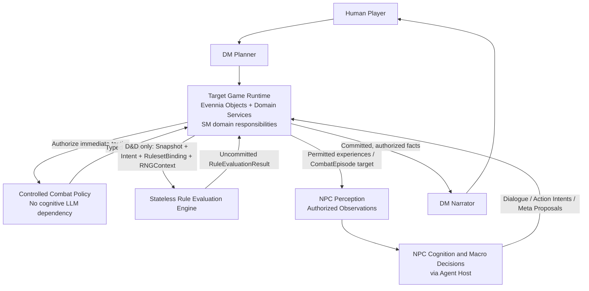

# Agentic TRPG

**A modular architecture for AI-driven tabletop role-playing games, combining autonomous characters with deterministic game rules.**

> **Project status:** Architecture and interface design in progress. This repository is the project-wide documentation and coordination hub, **not** a standalone playable application. The specifications describe the intended system; they do not imply that all interfaces or components are implemented.

## Overview

Agentic TRPG aims to create a tabletop role-playing experience where an AI Game Master can run an adventure, non-player characters can make their own decisions, and a deterministic rules engine handles game mechanics.

The central design principle is simple:

**Let LLMs handle language, narrative judgment, and character decisions; let deterministic software validate rules and commit game state.**

The project separates the AI Game Master, the authoritative game runtime, the rules engine, and the future visual presentation layer. The architecture is intended to be extensible beyond a single ruleset, although the first MVP focuses on a D&D adventure.

**[DECIDED] 2026-10-12:** Prioritize **Evennia as the game runtime foundation**, retain the existing D&D Rule Engine, and allow migration and refactoring of State Machine implementations. Reuse native objects, persistent attributes, prototypes, command hooks, Scripts, building tools, and the text client. This direction is selected; migration and runtime acceptance have **not** been performed. Storage, transaction boundaries, and interfaces require EB-1–EB-3 validation in the [Evennia Adoption Plan](docs/EVENNIA_ADOPTION_PLAN.md). Ranvier and CDDA provide design ideas; they are not additional runtime frameworks.

## System architecture



### Main responsibilities

| Component | Responsibility |
| --- | --- |
| **Agent DM** | Interpret player input, coordinate the adventure and NPCs, make authorized narrative/GM judgments, and narrate committed outcomes. The DM Planner and DM Narrator have separate contexts and permissions. |
| **NPC Sub-agents** | Independently interpret authorized experiences and propose dialogue, beliefs, memories, goals, and macro decisions. Immediate tactics use a controlled Combat Policy; they do not require an LLM call per action. |
| **Agent Host** | Execute LLM calls and manage prompts, contexts, invocation retries, and inference resources; it does not own authoritative game state. |
| **Game Runtime / SM domain responsibilities** | Maintain one authoritative source per game fact and trusted commits. The Evennia target may distribute distinct facts across objects and domain services; mapping remains open. Preserve authorization, versions, idempotency, RNG, receipts, persistence, private NPC state, and reliable processing. The current SM repository is a migration asset, not a required permanent implementation. |
| **Rule Engine** | Deterministically evaluate supported action legality, attacks, damage, checks, saves, action economy, movement, spells, effects, and reactions. Return typed, *uncommitted* results without independent authoritative runtime state. |
| **Visual Presentation** | Future presentation of maps, tokens, scenes, and animations. It is outside the first MVP. |

[Module Contracts](docs/MODULE_CONTRACTS.md) is the highest authority for cross-module target interfaces and state ownership. The standard evaluation boundary is:

```text
StateSnapshot + Typed Intent + Pinned RulesetBinding + Explicit RNGContext
    → RuleEvaluationResult
```

Snapshots have two versioned contexts, CombatSnapshot and NonCombatSnapshot, composed from complete typed mechanical state components. Results use four statuses (`accepted`, `rejected`, `needs_choice`, `unsupported`) and include the applicable closed Typed StateDelta, ProposedEvents, RNGTransition, and ReadSet. The trusted runtime alone commits authoritative changes; `accepted` does not mean committed. These contracts remain target specifications, not a newly frozen ABI. Ordinary world operations need not invoke RE; Evennia sample combat does not implement our D&D rules. Evennia and the old SM must not maintain synchronized authoritative copies of the same facts.

Immediate Mechanical Response is coordinated by the State Machine through trusted deterministic mechanisms, Combat Policy, and Rule Engine. Tactics, reactions, automatic effects, and combat triggers do not depend on DM Planner, JEV LLM, Memory Gate, or EVA. Required mechanical perception must be established through trusted deterministic/rule paths; unknown does not mean perceived. Agent Cognitive Response handles subjective interpretation, long-term memory, relationships, goals, macro decisions, and character dialogue afterwards.

Normal rule evaluation targets current mechanical state plus necessary typed historical ledgers, while retaining audit history for deterministic replay. One request should resolve all continuously executable effects for its intent. Interrupt / Continuation targets durable pause/resume and consistent RNG without holding a database write transaction while waiting; its ABI and supported MVP paths remain open. [Module Contracts §1.1](docs/MODULE_CONTRACTS.md#11-2026-10-12-跨仓库核对静态代码--review未重跑运行测试) distinguishes implemented development-branch work from remaining targets and the pinned/latest RE version gap.

The final goal is to refactor the Stateful Combat Engine into a Stateless Rule Evaluation Engine. Supported execution must not depend on legacy `_LiveCombat`, `CombatHandle`, `_REGISTRY`, or the Stateful Combat Orchestrator, including rebuilding them behind a permanent adapter. Correct Nat20 algorithms, resolvers, and declarative rules data may be reused with explicit state dependencies; local evaluation variables and temporary calculation contexts are allowed. Legacy Stateful APIs may remain briefly for isolated regression comparison, subject to the [migration completion criteria](docs/MODULE_CONTRACTS.md#141-stateful--stateless-完成标准-decided-not-implemented). Project specifications define the target; legacy code does not define the architecture.

### Events, perception, and NPC knowledge

A committed world event is not automatically known to every character. The current event-level protocol and migration assets follow this pipeline when such events are recorded:

```text
Event + Observable Signals → per-Signal Scope Discovery → Event-local Evidence
    → Atomic commit with reliable Outbox
    → Deterministic / optional JEV Perception Judgment
    → Authorized stage Observation
    → Existing NPC Inbox and Evaluation Flow
```

NPCs receive only observations they could perceive and are authorized to know. Their beliefs and memories are separate from objective world facts. Event observations do not automatically trigger an LLM call or change a character's goals.

Mechanical Audit does not automatically enter perception. **One complete battle corresponds to one CombatEpisode**, with EpisodeObservation as the NPC's logical observation of the whole experience. Rounds/actions do not each require an Episode, WorldEvent, or separate OB. Runtime perception can support immediate behavior; retaining necessary wartime perception results/evidence and aggregating afterwards is a proposed EB-3 approach, to compare with reconstruction from trusted history. Neither approach may invent past perception from the final state or expose unseen content or hidden causes. Existing stage results remain immutable and traceable; Event-level OB/Outbox is a migration asset, not a permanent target granularity. Schema and lifecycle mappings remain open, and existing records and EVA protocols are retained. JEV handles authorized perception/memory judgments, not required mechanical rules or trusted facts.

## First MVP

The initial milestone is a **locally runnable, text-first, single-player adventure**:

- One human player controls one player character, with no permanent AI party companions.
- The AI Game Master supports dialogue, exploration, checks, combat, and adventure progression.
- NPC Sub-agents independently make meaningful dialogue and macro decisions, including at least one enemy whose agent decisions demonstrably affect controlled behavior and later cognition; immediate tactical intents come from Combat Policy.
- Rules-based outcomes are evaluated by the Rule Engine and committed by the State Machine.
- The adventure is loaded from a manually prepared and reviewed Adventure Package.
- A complete, repeatable end-to-end experience takes priority over broad ruleset coverage or visual polish.

The MVP can support a selected rules subset, but every selected mechanism must use the stateless evaluation boundary. Passing that subset does not establish that the entire Stateful Engine migration is complete.

The selected private integration scenario is *First Blush* (D&D Duet), subject to content rights and manual rules adaptation. **The original adventure text, maps, and unauthorized derivative content are not distributed in this repository.** D&D SRD 5.2.1 is the proposed initial mechanical baseline; final compatibility is governed by the relevant specifications and implementation tests.

**Not part of the first MVP:** multiplayer, permanent AI companions, automatic adventure-document ingestion / World Creation Agent, interactive tactical visualization, or guaranteed exact restoration of an interrupted active combat.

Reuse the text client first; maps, tokens, and animation remain later presentation work. Controlled runtime content/behavior extensions are a target capability, distinct from a full Coding Agent system or safe execution of arbitrary generated code. Fixed Adventure Packages remain Session baselines; extensions must not silently rewrite them.

See [MVP Scope](docs/MVP_SCOPE.md) for precise requirements and open decisions.

## Repositories

| Repository | Role |
| --- | --- |
| **[agentic-trpg/agentic-trpg](https://github.com/agentic-trpg/agentic-trpg)** | This repository: overall project direction, architecture decisions, cross-module interface contracts, MVP definition, and shared documentation. |
| **[agentic-trpg/trpg-rules-engine](https://github.com/agentic-trpg/trpg-rules-engine)** | Rules engine implementation, tests, and mechanics-specific development. Its existing code and the target stateless evaluation boundary are not assumed to be identical. |
| **[agentic-trpg/trpg-state-machine](https://github.com/agentic-trpg/trpg-state-machine)** | Existing implementation, verified integration/processing assets, and isolated regression reference. Retained during migration; not deleted or archived. |
| **`agentic-trpg/Evennia_base` — Planned** | Future Evennia game project and runtime integration layer, preferably using a pinned framework dependency. Not yet created; not a default framework fork or renamed SM copy. |

Other components are described in the architecture but are not represented here as already-published repositories.

## Documentation

The design documents are currently written primarily in Chinese. Start with MVP Scope for product boundaries and Module Contracts for the authoritative target architecture and interfaces.

| Document | Purpose |
| --- | --- |
| [MVP Scope](docs/MVP_SCOPE.md) | Product goals, first playable milestone, acceptance boundaries, and deferred features. |
| [Module Contracts](docs/MODULE_CONTRACTS.md) | Highest cross-module target interface specification: final stateless architecture, state ownership, requests/results, atomic commits, and migration completion criteria. Detailed ABI proposals remain subject to review. |
| [Evennia Adoption Plan](docs/EVENNIA_ADOPTION_PLAN.md) | Selected runtime direction, actual framework reuse, migration boundaries, EB-1–EB-3 evidence, and exit conditions; subordinate to Module Contracts. |
| [State Machine Architecture](docs/STATE_MACHINE_ARCHITECTURE.md) | SM domain responsibilities, current implementation assets, and the open mapping to the Evennia runtime. Filename retained. |
| [Agent Architecture](docs/AGENT_ARCHITECTURE.md) | DM Planner/Narrator separation, NPC Sub-agents, Host responsibilities, and evaluation modes. |
| [Adventure Package Schema](docs/ADVENTURE_PACKAGE_SCHEMA.md) | Static adventure content, validation, initialization, and runtime separation. |

### Design status and terminology

The architecture documents distinguish the status of individual decisions:

- **`[DECIDED]`** — Agreed design direction or invariant.
- **`[PROPOSED]`** — Candidate interface or policy, subject to review.
- **`[OPEN]`** — Unresolved design or implementation decision.
- **`[NOT IMPLEMENTED]`** — Documented target behavior, not a claim of working code.

The agreed invariants in Module Contracts establish architectural intent; draft ABI fields remain proposed or open. Neither status certifies implementation. Refer to actual code and executed tests for conformance evidence, while keeping the project specifications as the source of the target design.

## Development direction

The next implementation work is gated by the adoption plan; none of these stages ran in this docs-only batch:

1. **EB-1:** Native rooms, door, NPC, text interaction, runtime creation/configuration, and persistence after a normal restart.
2. **EB-2:** One fixed, supported real RE operation; verify authority, RNG, retries, conflicts, faults, rollback object/cache consistency, and post-commit notifications.
3. **EB-3:** Continuous NPC behavior, target rechecks, controlled behavior versions, authorized views, and minimal CombatEpisode experience records.
4. After phase review, integrate Package / Host / NPC cognition and validate the single-player text MVP. A full Coding Agent system is not an EB-1 prerequisite.

Stop the overall migration if it requires broad framework rewrites, duplicate authority, or cannot meet critical correctness requirements. Old and new implementations use independent test Sessions. This replaces the previous SM-first development order while preserving its reusable designs and regression evidence.

Measure refactor progress first by removed Stateful dependencies and migrated existing rules capabilities. Track new rules coverage separately; added adapters or files are not evidence of architecture migration.

## Contributing

Architecture and implementation discussions are welcome. When proposing a change, identify the affected module boundary, distinguish agreed behavior from proposed behavior, and avoid describing draft APIs as already implemented. Please refer to the relevant design document and the owning code repository before submitting a change.

## Licensing and content

This meta-repository currently has no repository-level `LICENSE` file; do not assume a license for its contents. Separate repositories may have their own licenses. Adventure and ruleset source material may also have independent copyright and licensing restrictions; do not commit protected third-party adventure content without the necessary rights.
