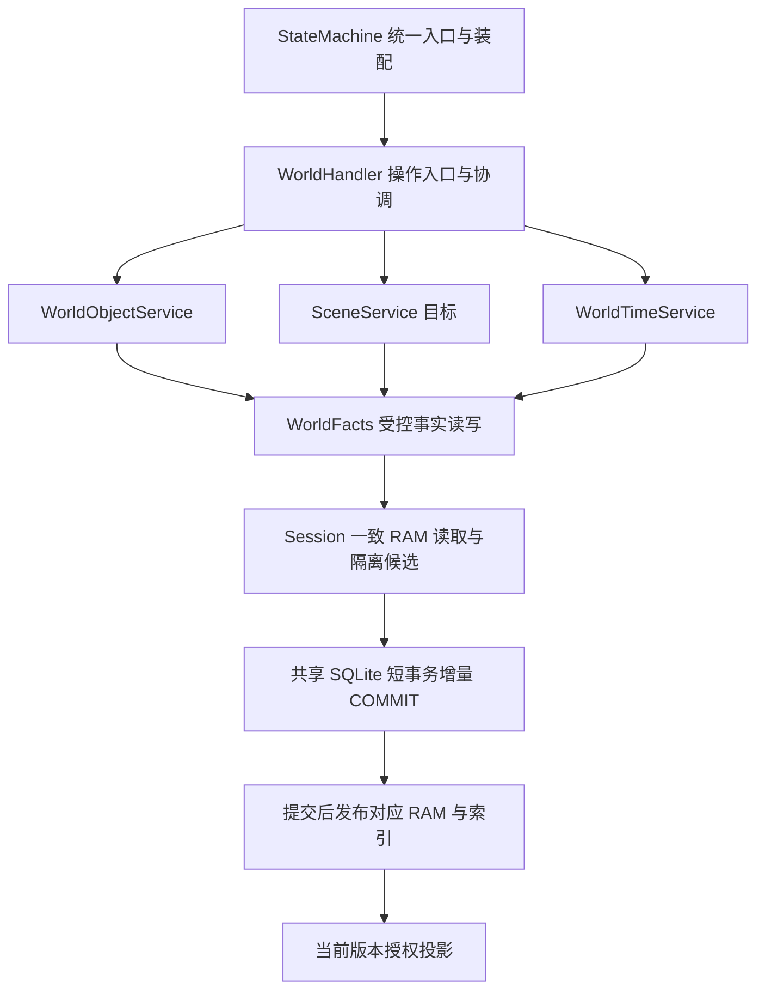
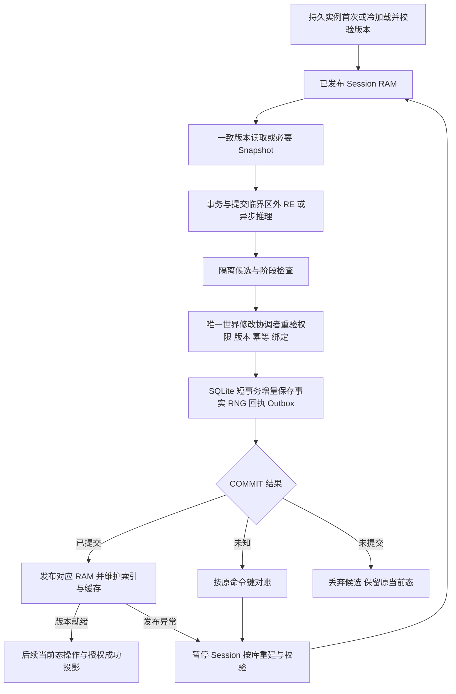

# Agentic TRPG — State Machine Architecture（MVP）

**2026-10-22 实例字段接入：** 共同决定见 [MC §2.3a](MODULE_CONTRACTS.md#23a-实例字段关联与局部准入-decided)。
Service 经现有 SessionMemory／UnitOfWork 读取目标实例和必要关联；Object 持有自身配置、
容器内容物／重量和机关触发关联，Scene 按 spatial／environment／lighting／mechanisms／objects
持有相应字段。消费者从有效字段构造 View／固定 Snapshot，不另查库重组同一状态。
每次修改继续增量持久提交后发布，候选和旧快照隔离；失败恢复必须使所有连接的旧当前态失效，
各连接在自己的线程重建。按需加载和预算淘汰保留，普通操作不以整场／整会话扫描替代已有索引。
实现证据与具体限制见 [本次核对](reviews/RUNTIME_INSTANCE_OWNERSHIP.md)，下述历史状态保留原日期。

**2026-10-22 后续实现核对：** 重量字段读取只验自身版本，修改时维护必要祖先；机关使用
安全只读事件／目标索引，命中不复制全表。Scene 的 light／mechanism 成员由实际移动
子树、携带关系及能力成员事实局部补丁维护，同场景遮光由所选贡献依赖更新。照明地面
几何另有修改版本，避免上层命中展开所有负向空间能力依赖。这些派生字段、关联补丁和
失效标记共享既有候选／保存点／增量持久化／RAM 发布边界；跨连接恢复协议保持。
具体入口、实测及冷准备／完整输出限制见 [后续核对](reviews/RUNTIME_INSTANCE_OWNERSHIP.md#2026-10-22-follow-up-field-validity-and-local-associations)。

**2026-10-21 当前目标：** 活跃事实统一由 Session RAM 提供一致读取，SQLite 每次修改短事务增量持久化，COMMIT 成功后发布 RAM，再正常返回成功及对应投影。Architecture Decision Status **[DECIDED]**；完整运行层 Implementation Status **[NOT IMPLEMENTED]**；运行 Acceptance Status **未执行**。现行协议由 [MC §0.3、§2.3、§6](./MODULE_CONTRACTS.md#23-运行时数据复用派生-snapshot-与版本有效性-decided) 维护；本文件细化数据模型、协调和恢复。较早日期的源码判断保留原时点，当前基线见 MC §1.8。

> **状态**：Draft v0.20 + 2026-10-21 Session RAM 架构决定（文档补充；完整运行层未实施）
>
> **日期**：2026-10-21
>
> **建议位置**：`agentic-trpg/agentic-trpg/docs/STATE_MACHINE_ARCHITECTURE.md`
>
> **依赖**：[`MODULE_CONTRACTS.md`](./MODULE_CONTRACTS.md) v0.18（跨模块最高规范）；[`MVP_SCOPE.md`](./MVP_SCOPE.md) v0.20；[`ADVENTURE_PACKAGE_SCHEMA.md`](./ADVENTURE_PACKAGE_SCHEMA.md) v0.14；[`AGENT_ARCHITECTURE.md`](./AGENT_ARCHITECTURE.md) v0.18；[`GAME_CORE_EVOLUTION_PLAN.md`](./GAME_CORE_EVOLUTION_PLAN.md) v0.7；[`WORLD_SUBSYSTEM_DESIGN.md`](./WORLD_SUBSYSTEM_DESIGN.md) v0.4（候选组件设计）
>
> **目标场景**：一位玩家、一个 PC、文字优先、人工整理的单人冒险包；Agent DM 和按需 NPC Sub-agent；不要求可视化引擎、World Creation Agent、多玩家或开放世界模拟。
>
> **证据边界**：本文件是基于已讨论范围和冒险需求的**设计建议**，不是现有 State Machine 代码的完成状态。与 Rule Engine 的 API 适配以实际实现和独立测试为准。

**2026-10-19 运行时复用同步：** Package 完整实例化以 MC §2.4 为准；共同复用约定以 [MC §2.3](./MODULE_CONTRACTS.md#23-运行时数据复用派生-snapshot-与版本有效性-decided) 为准；Grid／Environment 细化见 World §2.0b–§2.0c，RE 加载身份见 MC §4.3。当前实现专项核对见 [MC §1.4](./MODULE_CONTRACTS.md#14-2026-10-19-运行时复用专项核对当前分支静态证据)，下述较早日期摘要及待办保留原时点，不作为最新完成状态。本轮仅文档，未新增待办或运行验收。

**2026-10-20 文档补充：** 快照与定向查询的通用原则及性能验收要求统一见 MC §2.3，Grid／Environment 的有限现状核对见 [MC §1.5](./MODULE_CONTRACTS.md#15-2026-10-20-快照与查询专项核对静态证据)。本次只更新文档，未修复 SM 查询性能、增加 API 或完成后续索引／局部校验工作；较早摘要保留原时点。

**2026-10-17 v0.4 评审同步：** [Module Contracts](./MODULE_CONTRACTS.md) 继续是跨模块最终权威；[v0.4](./reviews/agentic-trpg-architecture-contracts-2026-10-17-v0.4.md) 仅保留审查记录。旧修订摘要中的整场 CombatEpisode／旧 OB 术语仅记录历史，现行目标为 Turn／Round Episode、单一有界 Recent OB List 和 `pending`／`processed`。每条新 OB 必经 Gate 决策（模型可选）；EVA 冻结完整授权近期窗口，processed 可影响 Meta，提交只完成固定 pending 覆盖。代码证据保持原日期／SHA，本次不刷新实现状态或冻结新增 ABI。

**2026-10-18 定向同步：** 上段为 10 月 17 日历史记录。本轮当前代码依据更新至 [MC §1.3](./MODULE_CONTRACTS.md#13-2026-10-18-远端实现核对定向静态调查)，区分 main 当前实现、ObjectSpatial 分支沿革与未实现目标；Scene 结构与环境边界遵循 MC §0.3a。保留 Turn／Round Episode、Recent OB／Gate／EVA、CombatPolicy 及版本／幂等／RNG／事务契约，不扩大 MVP，不冻结新 ABI。


**2026-10-20 三仓库对齐基线：** 当前实现和接口以 [MC §1.6](./MODULE_CONTRACTS.md#16-2026-10-20-三仓库-main-对齐) 的固定 main、源码／测试及 Progress 为准；§1.1–§1.5 与带日期 Review 保留历史适用范围。Schema39 实例配置、冻结规则复用、TimeDriver／Round 及受限 Availability 已有实现，完整动态实例／时间消费者／通用 API 仍有缺口。Full Audit、局部准入、查询及共享 Finalize 的共同规范只维护于 MC §2.3、§6.5–§6.6；本批只改 Markdown，不运行或宣称通过业务／性能测试。

## 1. 目标、边界和核心术语

**2026-10-21 查阅与复用约束：** 设计／实现先读 MC 和对应领域文档，规则／世界观／工程资料入口为 [References](./REFERENCES.md)。全部运行时计算结果复用遵循 [MC §2.3](./MODULE_CONTRACTS.md#23-运行时数据复用派生-snapshot-与版本有效性-decided)，状态保存和 Package／实例归属遵循 §2.4，不另建可写缓存权威。容器重量的跨操作内存缓存是 [World §2.1b](./WORLD_SUBSYSTEM_DESIGN.md#21b-容器重量派生与跨操作复用) 的目标；当前 SM main 已包含 scoped refactor（MC §1.8），weights 仍仅单次操作临时复用。MC §1.7 的未合并结论是历史证据。本文较早实现描述保留原日期／SHA；本次只改文档，不实现缓存或宣称运行验收。

本文保留 State Machine 文件名与当前 SM 公开入口，区分现有实现和**按领域管理状态、按事实确定权威、按操作组织事务的目标设计**。MODULE_CONTRACTS.md v0.17 §0.3 / §0.5–§0.6 规定领域归属、探索/战斗编排与模块化；`trpg-state-machine`＋RE 仍是开发基础。**StateMachine 是统一 API 与组件装配入口**，各子系统显式依赖协作，不要求中心类理解和批准所有业务细节。已实现的部分组合与仍存 Mixin 见 MC §1.3，不将目标拆分一概写成尚不存在。以下 Task / Perception 协议中的“SM”沿用该逻辑入口。

**适用范围 `[DECIDED]`：** SQLite / WAL、具体表结构及 Event-level OB / Outbox 是当前 SM 实现或可复用设计资产，不是永久实现约束。保留授权、幂等、RNG、回执、故障一致性、NPC 私有状态与可靠处理语义，并通过回归证明替换后的正确性；不要求逐类逐表迁入另一框架。不同表可以保存不同事实，视图/缓存只是派生数据；禁止两份相同权威世界双向同步。替换原型与现有实现使用独立测试 Session。Evennia 整体采用仍 OPEN，可选评估不阻塞主线。

目标内部协作承担六件事 `[DECIDED]`；已有受限实现见 MC §1.3，新增类/字段/API `[OPEN]`：

1. Session / 世界领域加载验证固定 Adventure Package，按各数据负责人接口一次初始化。
2. WorldFacts 保存场景/空间/对象/物体耐久/门锁/容器/物品实际关系；CharacterFacts / 机械组件保存唯一角色位置、HP、资源和装备。库存归属由 World 实例关系受控投影，不维护两份可独立修改的权威。
3. 授权查询 / Perception 提供角色视图；共享对象接口不能泄漏秘密。
4. Combat Handler / 相关领域组织显式事实、行动、绑定和 RNG 交 RE 求值；各领域应用未提交结果，共享设施在同一事务提交状态、RNG、事件和回执。
5. 共享持久化与提交设施保障版本/原值、授权、幂等、回执、可靠通知及恢复；当前 Python + SQLite WAL 基础继续使用，MVP 安全续玩边界不变。
6. NPC Cognition 管追加版本的 Meta / Evaluation / 模式，Perception/Observation 管证据、授权观察与窗口保留，Cognition 管 Gate／pending／processed 与任务覆盖，两者按既有完成协议协调。Host 仅执行模型与 Context 运行。

### 1.1 四个容易混淆的概念

| 概念 | 内容 | 可变？ | 谁拥有权威？ |
|---|---|---|---|
| **Adventure Definition** | 地点、静态世界事实、NPC 初始档案、剧情条件、规则绑定 | **不可变**（Session 固定版本） | Adventure Package 作者 / 验证器 |
| **Session Runtime State** | 当前场景、场景实例、世界标记、物体归属、任务、NPC 记忆、事件记录 | **可变** | Session / 世界 / Cognition 等按事实分责，共享提交 |
| **Mechanical Combat State** | 人物 HP/位置、行动预算、效果、回合、RNG 等组合视图 | **可变** | CharacterFacts / CombatRecords / Effects 分别管理；RNG 经共享设施提交 |
| **LLM Evaluation Context** | DM Context；NPC 可复用 Interactive / 一次性 Background Context | **临时派生视图** | Agent Host 管生命周期；负责领域提供授权事实与证据 |

**不变量（MODULE_CONTRACTS.md §0.3、§4–§6）**：静态模板不是当前状态；描述不是命令；提议不是提交；叙事不是规则结果。每项当前事实有一个负责领域，跨领域不可分割操作共享一次提交/回滚；RE 只求值。临时候选状态、事件缓冲区和规则上下文允许存在，不能把 Legacy 隐藏战斗对象恢复为长期权威。

### 1.2 行动、观察与记忆的认识论边界

| 概念 | 由谁产生 / 确认 | 是否成为世界事实 | 可供 NPC 使用的方式 |
|---|---|---|---|
| `Intent` / `Proposal` | PC/Agent/Host 提交的**内部提议** | **否**；被拒绝的私有意图尤其不能公开 | 提议者可获合法拒绝回执；其他角色不可据此读心 |
| `ObservableActionStarted` | **真实在世界中发生**且被提交的外部动作（例如实际伸手） | **是，该外显动作已经发生**；但目标效果未必成功 | 通过 Perception 判断哪些角色看到了动作 |
| `WorldEvent` | 负责领域通过共享设施提交的世界事实 | **是，记录客观行为或结果** | 不能向所有 NPC 原样广播含秘密的事件 |
| `Observation` | Perception Projection（必要机械判定来自 RE） | **是，该角色获得了某项观察**；观察内容不一定涵盖全部事实 | 构成该角色后续认知的证据，按角色私有保存 |
| `Belief / Memory / Relationship / Goal / Plan` | 当前模式 NPC LLM 提议；NPC Cognition 验证并持久保存版本 | **成为 NPC 私有权威状态，不自动成为客观世界事实** | 两种模式都读取同一份授权持久状态 |

**关键区别**：Agent A 获得金币，不等于 A 知道 B 也想拿金币。只有 B 真正作出可观察的动作并被 A 感知，A 才能基于观察判断双方是否发生争抢。世界事件的排序也不能直接替代游戏世界的“谁更快”的规则裁决。

### 1.3 不属于此模块的工作

- 不自动解析/编译剧本或生成完整初始世界：这是后置 World Creation Agent；获准运行时对象创建与 Session 扩展按 MC §3.6 处理。
- 不计算 Attack、Damage、Save、Spell Slot、Concentration、战斗行动顺序；应复用 Rule Engine。
- 不替 NPC 决定主观动机、谎言、记忆解释或宏观目标；NPC Sub-agent 保留独立认知。即时战术由运行层授权的非 LLM Combat Policy 与 RE 协作，不要求每次行动由 Sub-agent 生成。
- 不管理 System Prompt、物理 LLM Context / KV Cache，不执行 LLM 主观推理；这些由 Host 运行时和 NPC LLM 承担。
- 不生成叙事文本和插画，不做实时地图、Token、动画。
- 不直接执行未验证、越权的任意脚本；受控 Session 扩展目标按 MODULE_CONTRACTS.md §3.6 验证/准备后启用，Coding Agent 是可选手段，不把回调或 reload 等同安全热部署。

## 2. 总体运行架构

**Immediate Mechanical Response 与 Agent Cognitive Response 是独立路径 `[DECIDED]`**（MODULE_CONTRACTS.md §0.1 / §0.4）：Combat Handler / 相关领域组织可信机制、Combat Policy 与 RE 完成即时战术、Reaction、自动效果和触发，不等 Planner、JEV LLM、Cognition Gate 或 EVA。机械察觉不能用未知/LLM 猜测证明；Policy 只在授权机械可知视图内选 Intent。NPC LLM 保留认知与宏观决定，Host 管模型调用，Narrator 呈现玩家获准事实。

```text
Human Player / DM Planner -> submit_command / trusted authorization -> responsible Handler
   Current foundation: trpg-state-machine + RE; partial composition, Scene split pending
   Session | WorldFacts | CharacterFacts | CombatRecords | Activity | Effects
   Immediate path -> stateful Combat Handler -> player boundary OR Combat Policy
                  -> RE only when D&D adjudication required -> domain interfaces
                  -> isolated candidate -> shared SQLite COMMIT: changes + RNG + receipt + outbox
                  -> publish current Session RAM -> permitted committed projections
                       [no Planner / JEV / Cognition Gate / EVA dependency]
   Perception / Evidence -> reliable Observation
   NPC Cognition / Gate / Schedule / Mode -> authorized Evaluation Task
                                  |
                         NPCEvaluationRequest
                                  v
                         Agent Host LLM Runtime
                |- Interactive Context / current Interactive LLM
                '- Inactive Background Task / one-shot Context / NPC LLM
                                  |
                        NPCEvaluationResult (data)
                                  |
                     Host submits evaluation_id + Result
                                  v
                      NPC Cognition + shared commit -> RAM publication: Meta / sole Result / EVA completion
                |- reliable Dialogue / Action Intent handoff
                '- independent command_id -> SM authorization
                   -> ordinary world handling OR D&D evaluation (validated Snapshot / Intent
                      + pinned RulesetBinding + explicit RNGContext -> uncommitted Result)
                   -> responsible domain interfaces / shared Atomic Commit
                                  |
                    EvaluationReceipt / cognitive completion + reliable handoff
                    committed WorldEvent -> Perception
                    player-visible receipts -> DM Narrator -> Text UI
```

认知路径是 **NPC Cognition / 授权 Perception → Host → NPC LLM → Cognition / 共享提交**。默认进程内、共享持久化；Handler 使用受控领域接口及共同事务上下文，不要求内部字段变化逐一包装外部命令/JSON/RPC。共享库不允许跨责任任意写表，不引入微服务、多数据库、分布式锁或两阶段提交。Host 管模型、Context、预算、调用重试，不持有权威事实。

DM Planner / Narrator 的角色、Context 和权限隔离，允许共享底层模型；Planner 提出主持方案，Narrator 只呈现玩家可见已提交结果。NPC 私有主观认知由对应 NPC LLM 完成。Python + SQLite WAL 是当前 SM 基线，不冻结未来实现；Jev 为可替换候选。普通世界操作不必进入 RE；D&D 规则沿用 RE，SM / 脚本不重复实现持续效果、Reaction 或连锁裁决。旧 Stateful Engine 仅为历史基线或隔离回归对照，最终执行路径及 SM 均不依赖 `_LiveCombat` 等 Legacy 对象。

**历史远端核对（2026-10-18）：** 顶层 main 为 `73d3bd0`；SM main 开始为 `a897ae5`，复核已到 `97c5af1`（Schema33、Engine／SRD pin `d596161060555630019163ab301e1d25fd816549`）。Openable 真实非战斗检定、Container 两层及相关容量／祖先访问、WorldTimeService 固定绑定已有实现；ObjectSpatial `0c2c4c7` 的朝向、整格占地／接触／独立贡献已由外部合并进入当前 main；开始时未合并的状态保留为沿革。当前证据见 [MC §1.3](./MODULE_CONTRACTS.md#13-2026-10-18-远端实现核对定向静态调查)，10 月 15 日 GC5 脏工作区／Schema25／旧 pin 保存在 §1.2，不能作最新状态。本轮仅定向静态源码／测试源码核对，未执行运行测试或完整代码审阅。

### 2.0 World 结构与 Scene 内部分责 `[DECIDED]`



目标 World 下并列对象、Scene 子系统和游戏时间；顶层图不展开 Scene 内部。SceneService 协调初始化／进出／访问／Flags／生命周期，GridService 提供共享网格与基础几何，TerrainService 管基础地形及受控变化，EnvironmentService 管基础环境并查询位置／区域的有效环境。10 月 19 日当前分支已有 SceneLifecycleService 切片、GridService 和 EnvironmentService，完整 Scene 协调／TerrainService 仍待落实；准确分支／SHA 和接入限制见 [MC §1.4](./MODULE_CONTRACTS.md#14-2026-10-19-运行时复用专项核对当前分支静态证据)。内部责任见 MC §0.3a 和 [World 结构表](./WORLD_SUBSYSTEM_DESIGN.md#20-world-与-scene-的结构-decided)。查询可直接使用适当组件，不强制全部经过 SceneService。

共用 Scene Grid／坐标，复用已有几何算法；Character 保有唯一角色位置，WorldObject 保有对象位置与动态贡献，Terrain 读取 ObjectSpatial 投影而不复制可写事实。Environment 的 Package 初值是目标内容边界，当前受控导入不等于候选字段已进入 Loader。Session 运行变化、局部防护与有效 Effects 按需组合；首次进入前变化不得被模板覆盖，不建天气继承树或逐格最终态权威。当前分支已有显式防护，仍不能由视觉／移动阻挡推导；正式 WO／Effects 生产适配接线边界见 MC §1.4。Effects 保有来源／范围／生命周期，角色暴露进度归属 [OPEN]。

WorldTimeService 的固定单位／换算／昼夜／边界及推进委托已实现；当前 main 的 SessionTime／TimeDriver 还支持显式倍率、暂停恢复、有界工作和真实 Round 接线（MC §1.6）。默认倍率／宿主策略 OPEN，完整 Activity／Effects 时间消费和秒制 NPC／OB／Gate 尚未完成。world-time/1 为 1 tick = 1 游戏秒；legacy game-clock/1 不改称秒。秒制 Session 的 NPC Runtime／聚合感知／OB 消费保护见 MC §1.3，不把有时钟等同完整时间系统交付。

### 2.1 A1：探索与战斗的操作编排分离 `[DECIDED]`

探索移动采用 **Navigation / Activity + WorldHandler**，战斗移动采用 **CombatHandler + Rule Engine**；两者复用 CharacterFacts 唯一实际角色位置。Navigation 计划/目标、CombatSnapshot.actor_zone 是进度或投影，不保存独立可写的探索位置/战斗位置。战斗空间由实际世界空间映射，当前 `_current_cells` 复用同场景 cell；未来子地图/zone/跨场景的尺度、原点及落位转换 OPEN，无法表达时明确不支持，不通过战后同步双位置补救。

开门、解锁、取放、破坏障碍共享 World 对象事实与能力操作。战斗入口额外经 RE 协调行动资格、资源、时序、触发与反应，Handler 编排并组织共同提交。当前非战斗入口的 combat guard、可达性、授权/凭据和装备/活动等限制仍有效；不能直接调用内部方法绕过。受控战斗执行上下文、规则 Delta 与回归证据未齐全前，不扩大现有支持。完整边界以 MC §0.5 和 [World 草案 §4](./WORLD_SUBSYSTEM_DESIGN.md#4-探索战斗与底层互动-decided) 为准。

### 2.2 A2：StateMachine 模块化与职责边界 `[DECIDED]`

按需组合 Handler / Service、Facts / Records、Supporting Components，以构造依赖和共享 SqliteStore 协作，逐步减少 Mixin / 隐式 `_conn` 依赖。Facts / Records 是统一事实访问与受控修改组件；已加载有效事实统一读 Session RAM，SQLite 保存持久提交事实；跨域操作共用提交边界，不由组件各自提交。不要求每个子系统有全部层次、不要求每种对象有专属 Handler、不引入强制 ECS。当前显式装配是基础，剩余模块化及完整 Effects 边界仍 OPEN；见 MC §0.6 / §1.2。

## 3. 运行时数据模型与状态所有权

依据 MODULE_CONTRACTS.md §0.3，各领域可管理、持久化其负责状态；一次操作涉及 Character、Combat、Effect、World 与 RNG 的必要变化在同一事务共同生效。下述结构按数据责任组织，并不规定一个 SM 包保存所有内容。规则输入显式、输出未提交，实体身份共用。

下面按领域说明**概念数据结构**，不是冻结的 SQL 聚合、JSON/Python Schema 或单个全字段 SessionState。持久存储可逐步拆分聚合 JSON；RAM 可以按领域组织适合查询的结构。运行读取边界与存储粒度分别迁移，加入 RAM 不自动消除 RE 依赖组装或底层写放大。

完整实例化以 [MC §2.4](./MODULE_CONTRACTS.md#24-package-创建参照与完整实例化-decided-partially-implemented) 为准：Package 只作创建参照，世界／场景／角色／WorldObject／Item 创建后，有效配置、当前状态及必要关联由 Session 内所属领域记录持有。统一实例读取入口组合原负责组件数据，Service 不各自回查 Package 补字段；Schema39 已迁移现有读取闭包，动态 spawn／一般依赖创建和装备／Effects 生命周期仍未完成（MC §1.6），不新增第二套权威内存状态。

### 3.1 `SessionRecord`：一次冒险实例

| 字段（建议） | 说明 |
|---|---|
| `session_id` | 稳定、唯一、与其他 Session 隔离 |
| `adventure_id`, `package_version`, `package_digest` | 固定加载的冒险定义版本；重载时校验，禁止静默升级 |
| `ruleset_binding` | 固定 ruleset_id / data_revision / evaluator_version；数据修订区分生效规则及适用 Homebrew，Engine 求值前验证匹配 |
| `players[]` / `pc_actor_id` | 可信认证主体核验的 player_id / pc_template_id / Actor 控制关联；MVP 严格一玩家一 PC，具体存储字段 [PROPOSED; NOT IMPLEMENTED] |
| `current_scene_id`, `current_location_id` | Session 当前场景引用；角色位置从实体负责人读取，若缓存须可重建且不可独立改写 |
| `phase` | `exploration` / `combat` / `challenge` / `completed` 等有限阶段（候选） |
| `world_version` | 世界/机械状态变更提交时单调推进，与事件序号不同；仅事件/元数据提交的推进规则 [OPEN] |
| `last_world_event_seq` | 本 Session 已提交事件的稳定全序序号，观察记录据此引用及排序 |
| `last_safe_checkpoint_id` | 最近可核验的非战斗安全恢复点；不意味着活跃战斗可精确恢复 |
| `status` | `active`、`combat_unrestorable`、`completed`、`blocked_reconciliation` 等（候选） |
| `active_combat_ref` | 指向 CombatRecords 保存、CombatHandler 编排的遭遇/流程状态，不依赖 Engine 私有 Handle |
| `created_at`, `updated_at` | 运行元数据，不直接决定游戏世界时间 |

**注意**：`phase` 不等于每个场景固定的剧情幕数。玩家可合法往返 Scene，不应被强制套入不可逆的线性故事进度。

固定 Package／Ruleset 身份用于绑定核验和追踪，不能代替完整实例化。Session 创建时落实已创建实体所需的完整有效配置与状态；运行中新生成的实例采用同一约束，不能只保存模板引用和变更量而依赖初始化定义补齐有效字段。

### 3.2 `WorldState`：会话全局事实

WorldFacts 管世界/场景/对象事实与唯一世界时钟（当前 game_tick）；Quest 保留任务状态责任。候选 `world_actor_locations` 只是 CharacterFacts 角色位置的派生查询，对象清单从 WorldFacts 读取；Session 引用时钟，不另存一份。候选存储映射 `[OPEN]`，不能独立改写位置/归属。

约束：

- `flags` 仅用于剧情/场景状态，不能成为 HP、Slot、Action Budget 等机械变量的替代品。
- 物品 `owner_id`、当前位置与 `quantity` 由物品/库存负责接口维护；战斗中同样与角色/流程变化共同提交，机械消耗先由 RE 求值。
- 人物身份稳定；`Combatant` 只是同一 Actor 的参战关系/规则投影，不在战斗内另存一份 HP/位置/背包，结束时无需从第二权威回写。
- 若两个场景引用同一个世界 Actor，不复制成互不关联的角色实例。

### 3.3 `SceneInstance`：场景懒初始化、只初始化一次

建议字段：`scene_id`、`initialized`、`visited_count`、`local_flags`、`object_ids`、`trigger_history`、`last_visit_seq`。

进入场景流程：

1. 根据 `scene_id` 区分尚未创建与已存在实例：前者可查询 Scene Definition 作为创建参照；后者从实例记录读取有效场景配置、出口及状态条件，不用静态定义填补缺失字段。
2. 若本 Session **从未实例化该场景**，一次落实有效配置和 `initial_state`，生成具备完整声明能力数据的对象实例和局部标记；NPC 按 Session 级身份查找，必要时首次创建，不能复制或覆盖已有位置、Memory、Belief、资源。
3. 若已实例化，则保留现有实例状态；**绝不因为重访重放初始掉落、NPC 位置或机关状态**。
4. 按权威状态记录 `scene.entered`，其触发的事件走统一事件审核与提交路径。

注意：静态 `actor_ids[]` 只提供初始在场信息；世界 Actor 的当前位置由运行态单点保存。不能因为玩家重访让已经离开的 NPC 重新出现。

### 3.3a 运行时读取与派生结果的生命周期 `[DECIDED]`

遵循 [MC §2.3](./MODULE_CONTRACTS.md#23-运行时数据复用派生-snapshot-与版本有效性-decided)。角色、物品、场景实例配置、关系、机关、环境来源与效果等按 Session／活跃场景和真实依赖加载。已加载且有效的事实供普通查询、操作检查、RE 请求、角色视图和 Snapshot **统一从 RAM 读取**；光照／环境／重量派生也使用同一范围，已有有效结果直接复用。不再为同批事实读库、解析聚合 JSON、装配实例，亦不以重复查库扫描证明每次 RAM 命中有效。

一致读取固定提交版本，不能与并发发布混合。RE／NPC／历史输入保留原版本，不泄漏可变世界引用；普通定向读取无需构造全 Session Snapshot。候选中间阶段从隔离候选读取，不先改已发布对象，不使用旧 SQL 忽略候选变化；候选索引、依赖和回滚阶段同步维护。固定输入隔离与候选具体数据结构 OPEN，不要求每次复制整个 Session。

基础事实、查询索引、派生缓存、固定版本输入按 MC 四类分开。Grid／Environment 的现有正确实现继续复用，容器重量／机关索引跨命令复用独立待实施；这些机制不是完整内存运行层。配置、唯一位置／归属／HP 仍归领域，索引不可独立改写事实。

SQLite 用于持久提交、首次／冷加载、恢复、回执和可靠工作查询。冷加载只取持久实例，并保证与读取版本一致；无法取得所需时点则重新建立一致范围或重试，不能混接。容量预算、加载／卸载、引用保留及 Session／Store 关闭释放须明确；不加载全部世界、历史日志和归档记忆。已有实例不靠 Package 默认值补字段。完整 RAM 生命周期与消费者接入 **[NOT IMPLEMENTED]**；精确接口／细粒度版本 OPEN。

### 3.4 `ActorRuntime` / `NPCState`

- 所有 Actor：稳定身份、当前世界位置、归属、世界层可见状态、可用控制策略。
- 玩家 PC：从 Package 内置的一个或多个完整、只读 PC Templates 中选择一名，经规则验证机械属性后初始化 CharacterState；HP、资源、成长等运行态由 Character 负责接口管理。无需独立构建服务或外部 pc_build_ref；未来外部导入 [OPEN]，不实现。
- NPC：唯一 Persistent Identity、Personality、Memory、Belief（允许错误）、Relationship、Goal、Plan 和 Runtime State（Schedule / Current Activity 等）；私有知识、处理游标与控制权一并权威保存，观察收件箱与认知更新分开。
- 敌人/普通怪物：与重要 NPC 一样有身份和状态，但是否调用 LLM 要由策略决定；不要求为每一个普通怪物常驻创建 Agent。

**三个独立命题**：`world_fact_is_true`、`npc_knows_fact`、`npc_believes_fact`。允许 NPC 有错误信念和撒谎，但禁止把信念自动提交为世界事实。

Interactive / Background 是 **LLM Evaluation Mode**，不是两个人格或两份 NPCState。State Machine 管当前模式、Evaluation Task / Status、NPCStateVersion 及内部完成状态；Agent Host 仅管理非权威 Context 与模型运行，不能从 Context 内容反向覆盖权威状态。

### 3.4a `CharacterState`、Combat Handler、Effect 与 RNG（分责、共同提交）

CharacterFacts / 机械组件管角色唯一实际位置、HP、资源、装备；WorldFacts 管对象、物体耐久、门锁、容器和物品实际关系，机械库存按 World 实例投影并校验；Effects 管持续效果及自身进度；Activity 管正在进行的活动；CombatRecords 管参战/回合/待选与推进记录，CombatHandler 组织流程。Facts / Records 读写 SQLite，不是独立内存权威。组合机械视图引用同一实体/效果事实，RNG 经共享设施提交，不为各 Handler 任意另开流。已有实现与目标差异见 MC §1.3；World 候选字段按模板/实例/关联/派生分类见 [专项草案 §3](./WORLD_SUBSYSTEM_DESIGN.md#3-可选能力组合-decided-proposed)，不冻结 SQL 或协议。

**[DECIDED; PARTIALLY IMPLEMENTED]** 当前 RE `/17` 与 SM Snapshot 已不把历史 event_log 作为普通求值输入（MC §1.6）；每回合使用标记、效果时钟、关键时间点等是必要当前机械状态，由规则计算并经负责接口共同提交，不另建重复的精简历史日志。本次有序 ProposedEvents / 结算结果在提交前仍为候选，审计与 Episode 证据按需保留，不自动回灌求值。新增消费者仍须审计真实读者并补齐当前状态，不能重复实施已完成的 history-free 切片；不置空日志、删历史表或删全部候选事件（MC §4）。

喝药、开门、取物、移动等跨界操作由负责领域在**同一共享事务**提交；RE 计算机械结果。当前目标 CombatSnapshot / NonCombatSnapshot 共享类型化组件，Required 字段与依赖完整性不取消。无状态不要求搬运全世界或网络调用：按 MC §2.3 复用只读输入与已算出的派生结果；具体读取接口 `[OPEN]`，不能以默认值掩盖缺失依赖或任意整份 Snapshot 覆盖数据库（MC §4.2）。缓存失效、重启及回滚一致性须验证，不宣称已测得提速。Session 提供固定绑定，RE 可有调用内候选状态/缓冲区，但不得恢复 Legacy 跨请求权威对象。

### 3.5 `ChallengeInstance`：非战斗技能挑战

针对撤退、追逐或跨多次检定的任务，建议记录：`challenge_id`、`scene_id`、`successes`、`failures`、`required_successes`、`status`、`resolved_check_ids`。每次检定的 DC/能力/结果由合法规则或显式 GM 裁决产生，**State Machine 仅累计已提交 Result**。

不要把非战斗技能挑战实现为伪造的 Combat；若失败伴随伤害/Condition，需要 State Machine 授权的受控 Hazard / Rule Engine 求值接口，缺失时明确阻塞该场景而不是直接写入 HP。

### 3.6 `WorldEvent`、感知证据与顺序

本节适用于保留的 Event-level 协议，属于当前实现/可复用资产；不要求每条机械记录生成 WorldEvent 或独立 OB。目标沿用 MODULE_CONTRACTS.md §7.5 的Turn／Round Episode 观察边界，具体存储与生命周期仍待验证，不绑定某框架。

`WorldEvent` 是**已提交的、不可变的世界事件记录**，最小概念字段：`session_id`、`event_id`、`event_seq`、`event_type`、`source_command_id`、`actor_id`、`object_ids`、`scene_id`、`occurred_at_game_time`、`payload`、`visibility_class`、`perception_evidence_ref`，可包含 `observable_signals[]`。Signal 的候选 signal_id / channel / content / scope 及约束统一见 MODULE_CONTRACTS.md §7.1，不另存重复 perception_scope；感知 Scope 与机械 Effect Scope 独立。字段为候选，不代表现有实现。

- `event_seq` 由 Session 中的权威提交顺序分配，单调递增；它是**记录顺序**，不是完整中间状态快照，也不自动证明角色的生理反应速度。
- **Event-local Evidence `[DECIDED]`**：一个 Command 可产生多个 Event，各自证据须对应其 Signals 的实际发生阶段。未变化的证据可共享，相关状态已变化则须区分；不能无条件复用命令结束态。相同 world_version / game time 不构成阶段等价证明。
- **Signal-scoped Evidence `[DECIDED]`**：逐 Signal 确定性 Scope Discovery 后，对该 Event 的候选 NPC / 所需环境取并集，保存可信 Origin、候选事件时位置/感官/Conditions 等最小且字段完整的证据或稳定历史引用；不复制 Session 全部感知状态。Discovery 不做视觉、听觉、遮挡、感官能力或实际察觉判断，可能无法感知的范围内 NPC 仍须纳入。必要字段缺失不能用当前 World State 补造或默认 Positive / Negative；完整定义、边界与实现差距见 MODULE_CONTRACTS.md §1.1 / §7.1–§7.2。
- **逻辑顺序与原子性 `[DECIDED]`**：Event + Signals 确定 → Scope Discovery → Evidence Capture → 原子提交 → 后续 Perception Judgment → OB（§6.2）。Event、Signals、Evidence / 受保护的稳定历史引用与可靠 Outbox 和世界变化同属一个 SQLite 原子事务；逻辑步骤不要求独立事务，Capture 可依附可信阶段，不允许中间可见部分提交。事件阶段的具体采集协议仍 [OPEN]，不能假定最终 Delta 可恢复中间状态。
- 可见动作的开始与成功/失败结果是不同的事实；仅实际发生并已提交的外显动作/结果 Signals 可投影给旁观者（如 action.started 候选事件）。私有 Intent、未执行命令、LLM 私下计划不得伪造为外显动作。
- Rule Engine 的拟议机械记录须随对应 Delta 原子提交后才成为权威审计；只有受审的外显事实才形成 WorldEvent，未提交结果不得触发永久世界事件或 NPC 观察。Planner 可提出按可能执行结果分类的候选 Signals，优先复用 Package / 标准行为模板；SM 根据可信结构化结果选择并与事件原子提交。rejected / unsupported 不产生该未执行行为的 Signals，accepted 未达目标仍可能有实际声音/动作；不采信 LLM 自报成功，不新增 Event Generation Agent。

**实现差距（沿用前批日期化基线）：** Batch A 记录的历史基线 `5deea78` 使用全实例范围/命令内共享的 `event-evidence/3`；更新后的 SM 开发分支已对受支持世界 Producer 实现阶段捕获和 Signal-scoped `/4`，RE 中间阶段仍明确不可恢复。Batch C 的每 NPC 感知队列和 PERF 按需水位/分页也已完成于开发集成分支；统一见 MODULE_CONTRACTS.md §1.1，不能按旧历史基线声称全部仍未实现，也不能把本地实现升级为正式跨模块 ABI。无法恢复阶段仍为 [OPEN]，不从最终 Delta 或当前世界补造。

**与规则输入的边界 `[DECIDED]`：** 本节 Evidence 是感知专用最小历史数据；供 RE 求值的 CombatSnapshot / NonCombatSnapshot 必须满足完整机械状态依赖闭包（MODULE_CONTRACTS.md §4.2），不能采用同一字段裁剪原则或互相替代。

### 3.6a `WorldEpisode` 与机械审计分流 `[DECIDED; NOT IMPLEMENTED]`

战斗以 combat_id 关联，本场参战 NPC 接收角色 Turn Episode 聚合来源，外部 NPC 接收 Round Episode 来源（在另一场战斗中也算本场外部）。Turn 含期间 Reaction、多次动作／攻击；一次 action 不等于 Turn。Turn 关闭交付内部、Round 关闭交付外部，提前结束也关闭并发布最后未满轮，不再强制一场只有一个 CombatEpisode。

只聚合已提交来源，固定路由／过滤依据／来源覆盖，范围与接收能力过滤继续有效，同 NPC／Episode 合批感官判断，未察觉不建空 OB。机械 Event 不逐条生成认知信号或工作，不另建逐动作感知证据链；非战斗独立 Event 阶段证据保留。EpisodeFilterBasis、Schema、加入／退出边界、去重覆盖与恢复仍 OPEN／NOT IMPLEMENTED；重试不按最新参战状态解释旧投影。历史 Event-level 进度先建映射再切换旧消费入口，不删观察或重复 Meta／Action。长期整场记忆可由 EVA 结合窗口内聚合 OB 提议，无需全知总 OB。

### 3.7 `ObservationRecord`：角色实际收到的观察

以下 Event 默认聚合仅用于非战斗；战斗使用类型化 episode／combat／Turn／Round 引用与 §3.6a 的覆盖版本，不伪造 source_event_id。

以下默认聚合粒度是既有 Event 协议内的规则，不能解释为目标运行层必须为每条机械事件创建独立 OB。

[DECIDED] 同一 NPC / WorldEvent 的多个已察觉 Signals 默认聚合为一条记录，内部 perceived_signals[] 保留 Signal ID、渠道和授权 Content；全部未察觉可完成处理而无 Observation，未完成/错误判断不能当作未察觉。持续事件分时产生的新观察不强行合并。候选字段沿用 observation_id、session_id、observer_id、source_event_id / source_event_seq、perceived_at_game_time、适用时 rule_check_command_id 的内部关联及投影/交付元数据，具体 Schema 与示例以 MODULE_CONTRACTS.md §7.2–§7.3 为准，不重复定义。

- source_event_id / source_event_seq 是 SM 内部来源追溯/排序字段，不能把事件类型、真实行动者、隐藏目标等一起暴露给 NPC。仅听见声音时 Context 只得到已感知且授权的 Signal Content，理解真实原因/形成 Belief 仍交 NPC EVA。
- MVP 先用同场景、简单视觉/听觉与明确约束；情境不确定的察觉可交受限 JEV，正式 D&D 感知检定仍交 Rule Engine，不以同场景或 JEV 替代规则掷骰。复杂空间/传播与机械检定编排 [OPEN]。
- SM 校验并持久记录感知判断后幂等形成 Observation；重投复用已保存判断/记录，不重新推理改写历史。默认聚合唯一键与分时观察边界见 MODULE_CONTRACTS.md §7.3。
- 投影/分发可异步，本地 Outbox 与待处理工作须和事件提交可靠关联；Inactive NPC 也保存观察，不能依赖在线模型状态。
- Observation（OB）是实际察觉证据，Recent OB 直接承担短期感知记忆职责，不另设 Short-term Memory 存储。它不是 Long-term Episodic Memory；后者及 Belief / Relationship / Goal / Plan 由 NPC EVA 提议、SM 验证持久化，不由 Perception / Gate 自动生成。
- 稳定 observation_id 与有序 Delivery Cursor 沿用既有协议；投影未完成不能跳过，全部未察觉须可靠记录处理完成。读取/Host 追加位置与内部 Processing / Completed Cursor 分开，不新增 ID / ACK，见 MODULE_CONTRACTS.md §7、§9。

### 3.7a OB 双生命周期与游戏时间 `[DECIDED; NOT IMPLEMENTED]`

NPC 维护**单一、有界的 Recent OB List**，按游戏时间窗口保存该 NPC 实际察觉的观察，顺序稳定。窗口的时长、截断规则和必要容量上限应在实现时固定；不要求另设 Pending／Historical OB List 或第三种 OB 处理状态。观察者感知投影水位仍按 MC §7.3 独立维护；读取列表、Host 添加 Context 均无处理副作用。

**OB 的 Cognition 处理状态只有 `pending` 和 `processed`：**

| 状态 | 含义与转换 |
|---|---|
| `pending` | 新 OB 的 Gate 判断尚未可靠完成，或 Gate 判定需要 EVA 而本次认知义务尚未由有效任务完成；失败、超时、模式竞争不可默认为 processed。 |
| `processed` | Gate 已可靠判定无需触发 EVA，**或**覆盖该 OB 的有效 EVA 已合法提交；表示当前没有未完成的认知处理义务，**不表示 LLM 一定读取过该 OB**。在游戏时间窗口内仍可被以后 EVA 读取为历史证据。 |

感知 JEV（MC §7.2）与 **Cognition Gate** 是不同职责：JEV 判断信号能否被察觉；Gate 判断新 OB 是否需要触发 NPC EVA。每条新 OB 在进入 Cognition 后都必须获得可靠的 Gate 决策；Gate 可以优先使用确定性策略，仅在设计明确需要时调用受限模型。现有 urgent／deferred／irrelevant／uncertain 等分类属于 Gate 的判断结果，不是额外 OB 状态；仅明确无需 EVA 的有效决策可置 `processed`，需要 EVA 则保持 `pending` 并依 Task 资格创建／排队，判断失败或尚未确定则维持 `pending` 并可靠重试。

创建 EVA Task 时固定本次覆盖的 pending OB／Work、认知版本，并冻结**当时整个仍在窗口内、授权且有界的 Recent OB List**（包含 processed 和 pending）作为输入。processed 历史 OB 可以改变 LLM 对当前新 OB 的理解，但再次出现在输入里不构成再次触发或再次消费。合法 EVA Result 只完成本任务固定覆盖的 pending OB；MC §9 的任务身份、结果幂等、Episode 覆盖和 Meta 原子提交继续适用。同一 NPC 同时只有一个有效 EVA；在途期间新来的 OB 继续接受 Gate 判断，需触发者 pending 并在后续有效任务处理，不修改旧任务的固定输入。

战斗 Gate 处理 MC §7.5 的 Turn／Round 聚合 OB，不退回机械 Event 级。一个 Episode 的 OB 不必对应一次 EVA；普通 OB 不暂停战斗。关键任务需要影响下一 NPC Turn 时依 MC §0.4 的获准等待边界处理。Gate 负责是否**现在需要认知更新**，而不是裁定 OB 是否有永远的记忆价值。

Recent OB List 按**游戏时间**滑动；到期的 processed OB 可以退出活跃窗口，但被有效 Task、回执、长期 Meta 引用或恢复流程必需的证据仍依相应保留策略保护。到期的 pending OB 也不得无条件删除或隐式置 processed；可从活跃列表移出并独立保护必要证据，直到处理或明确失败／恢复。Host 墙钟超时不推进游戏时间，重试必须保持冻结输入，不能用新的窗口内容覆盖旧 Task。

保留／到期／归档不是第三种认知状态；引用保护与恢复按 MC §7.4，不建立独立 Pending／Historical List。

### 3.8 NPC Meta、Episodic Memory 与 Belief History

NPC Cognition 持久管理 Memory、Belief、Relationship、Goal、Plan 的追加版本历史，保留旧内容/来源、稳定 NPC / 记录 ID、当前版本、Goal/Plan 状态、epistemic_status、适用 confidence、evaluation_id 与 NPCStateVersion。Meta 仍是一个整批原子更新单元，具体类型/约束 Proposed / Not Implemented。历史 Goal 不全部成为当前待执行项，记忆本身不保证避免循环；本轮不新增复杂导航知识图谱、目标树或防循环 Schema。

Initial Belief 与运行时 Belief 使用兼容结构。同一稳定 Belief 追加新版本，保留来源、版本、当前有效状态及完整旧历史，不直接覆盖/删除；NPC LLM 可修改、降低置信度或放弃旧 Belief，SM 不替它改写文本。

SM 仅确定性验证 Schema/类型、身份权限、Observation / Memory 引用、任务状态/版本、允许字段、幂等与数据库约束。Memory / Belief / Relationship / Goal / Plan 整批合法才在一 SQLite 事务提交；一项非法整批不写，返回结构化错误供同一有效 EVA 有限修正，不能出现 Goal 未写而依赖的 Plan 已写。

**SM 不做自然语言语义验证**：引用合法不证明 Memory 忠实，允许错误主观 Belief，但不改变 World Fact；不增加 Semantic Validator LLM。避免把未执行动作记为已发生是 NPC 输出要求，SM 只能核验结构化来源，不能宣称能判断文本真实性。原始证据、已确认承诺与确定性安全处理仍不等待 LLM。

MVP 向 Host 提供该 NPC 完整授权 Profile、Episodic Memory、Belief History、Relationship、Goal、Plan 与新 Observation。Host 只组装 Context，不做语义筛选 / Semantic Retrieval / Memory Ranking / 智能压缩，不增加独立 Memory Agent。已有 Interactive Context 可复用，后续增量追加已提交变化，不要求每 EVA 重注入全量 Meta；完整授权不等于泄漏他人秘密或全量世界。

### 3.9 NPCEvaluationTask 与 ObservationProcessingStatus

SM 持久 Task 关联 evaluation_id、Session/NPC、Evaluation Mode、授权范围、NPCStateVersion、Observation / observation_work_id、玩家输入、EvaluationStatus、最多一份最终 Result / 指纹、Meta 提交与必要输出交接。候选状态 authorized / running / failed / completed / cancelled 的具体编码待评审；仅有效/运行任务可选新 Result，调用者不能自行恢复失败/取消任务资格。

Evaluation ID 是 Meta 幂等键而非认证凭证；提交接口只有 evaluation_id + NPCEvaluationResult，SM 从 Task 恢复可信关联，运行环境提供调用身份。首次合法 Result 在**同一 SQLite 事务**重验任务有效性/认知版本、选定结果、整批提交 Meta、记录可靠输出交接和 completed。相同 Result 重试返回原 EvaluationReceipt，已选定后不同 Result 拒绝；选定前非法输出允许当前有效任务有界修正。

两模式统一七字段 NPCEvaluationResult：dialogue、memory_updates、belief_updates、relationship_updates、goal_updates、plan_updates、action_intents，均可为空。EVA 是认知与决策评估；Action Execution 独立使用稳定 command_id / Typed Command / Command Receipt，不以 Evaluation ID 替代行动幂等。

Host 管 invocation_id / context_id，一 EVA 可多 Invocation，一 Interactive Context 可多 EVA，非提交必填。SM 保留当前 interactive / inactive 状态，不需要模式代次计数器；切换原子撤销旧有效 EVA、移交未完成 Work 并创建新 EVA，不等待旧失败反馈，迟到旧结果拒绝。

ObservationProcessingStatus 仅表示 Processing，与 Retention 分离。完成只覆盖 Task 明确关联且实际处理的 Work，不把在途新增 OB 随旧结果完成；processed Recent OB 可作背景但不重开同一认知。EVA 完成不等行动执行成功或长期 Memory 生成；Command 失败/等待 choice 独立跟踪。读取、追加、模型返回、取消/失败本身不完成。架构语义已确认，新接口/编码仍 Proposed / Not Implemented。

同一 NPC 的有效认知 EVA 由 SM 串行授权/提交；模式切换的取消与新任务授权原子完成。旧物理 Invocation 未结束不影响新 Task，但旧任务无提交资格；一个 Interactive Context 可依次复用多个 EVA。

**固定 EVA 输入 `[DECIDED; NOT IMPLEMENTED]`：** 创建 Task 时固定 NPC 认知版本、本次 pending OB／Work 覆盖，并冻结当时整个仍在游戏时间窗口内、授权且有界的 Recent OB List（含 processed 与 pending）。Task 保存快照引用／版本及原始任务证据；同一 evaluation_id 重试读取原快照，不重读滑动后的列表。processed 仍可影响后续 Meta 推理，但不重复成为处理义务。合法提交仅完成本 Task 固定覆盖的 pending；在途新 OB 进入同一列表并经 Gate 决策，需 EVA 者交后续任务，不改旧输入或完成范围。同 NPC 只有一个有效 EVA；Interactive Context 复用须保持与 Task 冻结输入等价，旧 Token 中过期 OB 不重新获准为 Recent。恢复输入明确原始时序与到期事实，不新增独立 Pending／Historical List。

## 4. Session 生命周期与场景流程

以下为 [DECIDED] 职责与流程；接口/字段 [PROPOSED; NOT IMPLEMENTED]，不是新增运行时状态：

- **Package Loading / Validation**：统一 load_adventure_package 内部执行安全解析、Schema、引用、规则绑定、声明式操作与必要元数据检查，返回 valid / invalid 和结构化 errors / warnings；不暴露半验证包或独立验证服务。必要机制不支持、非法引用、Schema 错误阻止批准；可选非核心限制明确报告，不假装支持。静态验证不证明可玩性/平衡，来源元数据不证明版权合法。
- **Session Creation**：CreateSessionRequest 使用 players[]（player_id / pc_template_id，MVP 严格一项），SM 从可信认证环境取得 principal_id 并验证控制关系，不接受 LLM 自报身份。创建前以 (principal_id, command_id) + Fingerprint 持久幂等，相同请求返回原 Session，不同内容拒绝。短事务原子初始化 SessionRecord、WorldState、当前必要 Actor/NPC Persistent State、选定 CharacterState、入口 Scene、RNG 及创建幂等结果，固定 adventure_id / package_version / package_digest / 生效 RulesetBinding；失败无半初始化有效 Session。session_id 由 SM 生成，返回 ID、创建结果与有限元数据，不泄漏隐藏世界，不新增创建请求/Receipt ID。普通命令仍用 (session_id, command_id)；详见 Adventure Package §9.1a。
- **Session Interaction**：按当前 Phase 验证命令，读取所需世界视图，选择世界事务或规则执行；根据已提交结果推进世界与事件、计算 Observation；NPC 记忆解释独立于世界状态提交。
- **Load / Unload / Save / Resume / Complete**：加载后由统一 RAM 提供有效事实读取，按容量卸载冷范围；每次成功修改已经持久提交，手动／定期存档用于一致备份与命名检查点。重启校验后重建活跃 RAM／索引再开放**非活跃战斗**续玩；活跃战斗及未支持 PendingChoice／Continuation 仍保持阻塞边界，完成后保留事实和回执。

允许自由探索和合法的旁路，不建立不可跳过的硬编码场景序列。Scene Graph 只是可达性与条件定义；剧情是否推进由已提交的事实和事件决定。

## 5. Command → Result → World Event 的执行协议

目标读写主链如下；具体 API／结构 OPEN，统一协议见 MC §6：



每个 Session／世界唯一协调最终修改顺序，所有玩家、NPC Meta／Task、机关联动、Activity／Effects、系统时间和后台维护都须纳入。网络与推理可并行；等待不占世界提交临界区。进程内协调与 SQLite 路线不变，不建设多服务器共同写入；未来 5–6 名玩家负载单独验收，当前 MVP 一玩家一 PC。单写入者不取消 OCC、资格／权限及前提重验。

### 5.1 统一 submit_command 与命令信封（概念字段）

```yaml
schema_version: module-contracts/0.2
command_id: cmd.demo.0007
session_id: session.demo.01
actor_id: npc.gate_warden
principal_id: npc-agent:gate_warden   # 可信认证上下文绑定
expected_world_version: 12
command_type: world.operate_object
payload:
  object_id: object.iron_gate
  operation: open
```

这是**原创合成示例 [PROPOSED; NOT IMPLEMENTED]**；普通游戏命令统一公开入口 submit_command(TypedCommand)，内部按 command_type 分派 world.* / rules.* / combat.*，信封及强类型 payload 以 MODULE_CONTRACTS.md §3 为准，不另起一套命名。principal_id 来自可信认证环境；actor_id 按操作类型校验，Actor 行动必填真实 Actor，受信系统/世界事件操作可以没有行动 Actor，但须验证 principal、机械来源和目标（AP-15）。source_ref / 来源权限与具体联合字段 [PROPOSED / OPEN]，不能全局无约束可空。create_session、NPC Evaluation、查询/回执仍为独立生命周期。NPC controller.kind 保留控制策略语义。

### 5.2 内部分派与三个验证领域

| 分支 | 输入 | 权威执行 | 成功后的 State Machine 工作 |
|---|---|---|---|
| **世界操作** | 开门、取物、NPC 位置转移、设旗标 | State Machine 验证条件、权限并提交 | 记录一次世界事件，更新物体/Quest/Scene |
| **规则操作** | Ability Check、Save、Combat Intent、受控 Hazard | RE 无副作用求值，Handler 组织各领域共同提交 | 各领域验不变量，共享设施验授权/版本/幂等并提交全部状态、RNG、事件/回执 |
| **纯对话** | `NPCEvaluationResult.dialogue` | NPC 提议，经 SM 验证发布权限后成为可呈现内容 | 只有有明确语义的承诺/线索公开/关系变化才持久化；普通一句对话不产生机械效果 |
| **场景转移** | 进入已定义出口、传送剧情事件 | State Machine 的场景与权限判断，必要时 Rule Engine | 更新位置并记录 enter/exit；不重置旧场景 |
| **声明式事件** | 经审查 EventDefinition 与已提交事件/权威条件 | State Machine 内部受限声明式处理 | 执行允许列表的世界效果，一次性/按规定次数去重，不运行脚本 |

**[DECIDED]** 上表普通游戏操作是 submit_command 的内部处理路径，不是独立公开提交 API；纯对话仍沿用独立 NPC Evaluation / 发布生命周期。DM Planner 负责情境语义和 GM 裁决，SM 负责世界事实、身份权限、结构/引用/版本与提交不变量，Rule Engine 负责 D&D 机械合法性与计算。Planner 可基于完整授权 GM View 提出检定、能力/技能、DC 和成功/失败后果，优先使用规则或 Package 的规定；未规定时在掷骰前确定并留下可追溯依据。裁决复用 TypedCommand，不新增 Adjudication API / 语义审核 LLM；SM 只验证可确定性检查的内容，不重算规则，Planner 不提交骰点/伤害或替 NPC 决定私人意图。

Planner 可通过有限 Typed World Operations 提出简单 Object / World Fact / Scene Connection；已有 ID 从可信 GM View 引用，新身份由 SM 分配，正式提交后进入 Runtime World State 和后续授权 get_scene_view 等查询，不修改静态 Package。叙事/提议不是事实，不采信 LLM 自报引用或状态变化。操作封闭且字段受限，禁止任意 Patch、SQL、脚本或整份状态覆盖；完整字段及复杂 Scene/战斗地形生成 [OPEN]，详见 MODULE_CONTRACTS.md §3.3。

### 5.3 世界事务（同一数据库/进程内）

候选最小步骤：

1. 按 `(session_id, command_id)` 查询历史完成回执；同键相同内容返回原结果，**同键不同内容拒绝冲突**。
2. 验证 expected_world_version、可信 principal 权限、适用分支的真实 Actor 控制权或受信机械来源/目标、当前 Phase、可见/可用对象与事件条件。
3. 对需要机械规则的操作，先在**写事务外**调用 Rule Engine 求值得到 `accepted` / `rejected` / `needs_choice` / `unsupported`，保留预期版本与 RNG 转换；短事务内重验身份、版本及领域不变量，各负责接口共同提交全部 World／Character／Effect／Combat／RNG 变化、适用记录（非战斗 Event／Signals／阶段证据；战斗审计／恢复与 Episode 来源）、Outbox、Receipt 与去重键。世界操作可直接准备候选变化；阶段取证约束见 §3.6 / §6.2。
4. **SQLite COMMIT 成功且对应 RAM 版本发布就绪后**才正常返回 `committed`、构建授权投影并允许 Agent DM 将其叙述为事实；非法命令、提交故障/版本冲突不写任何部分 Delta。合法尝试结果失败可能仍消耗资源/时间并产生实际动作，按规则结果原子提交成本、阶段证据、进度、事件与回执；不能把所有“失败”混为回滚。

请求 payload 应使用稳定序列化计算指纹，以区分重复提交和同一 `command_id` 下的不同请求。当前 SM 使用单个本地 SQLite 原子事务；替换提交实现须证明等价正确性，不以两份权威副本同步替代原子性。

**当前 SM 实现的性能与锁纪律（SM-01）**：Agent 推理、远程/本地 LLM 调用、需要等待的 Rule Engine 调用必须在 SQLite **写事务之外**。读取版本和生成提议后，在短写事务内重新验证 `world_version` 与操作条件，再原子提交 State Delta + World Events / Signals + Event Evidence + Command Receipt + 去重记录 + 可靠 Outbox；后续判断/Observation 只消费已提交证据。SQLite WAL 允许并发读，但写事务仍需串行；Session 内逻辑命令协调不等于 SQLite 自带游戏顺序。

**子系统演进验证 `[OPEN; NOT IMPLEMENTED]`：** 短事务与求值/通知分离原则继续有效，新后端不由上述配置预先冻结。相关实现变更须注入失败，检查回滚后的已持有对象引用、属性容器、重新查询与后续命令所见状态，不能只验证 SQL 或靠重启清缓存。提交后回调不自动提供可靠通知语义；见演进计划 §8，可选 Evennia 评估另见 §9。

**提交／发布边界（2026-10-21）：** 本节领域应用表示隔离候选及对应增量持久修改；数据库 COMMIT 后才将最终候选发布为 RAM 当前事实。仅当该版本就绪，后续当前态操作才可使用并正常返回成功、构建该版本投影。SQLite 与 RAM 不构成跨介质 ACID；持久成功后发布异常须暂停／对账／重建，不得继续读落后 RAM，也不能把已提交结果伪装成未提交失败。全部故障矩阵见 [MC §6.4](./MODULE_CONTRACTS.md#64-原子性与故障-decided)。现有 SessionRuntime.publish 为事务内 SQL 版本／事件写入，不是该新协议已实现的证据。

### 5.4 共享提交协议：Rule Evaluation ≠ Commit

**目标遵循 MODULE_CONTRACTS.md §0.3 / §4–§6。** Combat Handler / 相关领域组装显式事实、Intent、固定规则绑定与 RNG 交 Stateless RE 求值；候选请求的命令/操作/Actor 或可信机械来源关联不变（AP-15，具体字段 OPEN）。RE 负责机械合法性与连锁，返回未提交结果。各领域应用自己的变化，共享设施提交；只有持久 `CommandReceipt.status=committed` 才代表世界已变更。分阶段可保留当前公开入口，不能让新旧 Handler 同时独立写同一事实。

```text
Read consistent Session RAM -> validated required CombatSnapshot / NonCombatSnapshot + Typed Intent
  + pinned RulesetBinding + explicit RNGContext
  -> Stateless Rule Engine evaluate（不得提交，无 Legacy 执行器依赖）
  -> accepted / rejected / needs_choice / unsupported
  -> Isolated candidate application / intermediate-stage checks
  -> Handler opens shared short SQLite transaction context
  -> Shared facility: authorization / versions / original values / request / idempotency
  -> Owning domains: structure / references / data lifecycle invariants
  -> Non-combat: Event / Signals -> Scope Discovery -> Stage Evidence binding
  -> Combat: mechanical audit / recovery records / Episode sources (no per-Event signals)
  -> Character / Object / Effect / Combat interfaces apply their typed changes + RNG
  -> Persist authoritative Events / Signals + Event Evidence + CommandReceipt + Outbox
  -> SQLite COMMIT incremental changes
  -> Publish corresponding Session RAM / indexes / cache dependencies
  -> Version ready: return immutable CommandReceipt / permitted projections / Narrator output
```

**核心约束**：

- 不能在 SQLite 写事务中等待 LLM、Rule Engine 或远程调用；提交前重新验证输入版本/关联读集；冲突时废弃未提交规则结果并刷新授权视图；原样重试用原 command_id，修改 expected_world_version 等命令内容须新 ID，未提交不推进权威 RNG。
- 共享提交设施持有权威 RNG 流/版本；求值使用独立显式 RNGContext，accepted 返回 RNGTransition。无随机消耗状态可不变，draws 仅可选审计辅助；未提交/拒绝/冲突不推进权威 RNG、不发布候选事件。角色/效果/战斗/RNG 必要变化同成同败。
- Accepted Delta 使用封闭 Typed Operation Union，覆盖 HP/资源/库存/位置/回合/行动经济/Condition/Effect/Concentration/Reaction/Limited Uses 等全部连带变化；允许受限类型化复杂组件操作，禁止任意路径/JSON Patch/整份 Snapshot 覆盖。StateDelta、RNG、正式事件、CommandReceipt、Outbox 同事务提交，SM 不根据 ProposedEvents 重算伤害/HP。
- Engine 的 ProposedEvents 无权威 event_id / event_seq；SM 保留 Mechanical Audit，按可信阶段语义形成可观察 Event / Signals，不能把每条机械审计自动送入 NPC Perception。同事务保存相关权威记录，提交后才发布授权投影；分流/阶段 ABI、事件型版本推进及复杂 Delta 仍 [OPEN; NOT IMPLEMENTED]。
- 一次 RE 请求尽量完成同 Intent 下可连续结算的效果、自动触发与预声明 Reaction；确需中途选择则按 MODULE_CONTRACTS.md §8.3 的 Interrupt / Continuation 目标暂停、持久化并合法恢复。进度/版本/已支付资源与 RNG 须防重放、重掷和重复支付；等待/续算不占 SQLite 写事务。前置 needs_choice 不含这些完整中途语义，Result / Receipt / 前缀提交与取消等 ABI 仍 [OPEN; NOT IMPLEMENTED]。
- SM 不创建、管理、传入或恢复 `_LiveCombat`、`CombatHandle`、`_REGISTRY` 或 Stateful Combat Orchestrator；最终 Engine 求值也不依赖它们。旧 Stateful API 仅可短期作为 Transitional / Legacy，在隔离状态上回归对照，退出条件见 MODULE_CONTRACTS.md §14.1；同一生产 Session 不得出现双权威或未迁移规则的隐式旧执行回退。
- Perception 只消费**已提交**来源：非战斗 Event／阶段证据或战斗 Turn／Round Episode／过滤依据；Narrator 不得把规则求值结果当作已发生事实。
- 上述步骤是逻辑依赖，阶段依据可在可信事件发生阶段保留，不能要求 Capture 一律读取全部 Delta 应用后的状态；最终与对应 Event 原子绑定。具体 SM / RE 阶段协议 [OPEN]，SM 不从 ProposedEvents 重算机械中间状态。

校验分责以 MC §6.5 为准：通用提交层不为每个法术/能力再写机械判定；确需规则适配须在明确边界记录覆盖范围。内部可信代码仍保留结构/不变量检查，RE accepted 不绕过权限、版本或提交失败；现有受限攻击专用白名单不能未经审计删除或冒称通用化。本节是目标语义，不扩大 MC §1.1 的受限本地实现/公共 API 状态。

### 5.5 声明式事件、作用域与链式效果

- Package 的 EventDefinition 只定义 Trigger / Condition / Effect / 重复政策，区别于 SM 生成的 CommittedWorldEvent。SM 加载并按 Session / Scene 等作用域管理定义，根据已提交事件与权威状态判断条件、执行允许世界效果、持久保存触发历史；不增加 Event Engine 服务，禁止 eval / 任意脚本或 LLM 文本直接写状态。
- Event Condition 沿用封闭词汇（all / any / not / flag_equals / actor_present / event_once / challenge_count_at_least 等）；set_flag / set_object_state 等世界效果由 SM 处理，机械计算必须交 Rule Engine。实际事件可由受控动态命令产生，不要求全部预定义在 Package。
- Planner 的受限 Conditional World Effect Proposal 也复用上述 Condition / Effect 语义，不建立第二套 Event Engine。尽可能在掷骰前确认操作、成功条件与后果可表达/受支持；SM 用可信规则结果与权威世界状态判断条件，不信任 LLM 自报成功。具体封装/结果关联 [OPEN]，见 MODULE_CONTRACTS.md §3.4。
- 同一命令提交前可完整求值的世界/机械效果，按 §5.3 原子提交全部 Delta / RNG / 正式事件 / CommandReceipt / 触发历史 / Outbox。未提交 ProposedEvents 不能冒充已提交触发来源。
- 若 WorldEvent 已提交后才触发机械效果，保留先前事实，可靠保存触发历史和后续命令交接，使用独立稳定 command_id 求值与提交；触发消费标记与命令交接同事务，重复投递/崩溃重试不遗失或重复伤害/领奖/已提交骰点。不能声称两个已提交事务原子，也不能因后续失败回滚先前事实。
- 按 event_definition_id、Session / Scene 作用域和重复政策去重，并关联 trigger_event_id / 后续命令键。发现循环可拒绝当前尚未提交命令或停止后续推进，不回滚已提交来源事件。具体索引、复杂 Effect 编排和循环预算仍 [OPEN]。
- 已提交事件只按事件时证据对各 NPC 投影，Observation / Outbox 必须可靠；需要规则检定时在写事务外协调，不持有写锁等待模型或 Engine。

### 5.6 并发取物与竞争动作：提交顺序不是敏捷判定

原创测试情境：金币 `coin.001` 在桌上，NPC A 与 B 都想取走。

1. A、B 基于相同 `world_version=12` 可以各自提交私有 `take_item` Intent。**仅提交 Intent 不意味着角色身体已移动**。
2. 如果是普通依次处理的非竞争命令，A 的取物先有效提交，物品归 A；B 的旧版本请求收到冲突并刷新世界视图。B 若在现场且能够看到 A 的动作，应收到对应 Observation。此时 A 只知道自己拿到金币，**不得**得知 B 的未外显意图。
3. 如果 State Machine 已根据游戏规则/GM 语义裁决确认进入“同步争抢”场景，应先生成可信的外显 `action.started`（仅在确实发生时），以公开的确定性顺序政策或 Rule Engine 执行需要的竞争检定，确定结果。不得按 API 到达先后编造“角色 A 更敏捷”。
4. 裁决后记录 A 获得金币、B 未获得的实际结果及适用的外显动作；按事件**当时**的感知条件投影给双方。A 只有在观察到 B 的伸手动作时才可记得“我与 B 争抢过”；B 若看到 A 抢先成功，可以将“我慢了一步”作为经历，而“对方有意羞辱我”仅是 Belief。
5. 两个 NPC 的后续愤怒、信任变化与行动选择由各自 Sub-agent 根据 Observation 提议，不预置所有 NPC 都会愤怒。其提议仍需权限、版本与来源校验。

本节只定义**语义要求**；哪些自由行动进入竞争流程、游戏时刻如何排序和检定公式，由 Agent DM 的授权裁决与 Rule Engine 适配在 `MODULE_CONTRACTS.md` 进一步冻结。

## 6. 知识隔离、感知投影、NPC 记忆与激活

### 6.1 视图类别与可观察事实

| 视图 | 允许包括 | 禁止包括 |
|---|---|---|
| `PlayerView` | PC 已感知的场景、已发现线索、合法已公开世界结果、本人资源摘要与最新观察 | DM-only 世界秘密、未发现伏击、其他 NPC 私人记忆、未观察到的隐藏动作 |
| `DMView` | 场景的完整审核信息、关键剧情条件、Rule Engine 能力边界、真实游戏状态 | 将未经规则确认的 Agent 文本标成机械成功 |
| `NPCView(npc_id)` | 该 NPC Profile、已知事实 ID、私人 Beliefs/Goals、合法 Memory、该 NPC 的 Observation Inbox 与眼前可观察状态 | 世界全部 `dm_only` 内容、其他 NPC 私有上下文、未见过的玩家秘密、其他 NPC 未外显的 Intent |
| `EngineRequest` | 合法 Actor、目标、可选能力、机械输入、固定规则快照 | 原始 NPC 私人思考、剧情文案作为伪规则参数 |

**实现约束**：在检索/投影层做行级与字段级过滤；不要先把全量 Adventure Package 或全局 Event Log 交给 NPC Agent，再靠 Prompt 要求它“不要看秘密”。最终感知投影由 SM 验证形成；正式 D&D Perception / Insight 等机械检定仍交 Rule Engine，JEV 不替代规则计算。get_scene_view 面向 NPC 时必须经过 NPC Perception / 授权投影，不能以通用查询绕过感知权限（DOC-02）；get_npc_view / get_current_perceptual_view 等入口保留。

### 6.2 `WorldEvent → Observation`：事实如何成为角色经历

以下阶段步骤仅用于非战斗。战斗按 §3.6a 的 Episode 过滤依据处理；JudgmentRequest 使用类型化 Episode 来源，同 NPC／Episode 合批，不伪造 Event ID 或重建逐动作视线。

这是当前 Event-level 准备协议，不是每次攻击/移动的必经认知环路，也不冻结目标 OB 粒度。即时机械判断与 Turn／Round 聚合观察分别见 §3.6a / MODULE_CONTRACTS.md §7.5。

**[DECIDED]** 复用既有工作/Outbox，接口结构 **[PROPOSED; NOT IMPLEMENTED]**，详情集中于 MODULE_CONTRACTS.md §7：

本节是后续 Agent Cognitive Response 的观察准备流程。即时战斗/Reaction 所需察觉独立通过可信确定性/RE 路径完成，不等本节 JEV、OB 聚合、Cognition Gate 或 EVA，也不能从它们的迟到结果补准历史机械执行。

1. **Event + Signals 确定：** SM 根据可信世界操作/规则结果确定待提交事件与匹配 Signals；一个 Command 可有多个阶段的 Event，此时尚不能对外发布为已提交事实。
2. **Scope Discovery：** 对每个 Signal 独立按已支持 Scope / 可信 Origin 和事件阶段发现候选，包含 Inactive NPC，再取事件级 NPC / 环境证据并集并保留逐 Signal 关系。只筛候选，不做视觉、听觉、遮挡、感官能力或察觉判断；不能提前剔除可能无法感知的 NPC。
3. **Evidence Capture：** 只保留各 Signal 判断必需的可信 Origin、相关环境及候选 Observer 的事件时位置/感官/Conditions 等完整字段，可共享未变化部分。依据可先在可信阶段保留，再按 Scope 裁剪/绑定；不能使用 Command 结束态统一替代或用当前 World State 补缺失历史。
4. **原子提交：** Event、Signals、Evidence / 受保护的稳定历史引用、可靠 Outbox 与世界 Delta / RNG / Receipt 在同一 SQLite 事务全部成功或全部失败。前述是逻辑依赖，不要求独立事务或中间可见提交；事务外依据须重验版本/读集。大型已支持 Scope 可分批展开，但此时必须已固定完整候选集合或其可恢复的历史枚举依据及必要事件时证据/引用，不能事后扫当前世界补齐。
5. **后续 Perception Judgment：** 提交成功后，SM 才基于事件时完整证据确定性检查感官、位置、明确遮挡与已支持机械约束。仅对不能确定性判断的 Signals，由 SM 授权、Host 在写事务外运行 JEV Perception Judgment；同 Observer / Event 可批量请求逐 Signal Boolean。JEV 不写 Signal / Observation 文本或认知；必要证据缺失不能交模型猜测或默认 Positive / Negative。SM 校验结果完整、无未知/重复 ID 或错误类型；缺失/超时/Schema 错误保留既有未完成工作，不默认 false。不新增 Signal Task ID / ACK；正式 D&D 检定仍经 RE，复杂 RNG / 命令 / 异步事务编排 [OPEN]。
6. **OB：** SM 汇总确定性及已验证候选判断，对已察觉 Signals 形成默认聚合的授权 ObservationRecord；全未察觉可完成而无观察，持续事件分时观察不强并。内部事件来源不传成 NPC 世界知识；Context 只收到授权 Signal Content 和既有证据关联，理解/Belief 留给 EVA。
7. Observation 可靠写入 NPC 私有有序 Inbox，异步交付失败沿用 Outbox / Cursor / 幂等恢复；观察持久化之后才走既有 Gate / Interactive / Inactive 路由，不将感知判断等同唤醒 NPC、改变关系或行动成功。

零 Signal Event 或可信完整发现后没有候选 NPC 时，不需要察觉调用或 OB，仍可靠记录空结果/处理完成；缺证据不算空候选。多 Signal 分属不同 Scene 时分别发现，再共享必要证据，不能套用 Event 单一 scene_id。大型范围须保持候选完整、去重恢复与历史证据可用，未完成不得越过投影水位；具体策略仍 [OPEN]，不新增 Scope 类型。完整边界及合成验收集中见 MODULE_CONTRACTS.md §7.2、§12.5。

EventObservation 与 CurrentPerceptualView 仍分别表示事件时观察与当前授权状态，通用查询不得补未目击历史。仅有 B 的私有 take_coin Intent 不通知 A；真实伸手且 A 察觉时，只投影实际感知的 Signals。听见声音不自动知道真实行动者，“听说”不冒充亲眼目击。

认知目标是按 §3.6a 聚合为受限 EpisodeObservation；现有阶段级 OB / Inbox / Work、Game Time TTL、Processing / Retention 与任务独占继续使用。Batch C / PERF 的已实现每 NPC 引用队列、独立放行和按需水位/分页保持不变，不改成等待所有 NPC 或整个 Episode 完成的全局屏障。既有未知历史保护仍适用，不以空 Pending 页冒充完整察觉。

### 6.3 Observation Delivery 与 NPC Evaluation Mode Exclusivity

SM 先可靠保存 Perception / Evidence / Inbox / Work，再按当前模式和优先级授权处理；Host 只执行模型运行与 Context 传输：

```text
SM committed event -> reliable Observation / Work
   |- Interactive active (including idle): ordered Context append
   |    -> required Gate decision (optional model); next / batched Interactive EVA or controlled No-op
   '- Inactive: SM Gate policy
        |- Irrelevant -> SM Safe Retention / No-op, processed but still Recent
        |- Deferred -> pending batch at periodic / maximum-wait deadline
        '- Urgent -> priority Background EVA -> Host one-shot Context -> NPC LLM -> release
   EVA paths only -> submit_npc_evaluation_result(evaluation_id, result)
   -> SM whole-Meta deterministic validation
   -> same SQLite transaction: Task validity / NPCStateVersion check,
      sole Result + atomic Meta + reliable output handoff + EVA completed
   -> separate Typed Command / Rule Evaluation / SM Commit / Command Receipt
```

Interactive 活跃期间，所有 LLM 主观 Memory / Belief / Relationship / Goal / Plan 与自主决策交当前 Interactive LLM，包括模型空闲期间；不创建新的 Background EVA 或额外 Memory / Cognition LLM。Cognition Gate JEV 可选只作重要性分类，不要求每条 OB 先运行。Urgent 优先现有 LLM 下一轮 EVA，Deferred 随正常交互/定期 EVA 批量，Irrelevant 可受控 No-op。Host 按事件顺序增量追加，不修改在途输入、Context 或 KV Cache，不重复注入整份 Meta 或全部历史 OB。

Inactive 不维持持续 Interactive Context。Gate 触发、分类采用和任务结果归 SM；Host 可运行轻量分类，也可使用确定性规则或批量处理，无逐 OB JEV 要求。建议 Urgent / Deferred / Irrelevant / Uncertain 或 Failure 分类的具体编码 `[PROPOSED / OPEN]`，分别优先 Background、定期/最长等待批量、获准 No-op、保守保护 Pending 工作。Gate 不生成 Memory / Belief 等主观 Meta、不做语义筛选；No-op 不删除有效 Recent OB，也不自动形成长期 Memory。

同一 JEV 模型可执行两个隔离判断职责：Perception Judgment 对事件时 Signals 判断察觉（§6.2）；Cognition Gate Judgment 只对已确认察觉 OB 判断是否需及时 EVA。两者输入、输出 Schema 与权限校验分离，SM 授权/验证采用，Host 执行；不新增 Memory Agent 或认知权威。缺失、错误或超时 Gate 结果不当作 Irrelevant / processed，迟到结果按当前模式/Work 重验路由（MODULE_CONTRACTS.md §9.8）。

Background 使用完整授权 NPC Meta 与新观察，可有独立 Prompt / 模型 / Builder，返回同一/兼容七字段 Result，可全空或独立提出行动；一次性 Context 不创建/恢复/激活 Interactive Agent。SM 不执行主观推理，也不判断自然语言 Memory 忠实性，所有模型调用在写事务外。

### 6.3a 定期 EVA、最长等待与到期 `[DECIDED; NOT IMPLEMENTED]`

SM 维护 Pending OB 的定期/最长等待调度，**最大调度等待期限必须严格小于适用 OB Lifecycle，并留出执行余量**；正常运行应在到期前完成必要认知处理。Deferred 积累多个 OB 后批量 EVA，不以 TTL 为唯一触发条件；合批不得重置最早等待期限，若未来采用不同 TTL，应检查各 OB 剩余窗口。周期、余量、游戏时间与 Host 执行耗时的对应仍 `[OPEN]`。

同一 NPC 至多一个有效认知 EVA，复用 §3.9 的串行授权/版本与切换协议；Urgent 到达已有任务时提高后续优先级，不能并发改 Meta 或扩张旧 Invocation 完成范围。Background 失败、LLM 超时、Mode Switch、Game Time 跳跃、Context Budget 不足、其他 EVA 占用与崩溃恢复可能导致越期，周期短于 TTL 不保证完成。SM 保护 Pending 证据/Work 并按 Task / Result / Receipt 对账安全处理，不借到期伪造 No-op 或 processed。

### 6.3b 引用、归档、清理与 Context 有效性 `[DECIDED; NOT IMPLEMENTED]`

1. 到期从 NPC 可用 Recent OB 投影移除；processed 不重新触发 EVA，Pending 保留必要原始证据、时序与任务关系等待合法安全处理。
2. Long-term Memory / Belief / Relationship / Goal / Plan 通过合法 SourceReference 引用 Observation ID，允许多记录引用一条 OB，复用现有来源字段。到期仍受引用保护的原始证据与关联归档，包括历史版本；内部保留不代表 NPC 仍记得，不自动投影为近期信息。
3. 无受保护引用且全部认知工作完成，才允许进入清理流程；未完成任务/输出交接、审计、回执、去重及幂等关系不能破坏。SM 在 Meta 提交/清理事务中核验保护条件，避免来源悬空；清理粒度/算法仍 `[OPEN]`，不要求复杂 GC。
4. SM 更新已入 Interactive Context 的 OB 权威有效性，Host 可在下一 Invocation 前传输结构化失效通知，不强删旧 Token、不自动 Compression / Compaction、不重做 EVA、不承诺严格遗忘，也不异步改在途输入/Context/KV Cache。
5. 新建/重建 Context 排除过期 Recent OB。过期 Pending Work 的必要证据只作明确授权、标明过期和原始时序的任务恢复输入，不重新赋予 Recent 资格；字段/权限细节见 MODULE_CONTRACTS.md §7.4 / C-22，仍待设计。长期 Meta 自身不因来源 OB 到期删除。

### 6.4 Action Intent、日程与模式切换

Interactive / Background EVA 及已审核 Schedule / Policy 可提出 Action Intent，实际执行共用 Actor 授权 → Typed Command → 必要 Rule Evaluation → SM Commit，非机械操作沿用 §5.2。EVA 不执行动作；Meta 合法整批提交，Action Intent 非法单独拒绝、不回滚 Meta，合法意图独立交接和执行。command_id 独立稳定、派发重试复用；Command Receipt 与 EvaluationReceipt 分开。

WorldFacts 管世界时钟；Activity、Cognition / Schedule 与相关支持组件在 SM 入口内协作，管理日程、Trigger / 活动版本 / 到期时间 / 完成取消回执，重验存活、失能、地点和环境前提，控制领域防循环；Host 只管调用资源预算与模型队列。确定性安全暂停不等于 NPC 已形成新主观计划，Jev 仍非强制依赖。

**Mode Switching（Proposed / Not Implemented）不等待旧 EVA**：Background → Interactive，SM 在短 SQLite 事务撤销旧有效任务资格、保留已提交 Meta、移交未完成 Work、更新 interactive 状态并创建新 Evaluation ID。新 Interactive LLM 获最新完整授权 Meta、未完成 Observation 与当前玩家输入；Host 尽力取消旧 Invocation，不等待旧调用结束、失败回执或 ACK，SM 拒绝取消任务的迟到结果。若旧结果先提交，则保留原 Meta 和可靠交接，不重做。

Interactive → Inactive 同样原子撤销旧有效任务、保留认知与未完成 Work、更新当前状态后按需创建 Background EVA。已交接 Command 的资格/取消由独立 Command 流程管理，不能因 EVA 切换回滚已提交动作。任务有效性和 Meta 提交必须在同一事务核验，不依赖 Host 内存状态；版本冲突/恢复由 SM 决定有效任务与最新输入，不允许调用方复活旧任务。

### 6.4a EVA Completion、Observation 与独立 Command

- SM 在完成事务内记录唯一 Result、整批 Meta 与 Dialogue / Action Intent 的可靠交接或明确拒绝/no-op，返回必要结构化 EvaluationReceipt；全空 Result 也可完成。
- ObservationProcessingStatus 根据必要认知处理与可靠交接维护；内部 Completed Cursor 不越过认知/交接缺口或未完成投影，不要求 Host 独立 ACK。读、追加 Context、模型返回、失败/取消本身不等于完成。
- **EVA 完成不等待 Action Execution 成功**。稳定 command_id 与持久交接防止遗漏/重复派发；Command 的失败、needs_choice 或未执行项继续以独立 Command Receipt / PendingOperation 跟踪，不阻塞已经完成且可靠交接的 EVA / Observation。
- 动作失败反馈可交现有 Interactive LLM 做动作交互，不自动重做完整 EVA / 重写 Meta；确需认知评估时由 SM 显式授权新任务。
- 单次 Invocation Timeout / API Error / Schema / Meta 验证失败不立即终止 EVA：任务有效且预算未耗尽保持 running，以同 evaluation_id / 新 invocation_id 有界修正，不选最终 Result、不写半批认知；只有耗尽或明确无法继续才最终 failed 并保留未完成观察，模式切换为 cancelled。提交响应丢失按 evaluation_id 查持久结果，行动响应丢失按 command_id 查独立回执。
- SM 不承担自然语言语义验证，不自动修改 Belief，不新增 Semantic Validator LLM。Memory Persistence 与 Context 资源管理独立；MVP 只预算保护、释放/完整 Meta 重建，不增加语义筛选或智能压缩。

### 6.5 对话承诺、知识传播及故障

- NPC 对话可包含谎言、猜测、转述或修辞；话语事实不等于内容是真实世界事实。可观察的已发布话语可以形成 `speech` 类型世界事件，并投影给合适的听众。
- 公开事实、完成承诺、赠与物品只有在结构化意图合法执行并提交后才产生对应**世界副作用**；NPC 自称“我给你金币”不等于金币已转移。私人 Relationship 与其他 Meta 更新整批验证、以 evaluation_id 幂等原子保存，不自动产生公开世界事实。
- Sub-agent 超时或 Schema / Meta 非法：当前有效 EVA 内有界重试/修正，耗尽保存 failed 与未完成 Observation；不能让 DM 静默冒充该 NPC 的独立决定。Action Intent 非法或执行失败独立反馈，不回滚合法 Meta、不重开已完成 EVA / 观察；事先批准的非 LLM 行动策略仍走独立命令授权。

## 7. 战斗：有状态 Combat Handler 与跨领域提交

### 7.1 启动 Encounter

**[DECIDED]** 当前 CombatHandler / CombatRecords 已有受限 Package 遭遇、检定/攻击/结束编排，见 MC §1.3；下述完整生命周期及通用动态组建仍为目标。可引用可选 EncounterDefinition，也可在获准能力范围内基于权威状态组建 Encounter；动态参与者须具可信、规则验证的机械数据。Package 不执行启动，不因进入 Scene 新建或重置 NPC。新增 Handler API / 完整持久推进模型 [OPEN; NOT IMPLEMENTED]。

1. Handler 经授权边界核验 principal / 适用 Actor 或系统来源，从 Session、实体/效果负责人读取完整必要事实、规则绑定与既有 RNG，准备 NonCombatSnapshot。
2. 复用 RuleEvaluationRequest / RuleEvaluationResult，候选 operation_kind=combat.start，强类型 payload 描述启动参数。Engine 计算先攻与机械初始化，在 accepted 时返回未提交 Typed StateDelta、ProposedEvents、RNGTransition；不注册独立权威战斗对象。
3. Handler 与 Session / Character / World / Effect 接口在同一短事务重验并建立遭遇、参战关系、流程进度及 phase=combat，共同提交全部必要状态、RNG、正式事件、Receipt / Outbox，保留合法战前安全点。

combat.start / 候选 Typed Delta combat.create 均 **[PROPOSED; NOT IMPLEMENTED]**；完整字段/初始化映射 [OPEN]，不以整份权威 Snapshot 覆盖代替受限类型化操作。失败不留下部分有效 CombatState，不推进权威 RNG；重试遵守 (session_id, command_id)。

### 7.2 战斗期间

CombatPolicy 使用授权机械可知视图与已提交 Meta 的受限、带来源版本参数，不读完整私有 Meta／玩家秘密。当前 Turn Reaction 不等待本 Turn EVA；认知合法提交后影响后续决策，不追溯改反应。友善 NPC 受攻击经聚合 OB → Gate／EVA → 关系／目标提交 → 参数生效，不并行自动设敌对。获准关键任务必须影响紧接下一 Turn 时保存等待边界、释放事务；失败走明确恢复，不强制敌对或假装完成。

- 外部 PC/Agent 提议沿现有命令边界分派给 Handler；Handler 根据已提交流程等待玩家或调用非 LLM Combat Policy。内部自动推进可直接用受控类型接口和共享事务，不把每步伪装成外部 Agent。控制权、目标可知范围、版本/前提仍重验，NPC Agent 保留宏观策略与后续认知。
- Handler 持久管理遭遇、参战关系、当前回合/等待决定、已提交行动关联及继续推进所需信息；角色 HP/位置/背包和效果读取负责领域，不另建可独立写的副本。RE 无隐藏跨请求权威；其调用内候选状态和临时缓冲允许存在。
- Handler 组织一次行动 RE 求值与共同提交，然后继续至下一决策边界、合法暂停或结束。回合索引、资源恢复、效果到期等由 RE 计算；Handler 应用结果，不能再次加回合或扣资源，一次攻击不默认结束整回合。自动推进有有界重试、无进展退出；调度预算 / Continuation Schema OPEN。
- 战斗中打开门、拾取物品、喝药、触发机关等，若世界/机械效果能够在同一命令提交前完整求值，则同事务提交完整副作用，Engine 不提前扣费；已提交事件才触发的后续机械效果使用可靠、幂等的独立命令，不声称跨已提交事务原子（§5.5）。
- 机械审计保留以便追溯／重放；战斗来源在 Turn／Round 关闭后聚合，按 Episode 级范围／接收能力过滤，不逐机械 Event 取证／投影。Narrator 只叙述玩家获准事实；审计全集或未提交结果不自动进入 NPC Context。
- 即时动作、Reaction、自动效果和战斗触发不依赖 Planner / JEV LLM / Cognition Gate / EVA。需要机械察觉时用可信确定性/RE 判定，未知不是已察觉；一次求值尽量连续结算，真实中途选择按 §5.4 的目标暂停。具体 Continuation ABI 仍 OPEN，不将复杂路径描述为现有支持。

### 7.3 战斗结束

- RE 计算适用机械结束条件与 Delta/Rewards；Handler 组织负责领域共同提交状态/任务/战利品/事件/Receipt 并结束流程、切换 Session phase。不存在从第二份 HP/位置/背包回写世界的阶段。
- 资源始终按原 Actor 的实际支付者归属记录；既有 `CombatOutcome.expended_resources` 的已知缺陷必须通过独立正确性用例检验，不能照搬旧有错误聚合。
- Handler 可靠关闭本场尚未结束的 Turn／Round Episode，包含最后未满轮的外部汇总；Perception 基于固定 Episode 过滤依据形成授权观察，不要求战斗逐阶段感知证据。历史来源与已察觉记录不可被当前变化改写；聚合恢复、跨图范围、参战切换和通用中断仍 OPEN。

### 7.4 活跃战斗恢复的 MVP 边界（SM-02）

**持久化 Handler 流程与领域状态不等于承诺精确的中途战斗续玩。** MVP 必须保证正常连续战斗和已提交动作的可靠性；非战斗 Session 恢复为发布要求。中途退出后的 PendingChoice、反应窗口、特殊效果延续和完整 Replay 精确恢复仍为 Post-MVP 验证目标。

若进程中断且处于活跃战斗：系统不能宣称能够无损续玩；可以在确认不违反已提交副作用与版本要求时**经玩家确认**从战前 Checkpoint 重新开始，否则明确阻塞并给出故障信息。不能悄悄回滚已永久提交的规则操作。安全重新开始是否支持及限制条件需要独立验收。

## 8. 持久化与恢复边界

### 8.1 需要保存的最小状态

`SessionRecord`、全局世界标记、SceneInstance、唯一 Persistent NPC State（含 Personality、Goal、Plan、Schedule / Current Activity）、**Observation Inbox、非战斗阶段证据／战斗固定过滤依据、冻结的 Recent OB Task 快照／pending 覆盖、NPC ObservationProcessingStatus / 内部 Completed Cursor 及待处理 Outbox**、Evaluation Task / Status / Observation Work、唯一选定 Result / Meta 版本、可靠输出交接与独立 Command Receipt、物品与 Quest、Challenge 计数、已提交 Event Log、命令回执与去重键、Package/Ruleset Digest、当前阶段、权威 `CharacterState` / `CombatState` / `RNGState`、待续裁决和规则求值/提交回执。LLM Context / KV Cache 不属于 NPC 权威存档。

**SM-01 当前路线的存储设计基线（代码事实沿用历史记录，不冻结永久后端，见 MC §0.2）**：Python + SQLite 单进程 State Machine，启用 `PRAGMA journal_mode=WAL`、`PRAGMA foreign_keys=ON`，优先 `PRAGMA synchronous=FULL` 保障关键存档的断电持久性；合理配置 `busy_timeout`、连接生命周期与备份策略。WAL 并不消除单写者限制；不要在写事务中等待 LLM/Rule Engine。数据库文件放在本地支持可靠文件锁与同步的存储上，不假定可经共享网络盘安全多写。子系统或可选框架改变此配置时须验证持久性与缓存一致性，不由此预定目标后端。

建议索引/约束（具体表结构待实现）：创建阶段 `UNIQUE(principal_id, command_id)` 与 Fingerprint / 原 Session 映射随初始化同事务保存；普通游戏命令 `UNIQUE(session_id, command_id)`、`UNIQUE(session_id, event_seq)`、`UNIQUE(session_id, observation_id)`、`UNIQUE(evaluation_id)`（在 SM 本地运行时唯一定位 Task）、每个 Evaluation 最多一个最终 Result 的唯一约束，以及按观察者/有序 Delivery Cursor 的索引和原子任务状态/认知版本检查；以实际键模型消除重复副作用。Session 的 Version Gate 与数据库写锁串行性分别负责语义一致性和持久化原子性。

快照可用于快速读取/恢复，但权威一致性来自短事务内提交的 State Delta + Receipt + Event/Observation Outbox；MVP 不必构建完整 Event Sourcing 平台。正常求值的机械依赖使用当前 Combat State / 必要归纳账本，审计历史另供重放，不为每次求值加载全集。WorldEpisode / EpisodeObservation 与 Interrupt 持久关联的具体 Schema 仍 OPEN，不能在本批当作已有表。5–6 名玩家与适量后台 NPC 的同世界支持属于将来基于真实并发、内存与延迟测试评估的扩展目标，**不是**当前单人 MVP 的功能承诺。

OB 存档另需保存 Game Time 有效期/Retention、独立 Processing、定期/最长等待的未完成工作、来源引用及受保护归档证据（具体字段未冻结）。恢复时以权威 Game Time 更新 Recent 投影，保护越期 Pending Work；不得因清理或恢复重置等待期限、Completed Cursor、已选 Result 或幂等记录。Context / KV Cache 的存活不影响这些权威状态。

**运行／存档分工：** 每次成功修改均增量持久化，正常崩溃恢复依赖已提交 SQLite 事实、RNG、回执和未完成可靠工作，不仅依赖定期存档。恢复校验后重建活跃 RAM 和查询索引，昂贵派生按需重算。手动／定期保存是命名检查点、一致备份与受控回档；复制正在写入的主文件不保证完整备份。迁移／导入／修复必须停用、排空相关 Session，再受控修改并重新加载校验，禁止活跃期脚本直写库绕过 RAM。当前 save_session 只是校验／读取已持久事实，不接受可写 Snapshot，不代表已有命名备份／任意阶段续玩能力。

### 8.2 非活跃战斗恢复（MVP 必须）

依据 MC §2.4，存档须包含各已存在实例的版本化有效配置、当前状态及必要关联，恢复／进程重启读取这些记录。Package 只用于绑定核验、来源审计或显式迁移，不重新套初始化模板修补字段或重置已有属性。逻辑完整性不改变各能力／领域原有权威归属，也不取消既有恢复边界。

加载 Session 时：校验包版本与 Ruleset、重建或读取最新 World State、恢复 NPC 知识、私有 Observation Inbox / `observation_cursor` 与 Memory、恢复 Scene 位置、Evaluation Task / Status / Observation Work / 内部 ProcessingStatus、已选 Result / Meta 与可靠交接及 Command Receipt，先对账再续未完成项；重访不得从 `initial_state` 重新复制已改变的实例。**只有处于非战斗状态且不存在未解决的命令/待续裁决，或已有明确受控安全点，才可以宣称 MVP 的成功续玩。**

### 8.3 活跃 Combat 恢复（明确移至 Post-MVP）

**SM-02 已确认**：不要求跨进程恢复活跃战斗的精确回合状态。活跃战斗不能调用普通 `save_session` 返回“可安全续玩”的成功回执。按 §7.4 使用战前 Checkpoint + 显式重新开始资格判定 / 阻塞状态；**不得悄悄回滚已提交机械结算**。未来评估从 State Machine 的持久 `CombatState` 和 PendingChoice/Reaction/RNG 精确续玩，**不再以恢复 Engine 私有 Handle 为前提**。

### 8.4 Replay 与审计

- **世界 Replay**：可根据已提交的有序世界命令/事件恢复或核验；保留各 NPC 的 Observation 来源、投影版本与记忆提议回执；不要求 LLM 对话、记忆解释逐字重生成。
- **机械 Replay**：以固定 Ruleset、已提交的 Snapshot/Intent/RNG 进度和确定性 RE 复算核验；负责领域与共享提交设施保留必要原始事实/审计证据，RE 提供求值一致性。独立 Replay 不把全日志回灌普通求值。
- **禁止**通过新一次随机执行重建已提交但回执不明确的命令；按 State Machine 的幂等记录恢复或阻塞。

### 8.5 State Machine 不可用

可信游戏运行层持续不可用或持久化失败时，Session 停止权威推进，进入暂停、错误或待恢复流程；不能写库时不声称已持久记录暂停。Host 停止派发并提示运行时错误，不接管游戏状态，不维护影子权威副本或独立游戏执行队列。此原则对当前 SM 与任何后续替换实现均有效。

恢复从 SM 已持久状态、Evaluation Task / Observation Work 和事务回执对账；提交状态未知按原 ID 查回执，不重新生成行动或重掷骰。非战斗 Session 恢复必须支持，未完成工作继续按当前授权处理；战斗中断精确续玩仍为 Post-MVP，沿用 §7.4 安全策略。不增加分布式协调系统。

## 9. 错误分类与安全失败语义（设计建议）

| 分类 | 典型原因 | 世界状态影响 |
|---|---|---|
| `invalid_package` | 文件/引用/规则绑定错误 | 无 Session 创建 |
| `unknown_session` / `unknown_actor` | 身份未定义 | 不提交 |
| `unauthorized_controller` / `knowledge_denied` | 越权 Actor、读取秘密 | 不提交 |
| `state_version_conflict` | 过期 `expected_world_version` | 不提交；要求刷新视图 |
| `rule_refused` / `unsupported_mechanic` | 结构化规则拒绝/能力不支持，区别于合法未命中或被反制但已支付的 accepted | 不提交机械变化/RNG；不能把候选拒绝事件发布为已发生效果 |
| `schema_invalid` / `ruleset_binding_mismatch` | 输入/结果 Schema 或固定规则绑定不匹配 | 求值前拒绝非法输入/绑定，非法结果不提交，不映射为规则 rejected |
| `rule_evaluation_error` / `transport_error` | 求值运行时异常或传输故障，独立于四种规则结果 | 未提交不推进状态/RNG，提交未知按命令键查询 |
| `commit_response_failed` | 已持久提交，响应构建或 RAM 发布异常（概念分类，非新增枚举） | 查原回执；发布异常先暂停当前态并按库重建，不二次执行或伪报未提交 |
| `evaluation_or_commit_unknown` | 网络异常或提交回执未知 | Rule Engine 评估不构成提交；查询 State Machine 命令记录，无法判定则安全阻塞 |
| `world_transaction_failed` | 数据库明确未提交的事务故障 | 不发布候选；结果未知则先对账，不直接归类为未提交 |
| `agent_unavailable` | NPC 模型调用错误、超时 | 无 NPC 世界副作用；保留观察收件箱，执行明确的故障策略 |
| `observation_projection_pending` | 投影/交付尚未完成，或需要受控规则检定；不是认知 Pending / Expired 的同义状态 | 保留事件及证据/Outbox，不对观察者泄漏秘密或丢事件 |
| `invalid_memory_proposal` | 记忆来源不属于该 NPC、越权编造亲见/引用、错误版本 | 拒绝更新；不污染世界事实或他人记忆 |
| `state_machine_unavailable` | 持续不可用或持久化失败 | 停止权威推进；Host 不接管，恢复先查 SM 持久状态/回执 |
| `combat_unrestorable` | 活跃战斗退出，精确机械状态无安全恢复办法 | 不宣称恢复原回合；检查战前重开条件或阻塞 |

特别区分 rejected、unsupported、合法机械失败（可为 accepted 并提交成本）、version_conflict、pending_choice，以及传输/提交未知。保持 RuleEvaluationResult 四态及 CommandReceipt committed / rejected / conflict / pending_choice 模型，unsupported 作为 rejected 的授权结构化原因，不新增回执状态。Schema/异常另行处理，不能一律映射为“失败，请重新掷骰”。

确定性拒绝不强制调用 LLM，仅新语义判断需要有界重规划；原样重试用原 command_id，修改内容后用新 ID，响应丢失先查询原回执。原因按权限供 DM Planner 使用。Narrator 使用玩家可知投影并保持世界内叙事，不直接暴露 API/Schema/unsupported 错误，也不因系统能力限制编造墙壁永久不可摧毁、骰点失败或未提交世界变化；必要能力/运行时提示由文字入口合理表达。

## 10. 最小公共接口（仅候选名称）

新增接口/消息均 **[PROPOSED; NOT IMPLEMENTED]**，见 `MODULE_CONTRACTS.md` §7、§9、§10。声明式触发调度属于 SM 内部职责（§5.5），需要机械计算时复用候选 rules.effect，不增加独立 Event Engine。SM 发出 NPCEvaluationRequest，Host 执行模型；SM 不实现 Prompt / 主观推理 / KV Cache。内部操作不作为新增跨模块服务。

| 接口 / 方向 | 输入 | 输出 |
|---|---|---|
| load_adventure_package | Package 来源 | valid / invalid、结构化 errors / warnings；valid 才固定 Package 身份/摘要及生效 RulesetBinding |
| create_session | CreateSessionRequest：批准包身份/摘要、command_id、players[]；可信认证上下文 principal_id / 控制关系 | 原子创建的 Session ID / 创建结果 / 有限元数据；(principal_id, command_id) 幂等，不返回隐藏世界 |
| get_scene_view | Session、可信 Viewer / 主持范围 | DMView / PlayerView 的授权场景事实；NPC 必须经 Perception / 授权投影，含可感知的已提交动态对象，不绕过感知，不新增服务 |
| get_npc_view | Session/NPC、可信主体 | 完整授权 Profile / Episodic Memory / Belief History / Relationship / Goal / Plan 及 NPCStateVersion |
| get_event_observations | Session/NPC、读取 Cursor / 范围 | 有序有效 Recent OB（含 processed）、投影水位和同列表 pending 覆盖与受保护恢复证据范围；过期不作近期输入，读取不完成工作 |
| get_current_perceptual_view | NPC、授权范围 | 当前感知；用于记忆的来源须可核验 |
| request_npc_interaction（DM/UI → SM） | 可信交互请求 / 当前玩家输入 | SM 原子撤销旧有效 EVA、授权新任务，不等待旧反馈 |
| NPCEvaluationRequest（SM → Host） | 已授权 Task、完整授权 Meta／Task 冻结完整 Recent OB List／玩家输入（适用时） | Host 模型运行与 NPCEvaluationResult |
| submit_npc_evaluation_result（Host → SM） | evaluation_id: str, result: NPCEvaluationResult | EvaluationReceipt；从 Task 恢复全部关联，整批 Meta 原子提交 / 结构化错误 |
| Runtime 状态 / Gate 分类反馈（Host → SM） | 非权威失败/取消/Context 状态、分类候选 | SM 采用分类、维护任务与领域状态 |
| 创建/取消 Task、维护 Completion（内部） | 领域触发、必要认知处理与可靠交接 | EvaluationStatus、ObservationProcessingStatus / Completed Cursor |
| project_world_event（内部） | 已提交 Event / Signals、Event-local / Signal-scoped Evidence、已固定候选关系/历史枚举依据与可靠工作 | 恢复必要候选批次 → 确定性 / 受限 JEV 判断 → 授权 Observation / Inbox；不从当前世界补 Discovery / Evidence，沿用持久 Outbox |
| tick_npc_schedule（内部） | 游戏时钟、日程、稳定 Trigger | 合法活动 / 取消 / 重评估任务 |
| OB 生命周期与认知调度（既有内部 Work 扩展） | 权威 Game Time、OB 期限、Mode / Gate、Pending Work、来源保护关系 | 到期投影、优先/定期/最长等待 EVA、获准 No-op、引用归档/安全清理资格；不是新的公共服务 |
| submit_command | TypedCommand：session_id / command_id、可信 principal_id、按类型适用的 actor_id、command_type、expected_world_version、强类型 payload | 内部 world.* / rules.* / combat.* 分派；授权 CommandReceipt / 结构化原因，规则部分复用统一求值 |
| evaluate_rule（内部调用边界） | RuleEvaluationRequest：session_id / command_id / operation_kind、按操作类型适用的 actor_id / 可信机械来源、强类型 payload、CombatSnapshot 或 NonCombatSnapshot、RulesetBinding、独立 RNGContext | 四种 RuleEvaluationResult；accepted 含完整 Typed Delta / ProposedEvents / RNGTransition |
| query_action_availability（SM → Engine，只读） | 可信 Actor、operation_kind / 强类型 payload、完整 Snapshot / 固定 RulesetBinding | available / unavailable / unknown；SM 过滤原因后供 UI/Agent Planning 使用，无 RNG/Delta/事件/CommandReceipt，执行仍需重新验证 |
| get_command_receipt | session_id、command_id、可信查询主体 | 原持久 CommandReceipt 的授权投影；Fingerprint 防止同 ID 不同请求，无二次 ACK |
| save_session / resume_session | Session、包版本 | 非战斗恢复或中断战斗安全限制 |

submit_world_command / submit_check_request / submit_combat_intent / start_encounter 仅可作为内部处理路径；公开普通游戏提交统一 submit_command。创建、NPC Evaluation 和查询/回执入口保持独立。

NPC Evaluation 提交入口只需 evaluation_id 与 Result；调用身份来自可信运行环境，不接受 LLM 自报。invocation_id / context_id 非必填提交信息，Evaluation ID 不是认证凭证；Action Execution 仍独立 command_id。EvaluationReceipt 是结构化反馈，不新增独立服务/复杂公共 Receipt 系统，也不增加 ACK 握手。

## 11. MVP 开发顺序与验收测试

**主线 `[DECIDED]`：** 以当前 SM＋RE 为基础，按演进计划 §8 的能力轨道交错推进对象/动作、Encounter / Activity、感知/Policy、真实 RE 与 Episode；最小执行路径可用时即验证真实 Agentic 行为，不等完整传统引擎或完整 Host。撤回 v0.14 的 Evennia 必经 EB 顺序，EB-1～EB-3 仅为计划 §9 可选评估。以下 SM-1～SM-4 是既有能力与回归清单，不是必须串行从头实现或四个新代码 Batch；具体类/表/接口可以重构或替换，正确性语义须验证。

建议先用**原创、可公开分发**的合成 Adventure Fixture 做最小可运行闭环；不要直接把未经授权的 *First Blush* 剧情/图片嵌入公开代码测试。

### 既有能力清单 SM-1：统一 Package Loading / Validation + Session / Scene

- 解析/审核固定包，验证悬空引用、ID、Schema/Ruleset 和初始 Scene。
- 创建独立 Session；Scene 初始化一次，打开的门/移动的 NPC 在重访时保留。
- 采用 Python + SQLite WAL + 短事务持久化非活跃战斗 Session；相同可信 (principal_id, command_id) / Fingerprint 不创建重复 Session，冲突拒绝、初始化失败无半有效 Session。
- **完成证据**：至少两个互不污染的 Session，以及一套 create → enter → mutate → leave → revisit → save → restart → resume 测试。

### 既有能力清单 SM-2：World Commands + Events / Challenges

- submit_command 统一信封、可信身份、按类型 Actor/机械来源、版本、持久去重、有限世界操作与世界事务；GM 裁决及 Conditional Effect 复用同一路径。
- 一次性事件链、条件 AST、成功/失败计数、Rule Check Result 的来源校验。
- **完成证据**：重复领奖、旧版本更新、事件循环、未经提交的检定、错误 NPC 权限全部被拒绝且没有额外状态变化。

### 既有能力清单 SM-3：WorldEvent / Perception / NPC Memory + Agent Integration

- 按 MODULE_CONTRACTS.md §7 / §12.5 验证逐 Event 阶段取证、逐 Signal Scope Discovery 与最小完整证据并集、Event / Signals / Evidence / Outbox 原子保存，再作确定性/受限 JEV 判断与授权聚合 Observation；覆盖多 Scene、零 Signal / 空候选、Inactive / 大型范围完整分批恢复、缺证据/判断不默认 Positive / Negative。沿用 Inbox / Outbox，不新增感知状态机；真实 SM / RE 阶段语义先验证，不能假造中间状态。
- 完整授权 Profile / Episodic Memory / Belief History / Relationship / Goal / Plan 隔离，Observation → EVA Result → 整批确定性验证 → Meta 原子保存，不做语义筛选/验证。
- NPC 按需激活与观察游标、提议与提交分离、非 LLM fallback 边界、有限自动反应深度。
- SM 双模式独占、持久 EvaluationStatus / NPCStateVersion、每 EVA 唯一 Result、原子 Meta 与可靠行动交接、内部 Completed Cursor；Host 执行模型与 Context；新接口均待实现。
- OB 生命周期与有界认知调度的后续实现职责见 §11.6，不新增短期 Memory 存储或 Memory Agent。
- **完成证据**：NPC A 无法读到 B 私有 Intent 或秘密；可见争抢各自形成正确 Observation；相同事件重试不重复投影；无论模型认为谁故意抢钱，都不能修改客观世界事实。

### 既有能力清单 SM-4：Stateless Rule Evaluation Integration + Unified Atomic Commit

- 受控战斗开启、战前安全 Checkpoint、完整版本化 CombatSnapshot / NonCombatSnapshot、独立 RNGContext、RuleEvaluationResult、完整 Delta 原子提交、资源归属、不可续战退出与错误回执；集成不构造旧 Engine 内部对象。
- 必要外部 Hazard 和 NPC 显式 Combat Intent 通过统一命令/规则求值路径与 Rule Engine 团队联合验收。
- 基础攻击 Action Availability Query 已有 SM＋RE `/13` 实现和只读回归（MC §1.6）；通用扩展继续与正式求值共享规则逻辑；无 RNG/状态写入/Delta/事件/回执，不等待 Visual Presentation。文字 MVP 不强制调用，视觉 UI 仍 Post-MVP，本轮仅更新计划。
- **完成证据**：已选择支持的战斗/非战斗机械操作从 Stateless 路径求值并提供无 Legacy 执行依赖的证据；每条动作至多一次 SM 权威提交；失败、版本冲突或响应异常不产生重复消耗或推进 RNG；不支持的能力明确报告。MVP 纵切通过不等于完整 Engine 迁移完成。

**节奏约束**：围绕最小原创纵向场景交错取证。真实模型验证开放行动映射、NPC 私有信息/目标差异及计划真正执行；确定性回归验证授权、幂等、RNG、延迟/重复/失败结果和故障一致性，两者分开报告。至少一名敌方 Agent 的宏观自主性保持 MVP 要求。完整 Host / Coding Agent / 沙箱 / 通用中断不是最初验证前提；本轮没有运行结果。

### 11.1 合成 MVP 验收矩阵

| ID | 行为 | 必须通过 |
|---|---|---|
| SM-A01 | 不同创建键的两个 Session 使用同一只读 Package | 世界数据、NPC 记忆相互隔离；相同可信创建键重试只返回原 Session |
| SM-A02 | 场景开门→离开→重访 | 门仍打开，不重新初始化 |
| SM-A03 | NPC 从 A Scene 移到 B Scene | 重访 A 不会凭静态 `actor_ids` 复制 NPC |
| SM-A04 | NPC 查询全局秘密 | 不应泄露 `dm_only` 或其他 NPC 的私密事实 |
| SM-A05 | NPC 提议开门/取物 | 校验 Actor 权限与世界条件后才提交 |
| SM-A06 | 同一 Command ID 重试/不同 Payload | 相同请求返回旧回执；冲突请求不执行 |
| SM-A07 | World Version 过期 | 不覆盖新状态，返回版本冲突 |
| SM-A08 | 多事件链与循环 | 合法链执行一次，循环/无限触发被阻断 |
| SM-A09 | Skill Challenge 三次检定成功 | 只累计权威 Result，重复结果不重复计数 |
| SM-A10 | 规则拒绝/故障 | 不伪造机械结果，不能直接修改 HP/Slot |
| SM-A11 | 战斗中多步事务及重试 | PC/NPC 资源归属正确，World/Character/Combat/RNG 一次原子提交，无战后双权威同步 |
| SM-A12 | State Machine 提交后响应丢失 | 按命令 ID 读取本地 Receipt，不能二次扣资源或重掷 |
| SM-A13 | 重载非战斗 Session | Scene/NPC/任务/物品/挑战状态一致 |
| SM-A14 | 关闭插画及视觉模块 | 纯文字端到端流程继续运行 |
| SM-A15 | A、B 同时提交内部取物 Intent，A 优先成功 | 金币只属 A，B 刷新状态；**A 不得从 B 的私有 Intent 读取“争抢”** |
| SM-A16 | A、B 已真实外显伸手并在彼此视线内争抢 | 记录 `action.started` 与裁定结果；双方获得匹配自己视角的 Observation；不以网络抢先宣称敏捷高 |
| SM-A17 | B 背对 A，或 B 不在场 | B 不得获“目击 A 取物”的观察；只可通过后续合法发现/转述知晓 |
| SM-A18 | NPC 收到 Observation 而未激活 LLM | 观察获取无需该 NPC 模型，事件/Inbox/Work 持久化；后续按有界调度处理，读取区分有效 Recent OB 与过期 Work 恢复证据 |
| SM-A19 | NPC 将看到 A 取物解释为“故意羞辱” | 可保存带来源的推断 Belief，不得把“故意”写成世界事实/目击内容 |
| SM-A20 | 伪造其它 NPC 的 Observation ID 提交 Memory | 拒绝越权记忆更新；原记忆/已知事实不受污染 |
| SM-A21 | 世界事件重试 / Observation 投影失败后补投递 | WorldEvent、每 NPC Observation、游标和记忆各不重复、不丢失 |
| SM-A22 | NPC A/B 对话相互触发循环 | 有限激活深度/预算；未处理观察保留而非无限唤起 |
| SM-A23 | 非战斗进程重启 | SQLite 中的 NPC 观察/记忆、世界版本、事件与回执无丢失或串 Session |
| SM-A24 | 活跃战斗中途退出后尝试精确恢复 | 明确不支持；仅满足战前重开安全条件时提示可重开，否则阻塞，不重掷已提交操作 |
| SM-A25 | Rule Evaluation accepted 但状态提交失败 | 不改变任何权威状态/RNG，不发布事件；可受控刷新状态后重新求值 |

### v0.3 追加合成验收

| ID | 行为 | 必须通过 |
|---|---|---|
| SM-A26 | 战斗中同时支付资源和恢复 HP | 单个 State Machine 事务处理规则 Delta、库存、行动预算和 RNG；不存在 Engine 自己的最终提交 |
| SM-A27 | Rule Engine 求值成功但提交前版本失效 | 不发布未提交机械事件，不推进权威 RNG，重试受控制 |
| SM-A28 | Inactive NPC 获得重大 Observation | 经可靠 Outbox 和 Lightweight Gate 保留溯源，不强制进行长时对话推理 |
| SM-A29 | Inactive NPC 的 Background Evaluation 超时 | 未处理观察与任务可恢复，重复触发不重复修改 Belief / Relationship 或执行行动 |
| SM-A30 | NPC 日程遇到环境前提改变 | State Machine 拒绝失效活动，不错误转移 NPC 或污染世界事件 |
| SM-A31 | DM Narrator 读取玩家视图 | 不可获得 Planner GM Secret，不能擅自叙述未提交的 Rule Evaluation |

### 11.2 v0.4 双模式合成验收（设计目标，尚未执行）

| ID | 行为 | 必须通过 |
|---|---|---|
| SM-A32 | Active Interactive NPC 新增 Observation | SM 可靠保存并有序投递；Host 有序追加现有 Context，必经 Gate 决策（模型可选） 无逐条强制，无新 Background EVA |
| SM-A33 | Interactive Context 空闲时收到重大事件 | SM 批准 Interactive Task，Host 执行当前 Interactive LLM；模式不因无在途请求而变成 Background |
| SM-A34 | 一 Result 包含 Dialogue、Belief、Memory、Action Intent | Meta 整批确定性验证原子写入，Action / Dialogue 独立处理，EVA 完成不等待动作成功 |
| SM-A35 | Inactive NPC 一次 Background Evaluation 决定移动 | 无 Interactive Agent Context 亦能提出并合法提交行动；临时 Context 释放 |
| SM-A36 | 普通低价值 Observation | 获准 Safe Retention / No-op 后 SM 持久完成工作，不调用完整 NPC LLM；TTL 前仍 Recent、关键证据保留 |
| SM-A37 | Background → Interactive 与旧 EVA 提交竞争 | 取消旧任务/新建与 Meta 事务内资格检查串行；不等旧反馈，保留先提交 Meta/可靠交接，拒绝取消任务结果 |
| SM-A38 | 模型失败、重投、版本冲突、完成事务前后崩溃 | 唯一 Result 与原子 Meta 防半批/重复写，稳定 Command ID / 可靠交接防重复行动；认知/交接缺口不跳过 |
| SM-A39 | Memory 成功持久化 | Host 可继续复用 Active Context；无强制 Compaction / Rebuild |

### 11.3 v0.5 职责与统一协议验收（Proposed / Not Implemented）

以下为待实施的原创合成目标，本轮未运行模型、数据库或故障恢复测试。

| ID | 行为 | 必须通过 |
|---|---|---|
| SM-A40 | Evaluation / Gate 触发 | SM 创建授权 Task、维护领域模式与处理状态；Host 分类仅候选，SM 不执行 LLM 推理或 Prompt 管理 |
| SM-A41 | 多 Invocation / Context 复用 | Task ID 与调用尝试分开，Invocation/Context ID 可省略；Evaluation ID 不是认证凭证 |
| SM-A42 | 模型伪造身份/权限/版本/状态 | SM 从持久 Task 恢复关联，并核验可信主体、NPC、范围、引用、版本、任务与幂等，不信任自报 |
| SM-A43 | Interactive / Background Result | 同一/兼容七字段、可全空，最小提交只有 evaluation_id + result；Background 无 Interactive Context 也可提出行动 |
| SM-A44 | 无 ACK、EVA 交接后 Command 失败/等待选择 | Meta / Result / EVA 完成原子持久，可靠交接后 EVA / 必要认知处理可完成，独立 Command / PendingOperation 继续跟踪 |
| SM-A45 | Dialogue 发布或 Action Intent | SM 检查受众/叙事权限，Action 复用共享 Typed Command / Rule Engine / Atomic Commit |
| SM-A46 | SM 持续故障及非战斗恢复 | Session 停止权威推进，Host 不接管；从 SM 持久任务/状态/回执恢复，未知提交先查回执 |

### 11.4 v0.6 简化 EVA 合成验收（Proposed / Not Implemented）

以下是待实现目标，本轮未执行模型或 SQLite 故障注入测试。

| ID | 行为 | 必须通过 |
|---|---|---|
| SM-A47 | 同任务重复/不同结果 | Evaluation ID 幂等，每 EVA 至多一个最终 Result；相同返回原反馈，已选后不同结果拒绝 |
| SM-A48 | Memory / Goal / Plan 任一更新非法 | 整批 Meta、最终 Result 均不提交；同一有效 EVA 有界修正，任务有效性与 Meta 写入同事务核验 |
| SM-A49 | 模式切换与 Meta 提交竞争 | 原子取消旧有效任务并新建，不等旧反馈；先成功 Meta 保留，取消后新 Invocation/迟到结果不能提交 |
| SM-A50 | Meta 成功、Action 非法/失败/needs_choice | Meta 与 EVA 完成保留；可靠交接及独立 command_id 防漏防重，Command / PendingOperation 独立跟踪 |
| SM-A51 | Timeout / API / Schema / Meta 错误 / 重试耗尽 / 反馈丢失 | 有效且有预算保持 running，同 evaluation_id / 新 invocation_id 修正；仅耗尽或无法继续 failed，切换 cancelled；丢响应查原结果 |
| SM-A52 | SM 提供完整 Meta、Host 构建/复用 Context | 六类完整授权 Meta + 冻结完整授权 Recent OB List（含 processed／pending），不语义筛选/Ranking/智能压缩；复用后增量变化即可 |
| SM-A53 | Initial / Runtime Belief 演变 | 同一 Belief 追加版本，来源/当前状态/历史保留，NPC 可修改/降低置信度/放弃，SM 不改写 |
| SM-A54 | 自然语言错误但结构/权限/引用合法 | SM 不做忠实性语义判断或引入验证 LLM，错误 Belief 不提升为 World Fact |

### 11.5 v0.11 OB Lifecycle 合成验收 `[PROPOSED; NOT IMPLEMENTED]`

以下是待实施目标，本轮只审阅文档；跨模块完整矩阵见 MODULE_CONTRACTS.md §12.4。

| ID | 行为 | 必须通过 |
|---|---|---|
| SM-A55 | No-op / 全空 EVA 后再次读取 OB | Processing `processed`，TTL 前仍 Recent；不重新排同一工作、不强制 Memory、不越过未完成 Cursor 缺口 |
| SM-A56 | 游戏暂停与游戏时间跳跃到期 | 墙钟不决定 TTL；到期不再提供 Recent，Pending 证据/任务保护，processed 不重触发 EVA |
| SM-A57 | 多 Meta / 历史版本引用与并发清理 | SourceReference 合法、多引用归档可追溯；事务保护防悬空，任务/交接/审计/幂等不破坏 |
| SM-A58 | 双用途 JEV、错误/迟到 Gate 结果 | Schema / 权限分离，错误不当 Irrelevant；按当前模式/Work 采用，不创建第二个有效认知 EVA |
| SM-A59 | Deferred 批量与 Urgent 插入 | 最长等待严格短于 TTL 且留余量，合批不重置最早期限；Urgent 优先后续 EVA，不改在途 Task 输入/完成范围 |
| SM-A60 | 失败/超时/切换/跳时/预算/占用/恢复越期 | 保护 Pending Work，先对账持久 Result / Receipt，再安全续处理；到期不自动完成或丢弃 |
| SM-A61 | Interactive OB 到期 / Context 重建 | 权威有效性更新、下一 Invocation 可通知；不删旧 Token/自动压缩/重做 EVA，重建排除过期 Recent OB |

### 11.6 State Machine 后续实现清单 `[PROPOSED; NOT IMPLEMENTED]`

已决定语义是实施约束；下列拆分是建议工作清单，不是本轮代码完成声明，也不是开发下一批的自动授权：

1. 扩展既有 Observation / Inbox / Work 的 Processing 与 Retention 元数据、Game Time 有效性投影；分别维护读取/Context 追加位置与 Completed Cursor，完成范围不含在途新增 OB。
2. 实现获准 Safe Retention / No-op 的持久采用、幂等反馈与范围检查；processed Recent OB 仍可读，重复到达不创建第二份同一认知工作。
3. 分离 JEV Perception / Cognition Gate 的输入输出及权限验证，沿用 Gate 分类反馈；确定性/批量分类、缺项/错误/迟到候选均可靠采用或安全保留。
4. 按模式实现 Urgent、Deferred、Irrelevant 与不确定/失败路由，游戏时间定期/最长等待及执行余量；复用每 NPC 单有效 EVA、版本和模式切换事务，防合批重置期限。
5. 在 Game Time 推进/跳跃、调用失败、超时、切换、预算不足、占用与非战斗恢复时保护过期 Pending Work，先查 Result / Receipt，再合法续处理；TTL 不充当完成或丢弃依据。
6. 复用 SourceReference 维护多 Meta / 历史版本关联，归档必要原始证据；提交与清理核验引用保护，保留任务/交接、审计、Receipt 与去重关系，确认安全后才清理。
7. 提供有效 Recent OB 与同一 Recent OB List 内 pending 覆盖及受保护恢复证据的授权读取，以及可选 Context 失效通知/受限恢复证据契约；Host 仅传输，不影响在途 Context/KV Cache，不自动 Compaction。
8. 用 §11.5 / MODULE_CONTRACTS.md §12.4 合成场景验证上述语义，含引用/清理竞争、到期/提交竞争、模式切换、故障与重投；TTL、周期、Schema 与清理参数经评审后再冻结。该 OB 实施清单不含 Event-time Perception P1 实现或 Host / RE 实现；Batch A 仅补充 §3.6 / §6.2 的证据架构约束，未修改运行代码。

## 12. 决策登记与仍需确认的实现细节

下表保留历次决定及明确替代关系；v0.15 撤回 Evennia 优先采用与强制 EB 顺序，保留正确性、CombatEpisode 和受控扩展原则。待设计/待验证内容不是实现或运行验收完成。

| 编号 | 议题 | 当前决定 / 约束 | 状态 |
|---|---|---|---|
| **SM-01** | 当前 SM 持久化基线 | Python + SQLite WAL、短事务及可靠持久化为当前实现基础；不永久冻结类/表/后端，改变实现须回归证明正确性 | **当前实现基线；后端非永久约束，见 MC §0.2** |
| **SM-02** | 战斗中途精确恢复 | **MVP 不支持**，列入 Post-MVP；须有明确安全检查点、不可伪恢复及战后可靠结算 | **已确认** |
| **SM-03** | 多 Agent 感知与记忆 | Event-level 流程保留为当前实现/资产；目标 Turn／Round Episode / EpisodeObservation，不要求每个机械事件独立 OB；任务与模型运行仍分离 | **[DECIDED]；目标映射未实现，见 MC §7.5** |
| **SM-04** | 状态权威（v0.16 修订旧独占限制） | 每项事实有明确负责领域；Facts / Records 读写 SQLite，一次操作共享提交/回滚，RE 只求值，见 MC §0.3 / §6.5 | **[DECIDED]；受限拆分已实现，完整边界仍 OPEN，见 MC §1.3 / A2** |
| **SM-05** | 非交互 NPC 状态 | 简单游戏时钟日程；Inactive Lightweight Gate / Background Evaluation 可产生行动；不要求 Interactive Agent 激活或常驻 LLM | **已确认逻辑设计，具体阈值待实验** |
| **SM-06** | NPC Evaluation Mode Exclusivity / 切换 | SM 管任务/模式、EvaluationStatus / NPCStateVersion、原子 Meta 与可靠交接；切换直接取消旧有效 EVA 并新建、不等旧反馈；Host 管 Context / 模型 | **已确认原则；具体协议 Proposed / Not Implemented** |
| **SM-07** | OB Processing / Retention / 调度 | OB 直接承担短期记忆；完成不等删除/长期 Memory；Game Time TTL、引用归档、到期保护 Pending Work；定期最大等待严格小于生命周期且留余量，Interactive 必经 Gate 决策（模型可选）、无新 Background EVA | **[DECIDED] 2026-10-11；未实现** |
| **SM-08** | Event-local / Signal-scoped Evidence | 逐 Event 对齐 Signals 实际阶段，逐 Signal 发现后取最小完整证据并集，Discovery 不判察觉；Event / Signals / Evidence / Outbox 同一 SQLite 事务，后续判断才形成 OB，见 MODULE_CONTRACTS.md §7 | **[DECIDED] 2026-10-12；开发分支世界路径已受限实现，RE `/24` StageFacts `/2` 与 SM 严格采用已实现；感知／Episode 全链路仍有缺口，见 MODULE_CONTRACTS.md §1.6** |
| **SM-09** | Evennia 优先采用（历史） | v0.14 曾提出优先整体采用及强制 EB 顺序，没有迁移或运行验收；有用机制研究与正确性原则保留 | **采用决定/强制顺序由 v0.15 / SM-10 撤回；整体迁移 [OPEN]** |
| **SM-10** | SM＋RE 游戏核心演进 | 当前 SM＋RE 为开发/运行基础，基于证据重构/替换子系统；机制与早期 Agentic 验证交错，Evennia 仅可选评估 | **[DECIDED] 2026-10-12；具体机制/Schema [OPEN; NOT IMPLEMENTED]，无运行验收声明** |
| **SM-11** | 有状态 Combat Handler | 持久遭遇/参战/等待/推进进度，组织规则求值和共同提交；不复制人物事实、不重算机械变化，见 §7 / MC §0.4 | **[DECIDED]；已有受限 Handler / Records，通用推进 / 预算 / Continuation OPEN / NOT IMPLEMENTED，见 MC §1.3 / A1** |
| S04 | `Session.phase`、Flag、Condition AST 的最终字段 | 与 Package Validator 一起固定最小集合 | 待设计 |
| S05 | `world_version` 与实体版本粒度 | MVP 先 Session 级版本；更高并发时评估细化 | 建议 |
| S06 | NPC 认知 Agent 与即时 Combat Policy | 即时战术不依赖 LLM；至少一名敌方 NPC 独立认知/宏观决定并实际影响受控行为的验收保留，不要求其生成每次 Tactical Intent | [DECIDED]；策略/授权配置 [OPEN] |
| S07 | combat.start / rules.effect 的适配与环境来源 | 复用统一协议；AP-15 按操作类型校验 Actor 已确认；候选 combat.create、复杂 Effect/编排与 source_ref / 来源权限字段尚待设计；不得当作现有支持 | [OPEN]；技术验证待做 |
| S08 | 完整 Meta、Belief 历史与 Context 预算 | MVP 输入完整授权数据、追加 Belief 版本、增量复用 Context；不新增语义筛选/排名/智能压缩，超预算反馈策略待验证 | 细节待设计 |
| S09 | 玩家 PC 模板与未来导入 | Package 内多个完整、机械属性经规则验证的静态模板供选择；MVP 一玩家一 PC，无外部构建服务前提 | [DECIDED]；未来外部导入 [OPEN] / 不实现 |
| S10 | First Blush 许可与发布 | 未经许可，不公开上传受限制的原剧情与派生数据 | 已明确约束 |
| S11 | 感知何时需要规则检定 | MVP 确定性同场景感知 + 个别经审查 Rule Check；复杂遮挡等后置 | 精确触发待设计 |
| S12 | 同步争夺物品的游戏时序 | 禁止按网络先后来断言敏捷；SM 领域时序 / Engine 机械公式的契约待冻结 | 待设计 |
| S13 | Observation Outbox/消费回执/投影唯一键 | 必须能防丢、防重复和追溯；具体字段在 `MODULE_CONTRACTS.md` 固定 | 待设计 |
| S14 | 战前 Checkpoint 可重开资格与已提交副作用的保护 | 不承诺所有崩溃都能自动重开，已提交事件不能被静默回滚 | 待技术验证 |
| S15 | Signal Scope / 事件阶段采集 / 感知检定编排 | 最小 Signal / Boolean 与 §3.6 证据原则已确认；真实 SM / RE 阶段可恢复性、字段依赖/共享、Scope 枚举/传播、模板条件、历史保留/完整分批、分时观察键及 RE RNG / 异步事务细节见 MODULE_CONTRACTS.md C-18 / C-19 | [PROPOSED / OPEN] |
| S16 | OB TTL / SourceReference / Archive / 清理 | 起算点、数值、分类型 TTL、存储编码、证据粒度与清理算法；多引用/历史及可靠任务保护不能降低 | [OPEN]，见 MODULE_CONTRACTS.md C-20 |
| S17 | Gate / 定期 EVA / 失效通知及恢复输入 | 分类 Schema、周期/最长等待/执行余量、跳时/资源恢复、通知与受限证据传输字段/权限 | [PROPOSED / OPEN]，见 C-21 / C-22 |
| S18 | CombatEpisode / EpisodeObservation / Interrupt | 本场参与者 Turn／外部 Round、只聚合授权察觉内容；过滤／路由／恢复待验证；暂停/持久化/恢复与 RNG 原则保留，Schema/生命周期/并发未冻结 | [OPEN; NOT IMPLEMENTED]，见 C-04 / C-23 / C-24 |
| S19 | 可组合世界、活动与受控扩展 | 对象关系/生命周期、子系统替换、提交/缓存、扩展版本/启用/在途绑定与行为状态迁移，不能靠双写或 reload 推定正确 | [OPEN; NOT IMPLEMENTED]，见 C-25 / C-26 / 演进计划 |

---

## 13. 文档治理与下一步

### v0.20 修订摘要（2026-10-19）

接入 MC §2.3 的运行时数据／派生结果复用与事务有效性约定，以及 §2.4 的完整实例化、创建／恢复与统一读取要求；Grid、Environment 双版本及全来源风向失效只在 World 专项细化，RE 身份只在 MC §4.3 规定。当前实现依据更新至 MC §1.4 的分支及固定依赖核对，保留 10 月 18 日历史证据；不新增待办、不修改代码、不宣称本轮运行验收。

### v0.17 修订摘要（2026-10-15）

细化 World / Character / CombatRecords / Activity / Effects 归属，明确 StateMachine 统一入口/装配、A1 两种编排共享唯一实际位置与对象能力、A2 按需显式组合及共享 SQLite。补充合法失败与拒绝/冲突区别；World 专项字段保持候选，感知/知识及 Event / Episode / Observation 机制沿用。当前实现证据更新到 MC §1.2，历史修订保留；后续 A1 / A2 统一登记 MC §13，不新增待办体系。本批仅文档检查。

### v0.16 修订摘要（2026-10-12）

遵循 MC v0.14 §0.3，替代单一 SM 独占状态限制；同步术语、数据责任、调用图、共享校验/提交和有状态 Combat Handler。保留历史实现基线、EVA 原子 Meta 与独立行动、观察证据/可靠处理及 MVP 恢复边界。只改文档，Handler 重构、RE 日志解耦和新 API 尚未实施；针对性后续验收见演进计划 §8.1。

### v0.15 修订摘要

恢复 SM＋RE 的当前开发/运行基础定位，撤回 Evennia 优先采用与强制 EB 顺序；允许证据驱动的子系统替换，保留已验证可靠性/授权/RNG/私有认知资产。同步可组合世界机制与早期 Agentic 交错验证，Coding Agent 可选；保留 CombatEpisode、阶段证据、OB/EVA 生命周期及开放 ABI。未更新其他仓库代码基线，未运行模型或集成验证。

### v0.14 修订摘要（历史：采用决定/强制顺序由 v0.15 撤回）

记录 Evennia 优先采用并保留 RE，解除 SM 职责与旧类/表/SQLite 后端的绑定；明确旧实现是迁移资产与独立回归来源。同步整场 CombatEpisode、受控 Session 扩展与固定冒险基线，改用 EB-1～EB-3 验证顺序，要求回滚后对象缓存一致性。既有 EVA 标识/完成及观察生命周期不重设计；迁移和运行验证均未执行。

### v0.13 修订摘要

明确 SM 协调 Immediate Mechanical Response，Combat Policy / RE 与 Agent Cognitive Response 分离；引入 WorldEpisode / EpisodeObservation 目标、Mechanical Audit 分流与状态式求值依赖。同步 Interrupt / Continuation 目标及 OPEN ABI，保留 OB 生命周期/独占和 MVP 战斗恢复边界。更新 Batch C / PERF 开发分支完成状态与 SM 锁定 RE 相对 main 的差异；本轮仅文档，场景/验收集中见 MODULE_CONTRACTS.md §12.6。

### v0.12 修订摘要（Batch A）

同步 MODULE_CONTRACTS.md v0.10 §7：Event-local / Signal-scoped Evidence、逐 Signal 候选发现与事件级并集、Scope 不判察觉、可信字段完整性，以及 Event / Signals / Evidence / Outbox 同一 SQLite 原子提交。§3.6 / §6.2 明确逻辑顺序与空集合/多 Scene/大型范围边界，§11 引用集中验收目标。区分 `trpg-state-machine@5deea78` 的全实例范围/命令内共享捕获与目标差距；真实 SM / RE 阶段协议及无法恢复中间状态的支持缺口仍 [OPEN]。仅文档修改，未实现上述目标，不改变 OB / Memory Gate / EVA / Host / Rule Engine 职责或生命周期。

### v0.11 修订摘要

OB 直接承担短期感知记忆，Processing 与 Retention 分离，SM 管 Game Time TTL、引用归档/安全清理及定期 EVA；JEV 双职责分离，Interactive 可选重要性 Gate、无新 Background EVA。到期 Pending Work 不丢失，Context 有效性与历史 Token 分开，不自动 Compaction。新增后续实现清单与合成验收，具体接口/参数仍待评审，无运行实现或 Event-time Perception P1 修复。

### v0.10 修订摘要

整合 Observable Signals、事件时 Discovery、确定性 / JEV 察觉判断与授权 Observation，沿用 Inbox / Outbox / Gate / EVA；修正 AP-15 请求描述与 NPC 通用查询权限。Schema、传播和正式感知检定事务仍开放，未实现 API。

### v0.9 修订摘要

统一 submit_command / TypedCommand 命名及内部路由；划分 Planner / SM / Engine 验证领域，有限动态创造与条件式世界效果复用受限语义。同步 AP-15 类型化 Actor / 来源原则、授权反馈和早期只读查询计划；候选 Schema / 复杂生成仍开放，未实现 API。

### v0.8 修订摘要

统一 Package 加载与可信创建幂等、内置 PC Templates 和 players[]；Scene / Encounter / 声明式触发由 SM 管理，combat.start / rules.effect 复用统一规则协议。区分单命令原子提交与已提交事件的可靠后续命令；候选字段和未决细节不视为现有实现。

### v0.7 修订摘要

同步 MODULE_CONTRACTS.md 的 P0 双 Snapshot / 强类型 payload、固定 RulesetBinding、四种规则结果、封闭 Delta、正式事件、独立 RNG 与命令键回执；新增只读 Availability Query 的候选入口。EVA 单次 Invocation 错误在有效且有预算时保持 running，仅耗尽或无法继续最终 failed；不增加 NPC 状态或改变行动隔离。新接口仍 Proposed / Not Implemented，编码、复杂 Delta / Continuation 与事件型版本推进仍 [OPEN]。

### v0.6 相对 v0.5 的修订摘要

1. 简化任务标识与最小 Result 提交，SM 持久 Task / EvaluationStatus / NPCStateVersion，不依赖 Host 内存状态或模式代次计数器。
2. Evaluation ID 为 Meta 幂等键，每 EVA 至多一个最终 Result；同事务验证任务/版本、选定 Result、整批原子写 Meta、记录交接与 completed。
3. 非法 Meta 整批不写，当前有效任务有限修正；SM 仅确定性验证，不做自然语言语义判断、不改写 Belief、不新增验证模型。
4. Action Execution 独立 command_id / Command Receipt，EVA 完成不等动作成功，可靠交接防漏防重，Command 失败/needs_choice 独立跟踪。
5. 模式切换原子取消旧有效任务、保留 Meta、移交 Work 并新建，不等旧调用或失败反馈；取消任务不能靠新 Invocation 恢复资格。
6. 提供完整授权 Meta，Belief 与 Initial Belief 兼容且追加版本保留历史，Host 只组装/增量复用，不新增语义筛选/检索/排名/智能压缩。保留统一权威状态、P0 规则契约、双模式独占及原 MVP 范围。

- 此文档只给出 State Machine 运行时架构与状态权威边界；在 `MODULE_CONTRACTS.md` 的最高跨模块契约内细化实现设计，不重定义 Agent 内部设计 `AGENT_ARCHITECTURE.md` 或 MVP 产品范围。
- 发现本架构与 `MVP_SCOPE.md` 已确认决定冲突时，以已确认的 MVP Scope 为准，并在审阅中提出修改，不擅自改动产品范围。
- 公开仓库只存放通用 Schema、原创示例和程序代码；完整 First Blush 内容、地图与实质性转写继续留在合法权限下的本地私有资料中。
- **文档优先级**：MODULE_CONTRACTS.md 是跨模块目标接口与所有权的最高规范；MVP Scope 约束产品范围，本文细化 SM 内部职责。历史代码与旧双权威用语不能覆盖这些目标约束，具体 ABI 的 Proposed / OPEN 状态保持不变。

**下一步建议**：遵循 MODULE_CONTRACTS.md v0.17 §14 与演进计划 §8，审计当前依赖并选择最小能力场景，与早期 Agentic 验证交错取证；不是先做完整 Host，也不是先整体迁移框架。AGENT_ARCHITECTURE.md v0.17 的 Host 边界和既有 EVA 协议继续适用。README 为正式入口，不承担接口细节；本批不创建仓库或实施验证场景。

**本阶段最重要的完成标准不是“状态模型有多少类”，而是一个 Session 能在不重复执行规则、不泄漏 NPC 秘密、不重置场景的前提下，可靠地从剧本初态走到已持久化的结局。**
