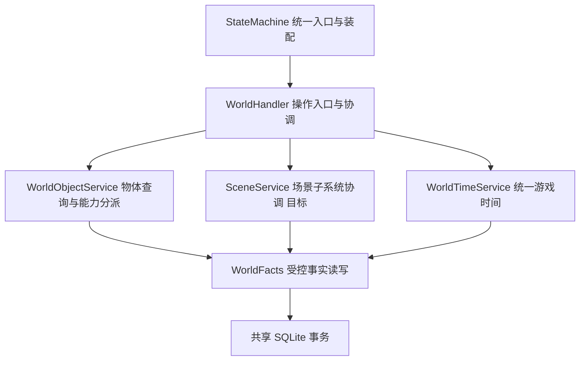

# Agentic TRPG — World Subsystem Design

> **版本**：v0.3 / Draft；**日期**：2026-10-18
>
> **规范关系**：[Module Contracts](./MODULE_CONTRACTS.md) v0.17 §0.3 / §0.5–§0.6 为最高职责规范；本文细化 World 候选能力。配套 [State Machine Architecture](./STATE_MACHINE_ARCHITECTURE.md) v0.19、[Game Core Evolution Plan](./GAME_CORE_EVOLUTION_PLAN.md) v0.6、[Adventure Package Schema](./ADVENTURE_PACKAGE_SCHEMA.md) v0.13。
>
> **状态**：职责和 Scene 目标结构 `[DECIDED]`；新增字段／ABI `[PROPOSED; OPEN]`；独立 Scene 组件 `[NOT IMPLEMENTED]`；超出 MC §1.3 受限实现的能力是目标设计，不能宣称已支持。本文不冻结 SQL Schema、跨模块消息或公共操作集合；仅修改总控文档。

**2026-10-17 v0.4 评审同步：** [Module Contracts](./MODULE_CONTRACTS.md) 继续是跨模块最终权威；[v0.4](./reviews/agentic-trpg-architecture-contracts-2026-10-17-v0.4.md) 仅保留审查记录。旧修订摘要中的整场 CombatEpisode／旧 OB 术语仅记录历史，现行目标为 Turn／Round Episode、单一有界 Recent OB List 和 `pending`／`processed`。每条新 OB 必经 Gate 决策（模型可选）；EVA 冻结完整授权近期窗口，processed 可影响 Meta，提交只完成固定 pending 覆盖。代码证据保持原日期／SHA，本次不刷新实现状态或冻结新增 ABI。

**2026-10-18 定向同步：** 上段为 10 月 17 日历史记录。本轮当前代码依据更新至 [MC §1.3](./MODULE_CONTRACTS.md#13-2026-10-18-远端实现核对定向静态调查)，区分 main 当前实现、ObjectSpatial 分支沿革与未实现目标；Scene 结构与环境边界遵循 MC §0.3a。保留 Turn／Round Episode、Recent OB／Gate／EVA、CombatPolicy 及版本／幂等／RNG／事务契约，不扩大 MVP，不冻结新 ABI。

## 1. 基线、范围与规则依据

本设计使用 **D&D 2024 修订规则：PHB 2024、DMG 2024、MM 2025、SRD 5.2.1**。这里的组件、字段和职责是项目工程设计，**不是官方数据库规范，也不宣称覆盖全部规则书**。官方版本依据：[PHB 2024](https://www.dndbeyond.com/posts/1810-updates-in-the-players-handbook-2024)、[DMG 2024](https://wpn.wizards.com/en/products/2024-dungeon-masters-guide)、[MM 2025](https://www.dndbeyond.com/posts/1913-updates-in-the-monster-manual-2025)、[SRD 5.2.1 发布与下载](https://www.dndbeyond.com/srd)。2026-10-15 核对公开版本信息及下列 SRD 条目；未逐章核对三本完整规则书，不从版本信息推断具体机制支持。

| 设计关注点 | 本次核对的公开依据 | 使用边界 |
|---|---|---|
| 对象互动与战斗时序 | [SRD 5.2.1](https://media.dndbeyond.com/compendium-images/srd/5.2/SRD_CC_v5.2.1.pdf#page=11) p.11–12 Interacting with Objects、p.13–14 Combat | 对象互动需要按情境处理；本文不统一规定开门/取物/撬锁都免费或都耗 Action，具体成本/资格由 RE 的受支持规则或显式裁决决定 |
| 光照与遮蔽 | 同一 [SRD](https://media.dndbeyond.com/compendium-images/srd/5.2/SRD_CC_v5.2.1.pdf#page=11) p.11 Vision and Light，p.15 Cover | 区分视觉遮蔽、遮挡和机械 Cover；不把阻挡移动等同阻挡所有感官，具体感官例外逐项待确认 |
| 物体受损 | 同一 [SRD](https://media.dndbeyond.com/compendium-images/srd/5.2/SRD_CC_v5.2.1.pdf#page=180) p.180 Damage Threshold | 阈值是有条件适用的规则概念，不能给所有物体默认加阈值；材质 AC/HP 表、免疫/抗性和破坏后果的具体取值/映射 **待确认** |
| 环境与陷阱 | 同一 [SRD](https://media.dndbeyond.com/compendium-images/srd/5.2/SRD_CC_v5.2.1.pdf#page=195) p.195 Environmental Effects、p.199 Traps | 仅确认可供逐项映射的条目；DC、触发/解除、伤害和时序未在本文列为已核实规则 |
| 持续魔法区域 | SRD Spells 与具体已启用法术条目 | 本次不规定统一法术公式；区域、移动、进入/离开/回合触发、集中与到期须逐法术核实并由 RE 执行，**待确认** |

World 覆盖世界时间、场景、空间/地形/障碍、基础对象、位置关系、物体耐久、开合/通路、锁具、容器/资源、光源/遮蔽、环境、陷阱/危险、隐藏与感官来源、通用交互、持续魔法区域的建模方向。**组件目录不是当前 MVP 全部完成清单**：按 MVP 已选场景启用最小能力，缺口明确拒绝/记录。车辆、荒野旅行、巢穴、位面和 Bastion 为 **后续扩展**，不成为当前 MVP 门槛，不因此扩大内容或引入完整物理模拟。

### 1.1 当前实现与目标的区别

当前远端 SHA、代码／测试源码和历史 PROGRESS 引用统一见 [MC §1.3](./MODULE_CONTRACTS.md#13-2026-10-18-远端实现核对定向静态调查)；§1.2 保留 2026-10-15 GC5 脏工作区快照。本轮定向静态调查，未运行 SM／RE 测试或完成全量代码审阅。

| 能力 | 当前 main 已实现 | 合并沿革／仍为目标 |
|---|---|---|
| 物体查询与分派 | WorldObjectService 及 Openable／Container／ObjectSpatial／Light／Mechanism 的受限组合 | 完整战斗费用、魔法生命周期、真实物体攻击、NPC 新意图转换仍未完成 |
| Openable | 共享开合／锁／闩／卡住方向／操作侧／触及；真实 RE 非战斗 PickLock、ForceOpen、ClearJam；查询复用资格，提交前重验 | 仅应用已配置的成功后果；强行开启不等于真实伤害／破坏。战斗与 Arcane Lock／Knock 仍 [NOT IMPLEMENTED] |
| Container | PutItem／TakeItem、相关子树及原／目标祖先容量／fit 检查、最多两层容器、祖先访问与 Openable 只读接口复用、同事务库存投影 | 部分数量转移、实例装备／调谐／效果生命周期仍未实现；内部耐久应用和待实现内容物摧毁规则不算交付 |
| WorldTimeService | world-time/1 秒制固定绑定与 legacy game-clock/1；Package 默认／创建整体覆盖／持久化，换算、昼夜／边界查询、推进委托 | TimeDriver／倍率、Round 接线、Activity／Effects／燃料与环境消费、秒制 NPC／OB／Gate 未完成 |
| ObjectSpatial | 当前 main `97c5af1` 已合入 `feat/object-spatial-service@0c2c4c7`：朝向／旋转、完整占地、候选验证、接触查询与独立移动阻挡／困难地形／视觉遮挡／Cover 投影；原 main `a897ae5` 只有较早基础 | 综合 Terrain／Perception／Light／Combat／RE 仍未接通，无挡雨／挡风接口；开始时未合并的状态只保留为调查沿革 |
| Scene 与环境 | WorldHandler／WorldFacts 有初始化、访问、Flags、网格／通路及移动基础 | SceneService／GridService／TerrainService／EnvironmentService 的独立组件均为已确认目标 [NOT IMPLEMENTED]；不能据现有基础宣布四服务已存在 |

## 2. 职责与依赖 `[DECIDED]`

StateMachine 是统一 API 和组件装配入口；WorldHandler / Service 编排世界操作，WorldFacts 读写所属事实，导航、时间、空间查询、规则适配与事件取证等按需作为 Supporting Components。通过显式依赖引用 CharacterFacts、Activity、CombatRecords、Effects 和共享 SqliteStore，不给每个对象类型配置一个 Handler，不机械套用全部层次，不强制 ECS。

**WorldFacts** 管场景、空间、对象、物体耐久、门锁、容器、物品实际位置关系及世界时钟。**CharacterFacts / 角色机械组件** 管唯一实际角色位置、HP、资源和装备。**CombatRecords** 管战斗运行记录；**Activity** 管进行中的活动与执行进度；**Effects** 管持续效果及其自身进度/时钟。Facts / Records 是领域读写组件，实际数据保存在 SQLite。Handler 不是另一份事实仓库，规则判断/计算归 RE。

World 的对象位置查询可以解析携带者的实际角色位置，不能复制一份可写角色坐标。Effects 区域引用 World 空间，World 的光照/阻挡等查询消费相关效果；效果实例、集中与到期不在 World 再存一套。物体耐久与角色 HP 分责，Creature/Actor 的伤害不能因使用“对象”统称转到 World。

### 2.0 World 与 Scene 的结构 `[DECIDED]`

以下为目标责任图。main 已有 WorldObjectService 与 WorldTimeService；SceneService 为目标，尚未独立实现。WorldHandler 保留操作入口与协调，WorldFacts 提供受控事实接口，所有写入共用 SQLite 事务。

顶层只展示 SceneService；内部四组件责任如下。不要求所有查询经过 SceneService，可按需要直接使用内部只读能力。正式名称沿用 WorldTimeService，TimeService 仅是讨论简称。

| Scene 内组件 | 目标责任 [DECIDED] | 代码状态 |
|---|---|---|
| SceneService | 初始化、进入／离开、访问记录、Flags、生命周期及内部协调 | 独立实现 [NOT IMPLEMENTED]；现有路径仍在 WorldHandler／WorldFacts |
| GridService | 网格定义、坐标有效性、邻接、距离等基础空间能力 | 独立实现 [NOT IMPLEMENTED]；复用既有 GridScene／GridTopology／canonical_cell_id，不重写 D&D 距离／范围规则 |
| TerrainService | 地表、地面高度、困难地形及通行属性；基础地形与受控变化 | 独立实现／综合合并 [NOT IMPLEMENTED]；对象造成的困难地形等读取 ObjectSpatial 投影，不复制为另一份可写地形 |
| EnvironmentService | 基础环境管理，结合局部空间防护与有效 Effects，查询位置／区域的实际环境 | 独立实现 [NOT IMPLEMENTED]；当前空间防护、环境消费尚无完成依据 |

WorldHandler 已迁出的业务包括对象能力分派、开合／锁具／门闩转换、容器操作、空间物体布置、灯光／机关及时间换算／推进委托。仍保留场景初始化和进入／离开、Flags／访问记录编排、角色移动、通路／共享门端点、传统拾取／放下部分路径、拓扑／触及／授权辅助及最终一致性协调；不是仅剩空路由器。完整退出这些业务和 Mixin 仍对应 A2；空间／战斗接线对应 A1，不能标记整体迁移完成。

### 2.0a 共享空间与环境边界 `[DECIDED; NOT IMPLEMENTED]`

所有组件共用 Scene Grid 与坐标标识，不各建一套 Cell。Character 拥有角色实际位置；WorldObject 拥有物体位置与动态空间贡献；Terrain 拥有基础地形及受控变化。空间派生结果不成为另一份可写事实，Grid 沿用既有几何规则。

环境初值来自 Package，运行变化保存在 Session 的 World 状态。可选一批场景设置天气，不引入世界→地区→场景天气继承；作用域为整个场景或明确区域。首次进入前对场景环境的受控修改必须保存，后续初始化只补未建立基础，不能被模板覆盖；重访也不重置。有效 Cell 环境按需组合查询，不要求预先逐格持久化最终结果。具体字段、覆盖优先级与版本／迁移仍 [OPEN]，不是新增公共 ABI。

挡雨、挡风、视觉遮挡和移动阻挡各自独立，不能相互推导。当前 ObjectSpatial 已有的视觉／Cover 贡献不提供挡雨／挡风；这些防护尚待实现与消费者验证。Effects 保存法术效果来源、范围和生命周期；Environment 只消费其环境贡献，不复制权威或期限。天气生成、气候继承、流体模拟不作为前置；角色暴露进度归属仍 [OPEN]，本轮不替它选择所有者。

### 2.1 身份、位置关系与库存

沿用现有 `session_id`、`scene_id`、`actor_id`、`object_id`，便携 `instance_id` 与 `objects.object_id` 是同一实例身份；不按名字另建 WorldEntity / InventoryItem 目录。模板绑定沿用 Package / 数据修订，新增关系键须先核对已有字段，本文字段拼写仅作候选。

当前便携物品落地为 `scene_id + cell`，携带为 `carrier_id`；位置互斥且引用有效。main 已支持置于容器；附着于对象仍为目标。对这些位置关系，同一物品仍只有一个直接实际位置关系，容纳/附着链不得成环；沿父关系解析实际空间。装备是角色机械绑定，不能自动等同位置；被装备实例仍须属于合法持有关系，取放应维护或拒绝无法安全解除的绑定。

`WorldFacts.transfer_item → CharacterFacts.project_item_transfer` 在同事务更新 World 位置、机械 `InventoryState.entries` 和 carried-slug 投影，并以 `validate_portable_inventory` 校验完整便携子集，再按角色投影。**持久化的库存投影不是另一份可独立改写的物品归属权威**。当前 `item_json` 含 item_slug、quantity、charges_remaining_per_unit 等，转移不能重置数量/充能或丢失非便携条目；相关规则消耗须按受控机械结果共同更新。slug 装备不能无歧义识别实例、活动效果/施法材料绑定等当前限制保留。容器祖先可访问性与容量所需递归重量已有受限实现；部分数量转移、资源耗用及统一实例装备／调谐／效果生命周期协议仍 `[OPEN; NOT IMPLEMENTED]`。

### 2.2 客观世界与认知

墙体遮挡、暗门的物理伪装、锁的客观机制和感官源存在性属于 World。谁发现暗门、听到了什么、知道密码或相信门后有宝物，属于 Perception / Observation / Knowledge / NPC Cognition；不能用 `discovered_by` 一类世界对象字段替代角色认知记录。World 可保存受控机制引用，但密码知识、秘密与发现结果只能通过授权视图/证据进入角色上下文。

光源/声音来源、通路、物理 Cover、视觉遮蔽、声音传播分别建模/查询，不能用一个 `hidden` 或 `blocks_passage` 同时解释所有规则。角色感官能力和机械 Conditions 来自角色/Effects；Perception 在非战斗按实际阶段证据判断，战斗按固定 Episode 过滤依据判断。World 提供来源和客观环境，不能直接写“所有同场景 NPC 已发现”。

## 3. 可选能力组合 `[DECIDED; PROPOSED]`

对象只装配需要的能力：**门 = 基础对象 + 位置 + 可选耐久 + 开合 + 可选锁具 + 通路关联**；**箱子 = 基础对象 + 位置 + 可选耐久 + 开合 + 可选锁具 + 容器**。箱子可没有锁，门可不可破坏，光源可附着于任意合适对象；能力缺失不伪造默认行为。木门、铁门以模板材质/规则参数区分，共用能力操作逻辑，不分别实现木门/铁门处理器。

以下按组件列候选字段及用途。**T = 模板配置**（固定定义/初始值）；**S = 持久实例状态**（只由所属接口写）；**R = 关联**（引用同 Session 已有身份/来源）；**D = 派生查询**（可缓存，不能独立修改）。表中拼写与尚未实现的扩展字段 `[PROPOSED; OPEN]`；已有代码字段／协议以 MC §1.3 固定源码为准，此表不重新冻结；与现有字段同义时复用现有结构，新增拼写不意味着新增 SQL 列或冻结跨模块协议。R 可持久化，但须指定唯一关系负责人；D 如物化，须有失效/一致性规则。

| 组件 / 用途 | T：模板配置候选 | S：持久实例候选 | R：关联候选 | D：派生查询候选 |
|---|---|---|---|---|
| 世界时间：推进共同时间 | 已有完整 TimeBinding 配置，版本 world-time/1；legacy 保留 game-clock/1，见 MC §1.3 | 复用 game_tick 与固定绑定，保存唯一时间 | 复用 session_id；活动／效果接线仍待完成 | 已有日期／昼夜／边界换算；有序到期消费者待实现，不另建探索／战斗时钟 |
| 场景：实例化与边界 | 复用 Scene 定义、初始 flags、空间配置，提供首次基线 | 复用 scene_instances 的 flags / visited_count，保留回访后果 | `scene_id`、Package 版本/定义引用 | 当前在场角色/对象与授权出口；不按静态 actor_ids 重生角色 |
| 空间 / 地形 / 障碍：导航和机械输入 | 复用 grid、blocked_cells、地形定义；候选 `terrain_ref` / `geometry_ref` 描述成本/形状 | 候选地形覆盖/障碍实例变化，保存实际改变 | scene_id、对象/区域与 passage 引用 | 可通行边、距离、占用、LoS / Cover 输入；规则成本由 RE 算 |
| 基础对象：身份与能力装配 | 复用对象定义；候选 `template_ref`、`capabilities`、`material_ref` 表达可支持能力/材质 | 复用 objects 实例身份/普通 state；候选启用/失效状态 | session_id / object_id、Package 定义 | 可用能力集合、授权描述；不按名称推断新能力 |
| 位置 / 携带 / 容纳 / 附着：实际位置 | 复用 initial_cell / initial_owner_id；候选允许关系类型 | 复用 scene_id / cell / carrier_id；候选容纳/附着的互斥关系状态 | `container_id`、`attached_to_id`、候选局部锚点；复用 actor/object 身份 | 解析后的实际场景/坐标、直接持有者/祖先链；不存独立库存 owner |
| 物体耐久：受损与破坏 | 候选 `max_hp`、`ac_ref`、可选 `damage_threshold`、`damage_profile_ref`，指向经核实规则/裁决 | 候选 `current_hp`、`damage_state`，保存实际损坏 | object_id、规则来源/已提交结算关联 | 是否仍能承重/阻挡/使用；破坏并不默认删除身份或抹掉历史 |
| 开合 / 通路：状态影响世界连接 | 复用 open/closed 初始 state、passages / endpoints；候选允许开合政策 | 复用 objects.state；候选卡住/破损状态，不把 unlocked 等同 open | 复用 `door_object_id`、`passage_id`、两侧 scene/standing_cell/threshold_cell | 当前通路可用性、双侧交互可达性；不为门两侧各保存一份门状态 |
| 锁具：控制合法开启条件 | 复用 `initial_locked`、`policy`、`credential_instance_ids`；候选检定/密码机制引用 | 复用 door_locks.locked；候选损坏/禁用状态 | object_id、door_credentials 与物品实例；未来秘密机制受控引用 | 当前是否有合法开锁路径；不从查询泄漏密码、钥匙秘密或未知目标 |
| 容器 / 物资资源：容纳与有限存量 | 候选 `capacity_ref`、`accepts_ref`、`resource_kind`、`initial_quantity`，约束内容/计量 | 候选容器自身状态、未实体化物资的 `remaining_quantity`；实体物品不再计一份可写数量 | 容纳关系反向查询；实物实例/补给来源引用 | 内容列表、剩余容量/可访问性/合计重量；角色资源池留在 Character 机械组件 |
| 光源：提供客观照明 | 候选 `light_profile_ref`、`fuel_policy_ref`，定义范围/消耗来源 | 候选 `enabled`、实际燃料存量；有物品充能时引用原实例余额 | 来源 object_id / actor_id / effect_id、空间锚点 | 当前受照区域与强度；燃料/充能不在两处独立扣减 |
| 遮蔽 / 遮挡：按渠道描述物理影响 | 候选 `occlusion_profile_ref`、`cover_geometry_ref`、`channel_mask`，分别表达视线/声音/机械遮掩 | 候选启用状态或几何变化，必要时直接派生自门/障碍状态 | 对象/地形/效果来源及空间 | 各渠道连通、视觉遮蔽与 Cover 候选；不直接得出角色已察觉 |
| 环境：持续客观条件 | 候选环境初值、整场景／明确区域与规则引用 | Session World 保存受控变化，首次进入前修改不被覆盖 | scene_id 或一批 scene_ids、区域、效果来源及世界时间；不建天气继承树 | 按位置／区域组合实际环境，消费空间防护与有效 Effects；无逐格最终态权威，机械结算归 RE |
| 陷阱 / 危险：受控触发与后果 | 候选 `trigger_ref`、`resolution_ref`、`reset_policy`，绑定已支持规则/包声明 | 候选 armed / disabled / spent、剩余使用次数与触发采用记录 | 对象/区域、触发 Event、后续稳定 command_id | 可触发候选/受影响对象；发现/识破知识不存入陷阱状态 |
| 隐藏与感官来源：提供察觉依据 | 候选 `concealment_ref`、`sensory_profile_ref`，描述物理伪装与光/声等源 | 候选源启停、伪装实际状态及变化时间 | source object/actor/effect、空间与已提交阶段 | 供 Signals / Scope Discovery 的客观来源和环境；发现结果由既有感知组件管理 |
| 通用交互：按能力复用操作 | 候选 `interaction_refs`、支持操作/前提政策、规则/裁决引用 | 通常不复制事实；确有需要仅存交互自身冷却/使用进度 | actor、目标能力、Activity / Command / Event 关联 | 当前授权可用性；query 不支付资源，执行时重验 |
| 持续魔法区域：空间与效果协作 | 候选形状/锚定/传播政策与具体法术规则引用 | World 仅保存必要空间锚定变化；持续效果状态/进度由 Effects 持有 | effect_id、source/target、scene/anchor、集中来源 | 当前覆盖与进入/离开候选；RE 计算触发/结算，不能另存一份效果时钟 |

**字段演进顺序：** 先为一个已选场景核对定义/实例/关联/查询消费者，再提出最小字段与操作；优先复用现有 objects、passages、door_locks、door_credentials、portable_items、机械组件与活动结构。WorldTime / Position 等是逻辑称呼，不要求建同名表。不得因 `location` / `position`、`item_id` / `instance_id` 命名差异重复建设；具体 SQL、约束、迁移、版本和跨模块协议必须在实现切片另行评审。

## 4. 探索、战斗与底层互动 `[DECIDED]`

**探索移动：** `StateMachine → Navigation / Activity → WorldHandler → CharacterFacts.move`，World 提供空间/通路/门/障碍事实，ActivityRecords 只保存目标与进度。当前每步重验，活跃战斗拒绝探索执行；世界时间是否随某活动推进由具体受支持政策决定。

**战斗移动目标：** `StateMachine → CombatHandler → RE → CharacterFacts + CombatRecords + 相关领域共同提交`。从实际世界位置组装战斗空间投影，RE 计算移动资格/成本、触发与反应，结果落回唯一实际角色位置及相关记录。当前 `_current_cells` 使用同场景网格坐标；未来子地图原点/尺度/zone、跨场景与动态障碍映射保持 OPEN。无法表达的范围/障碍显式不支持；战后冻结记录只供审计，不能反向覆盖角色位置。

**共享互动目标：** 开门、解锁、取放、破坏障碍按能力调用共同领域操作。探索入口执行适用授权、可达性、凭据/活动约束及需要的 RE 检定；战斗入口额外经 RE 协调行动资格、行动资源、时序、触发与反应。Handler 组织顺序、适用记录通道和共同提交（非战斗阶段取证，战斗审计／Episode 来源），不能自定规则公式。门/箱/容器共享开合和锁具能力，不复制对象事实或取放权威。

**当前限制是实施边界：** `_world_operation_capability` 拒绝活跃战斗的非战斗命令；`_spatial_combat_guard` 拒绝部分动态障碍/关闭通路门；物品/锁具还有公开性、凭据、装备、效果/活动等限制。复用须先设计受控战斗执行上下文及 Delta 适配，并逐项证明原有限制仍正确或已有明确替代；不得删除 guard 或直接调用内部 `_operate*` 作为“支持战斗互动”。main 已支持非战斗撬锁、显式方法强行开启／解除卡住和容器取放；仍须遵守公开对象、角色状态、工具、祖先访问与空间保护。战斗费用、魔法生命周期和真实物体攻击继续是缺口，不能通过直接内部调用绕过。

## 5. 事务、尝试结果与阶段证据 `[DECIDED]`

各 Facts / Records 使用调用方的共享 SQLite 事务；Handler / 提交设施组织边界，组件不自行 COMMIT。一次不可分割的互动应共同提交对象/角色/活动/战斗/效果变化、资源结算、RNG、触发采用记录、事件及实际阶段证据、Receipt / 可靠工作。求值、LLM、外部 I/O 与等待选择在写锁外，提交前重验权限、版本与前提。失败回滚还须防止缓存/已有引用泄漏候选状态。

| 情况 | 权威处理 | 反馈/重试 |
|---|---|---|
| 非法 / 越权 / 不支持的命令 | 不发生未获准行动、不消耗未获准资源、不发布动作事实；按已有协议保存允许的拒绝回执 | 授权范围内 rejected / unsupported 原因；不得编造骰点失败 |
| 版本 / 原值冲突 | 未提交变化和 RNG 不生效 | 原命令查询回执；刷新并改变内容/版本需新 command_id |
| 合法尝试成功或结果失败 | RE 或受控非机械政策确定实际后果；合法失败**可能仍消耗**行动、时间、工具/资源并产生可观察动作，必要变化原子提交 | 用已提交结果叙述；accepted 不保证任务目标成功，不能把结果失败统一回滚为未尝试 |
| 存储/提交故障或响应未知 | 失败事务整体回滚；未知先查原回执 | 防止重复扣费/重掷，不把传输失败当角色尝试失败 |

非战斗实际阶段捕获 Evidence：例如取物前的地面源位置、放下后的实际源位置，或破坏前后的可观察分支，不能在操作全部结束后用当前坐标补造先前视听。可信阶段可先缓冲，最终与对应 Event / Signals / 可靠工作共同提交；缺失阶段明确记录缺口，不能让 JEV 猜历史。

沿用 MC §7 的 **Event / Episode / Observation** 职责、事件时证据、Outbox、游标与既有 NPC EVA/Knowledge 管线，不新增世界专属感知队列/记忆体系。战斗本场参战 NPC 接收 Turn 来源，外部接收 Round 来源；按范围／接收能力过滤，同 NPC／Episode 合批，不逐机械 Event 发信号或另建逐动作感知证据链。提交后需独立机械命令的后果按现有稳定 command_id 可靠交接，不宣称两个已提交操作可一起回滚；异步感知/认知处理仍在各自可靠事务完成。

### 5.1 空间、容量、时间与效果协作

未知重量／容量只阻止依赖该信息的操作；main 对相关容器容量 unknown 仍拒绝移出，但不检查无关容器局部容量。检查移动子树、原／目标祖先及受影响关系闭包。当前 main 的 ObjectSpatial 分别输出移动阻挡、困难地形、视觉遮挡和 Cover 的对象侧贡献；Light 独立输出受限光照，综合 Terrain／Perception／Light／RE 接入仍未完成。目标查询保留版本、单位与未知部分，不相互推导，不禁止 RE 已支持的合法特殊移动。

main 已有 WorldTimeService：显式 world-time/1 固定 1 tick = 1 游戏秒；legacy game-clock/1 仍为抽象 tick。Package 提供完整绑定，创建 Session 可强类型整体覆盖并持久固定；已有时间换算、昼夜及有界边界查询、获准 world.advance_time 推进委托。唯一 tick 仍由 WorldFacts 写入，旧存档不转秒。

秒制 Session 创建拒绝带配置型 NPC State 的 Package；未配置 Runtime 的物理 Actor 可存在，但 NPC observation access／宿主聚合感知投影受 unsupported_time_consumer 限制。旧日程／OB TTL／Gate 周期不能按秒解释；完整限制见 MC §1.3。

[DECIDED; NOT IMPLEMENTED] 实时倍率与 TimeDriver、Combat Round 时间接线、Activity／Effects 期限消费及秒制 NPC／OB／Gate 仍待完成。整个 Round 约六游戏秒，各 Actor Turn 不重复增加整轮时长；认知交付粒度不创建不同流速的时钟。有消费者后，推进按有序到期边界处理，遇规则／选择／等待先提交合法边界和恢复进度，不先跳终点再补中间后果；现有数学边界查询不等于这个调度器已经实现。

Effects 管完整身份（现有 RE 为 target_id／id／origin）、Condition 多来源、专注及期限；World 管空间锚点，Character 读有效投影。取消单一来源不清其他来源，结束战斗／切场景不默认删除效果。Activity 每步重验事实，领域变化与游标共同提交，取消不撤销已发生步骤。完整接口仍待实现，未支持生命周期保持 unsupported，见 MC §6.6。

## 6. 后续落实与修订关系

唯一架构待办登记沿用 [MC §13](./MODULE_CONTRACTS.md#13-尚需显式批准或验证的开放问题) 的 **A1 / A2、C-18 / C-19、C-25–C-27**，实现验收复用演进计划 §8.1 的 DS-01–DS-07。本文不建平行 Backlog，不把完整组件目录变成强制 MVP 工程批次。

仍待确认／实现：最小场景所需能力与规则来源、坐标／战斗投影映射、实例装备与生命周期、物体攻击／破坏及内容物后果、隐秘锁发现／密码授权、TimeDriver 与各时间消费者、Scene 四组件、环境／陷阱／区域逐规则 Delta、支持组件依赖与故障验证。已有非战斗锁具检定、两层容器访问与固定时间单位不再列为全部缺失。角色暴露进度归属继续 [OPEN]。新增字段/规则不能由本草案直接视作运行能力。

本草案细化 MC v0.14 的领域所有权决定，不撤销其单一事实权威、共享提交或 Host / RE 边界；与旧“Character / World Object 合并责任”表述冲突时，采用 MC v0.17 §0.3／§0.3a。历史 ADR / 决策登记及历史实现快照保留，不另建 ADR 体系；本次没有运行实现、Schema 迁移、规则依赖升级或全规则书覆盖验收。
