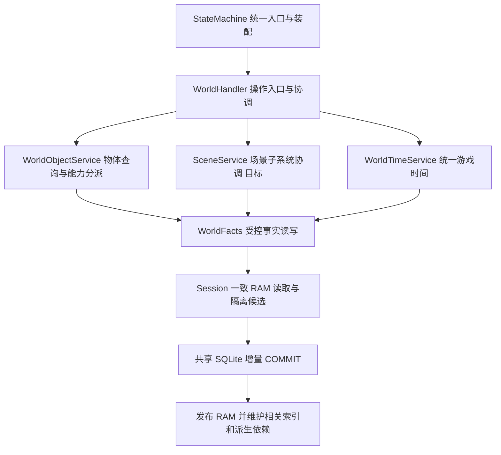

# Agentic TRPG — World Subsystem Design

**2026-10-22 运行实例归属 [DECIDED]：** 统一规则只维护于
[MC §2.3a](MODULE_CONTRACTS.md#23a-实例字段关联与局部准入-decided)，下述历史实现状态保留原日期。
本次实现核对另见 [分支证据](reviews/RUNTIME_INSTANCE_OWNERSHIP.md)。

**2026-10-22 性能后续 [IMPLEMENTED，限配套 SM 分支]：** 容器三个重量标量使用修改时
维护的对象版本，变化沿旧／新祖先失效；有效读取不比较各内容物版本。场景机关只读索引
按条目查询。能力成员进入／离开场景时沿实际移动子树或携带关系补丁更新；灯的同场景
遮光、开关和模式仍使所选贡献失效，无能力空袋子不使整个场景重新发现。地面遮挡几何
单独维护字段版本，避免照明命中传播无关物体负向配置依赖。事实、关系和失效状态按
MC §2.3a／§6 共同候选与发布；None、真实销毁后果、访问／容量／RNG 等语义不变。
新计数和限制见 [后续核对](reviews/RUNTIME_INSTANCE_OWNERSHIP.md#2026-10-22-follow-up-field-validity-and-local-associations)；
下文带日期的旧 NOT IMPLEMENTED 与测试记录保留其当时含义。

Scene 的 spatial 字段持有解析地图／基础拓扑及由实际位置维护的占用、阻挡索引；
environment 持有自身环境／来源、防护和有界位置／高度结果；lighting 持有光源贡献及
光照结果；mechanisms 持有事件／目标索引；objects 只列直接落地对象。
容器内部和携带物通过父子／carrier 关联解析有效场景，不能直接加入落地目录。
光源开关、数量、位置等仍归所属 Object，效果期限仍归实际效果持有者；共享门和跨场景
联动按真实作用范围持有。场景卸载不销毁角色或携带物，不新增 Cell 实例体系。

Object.container 的直接内容物关联来自唯一 parent 事实。重量区分自身重量 × quantity、
直接内容物的递归贡献，以及自身加后代总重量；None 仍表示未知。移动、数量／配置变化
维护两端必要祖先，摧毁按已有 shell／内容物后果处理；候选容量检查使用隔离候选。
不得排序或序列化整个候选状态来查重量缓存。机关触发关联在实例配置／有效场景改变后
维护或失效，零机关也可复用；无关事件先过滤，运行状态／频率／资格检查仍执行。

Environment area 校验直接用目标 Scene 的存在性与地图边界，不计算完整环境；单格照明
只合成请求格子。合法全图 View／机械闭包仍按明确范围计算。冷加载所需关系发现成本、
尚未接通的生产提供方及其他限制须与热字段复用分别报告。

**2026-10-21 运行读取目标 [DECIDED]：** 所属领域保存唯一事实，Session RAM 提供已加载有效事实的一致读取；每次修改通过 SQLite 增量提交后发布。统一规则引用 [MC §2.3／§6](./MODULE_CONTRACTS.md#23-运行时数据复用派生-snapshot-与版本有效性-decided)，完整 RAM 层 [NOT IMPLEMENTED]，本次无运行验收。历史日期／SHA 原样保留；当前 Schema40 及静态差距见 MC §1.8。

> **版本**：v0.4 / Draft；**日期**：2026-10-20
>
> **规范关系**：[Module Contracts](./MODULE_CONTRACTS.md) v0.18 §0.3 / §0.5–§0.6 为最高职责规范；本文细化 World 候选能力。配套 [State Machine Architecture](./STATE_MACHINE_ARCHITECTURE.md) v0.20、[Game Core Evolution Plan](./GAME_CORE_EVOLUTION_PLAN.md) v0.7、[Adventure Package Schema](./ADVENTURE_PACKAGE_SCHEMA.md) v0.14。
>
> **状态**：职责和 Scene 目标结构 `[DECIDED]`；新增字段／ABI `[PROPOSED; OPEN]`；受限实现按 MC §1 的日期化证据区分，Grid／Environment 本次核对见 §1.5，完整目标仍待落实。本文不冻结 SQL Schema、跨模块消息或公共操作集合；仅修改总控文档。

**2026-10-20 文档补充：** 快照与查询通用原则集中在 [MC §2.3](./MODULE_CONTRACTS.md#23-运行时数据复用派生-snapshot-与版本有效性-decided)，本次有限实现核对见 [MC §1.5](./MODULE_CONTRACTS.md#15-2026-10-20-快照与查询专项核对静态证据)。§2.0b–§2.0c 区分场景视图、局部查询与环境派生复用；本次仅完成文档约束，空间索引、局部校验及后续性能验收不标完成。下述 10 月 19 日及更早摘要保留为历史。

**2026-10-19 运行时复用同步：** Package 完整实例化以 MC §2.4 为准；共同复用约定以 [MC §2.3](./MODULE_CONTRACTS.md#23-运行时数据复用派生-snapshot-与版本有效性-decided) 为准；Grid／Environment 细化见 World §2.0b–§2.0c，RE 加载身份见 MC §4.3。当前实现专项核对见 [MC §1.4](./MODULE_CONTRACTS.md#14-2026-10-19-运行时复用专项核对当前分支静态证据)，下述较早日期摘要及待办保留原时点，不作为最新完成状态。本轮仅文档，未新增待办或运行验收。

**2026-10-17 v0.4 评审同步：** [Module Contracts](./MODULE_CONTRACTS.md) 继续是跨模块最终权威；[v0.4](./reviews/agentic-trpg-architecture-contracts-2026-10-17-v0.4.md) 仅保留审查记录。旧修订摘要中的整场 CombatEpisode／旧 OB 术语仅记录历史，现行目标为 Turn／Round Episode、单一有界 Recent OB List 和 `pending`／`processed`。每条新 OB 必经 Gate 决策（模型可选）；EVA 冻结完整授权近期窗口，processed 可影响 Meta，提交只完成固定 pending 覆盖。代码证据保持原日期／SHA，本次不刷新实现状态或冻结新增 ABI。

**2026-10-18 定向同步：** 上段为 10 月 17 日历史记录。本轮当前代码依据更新至 [MC §1.3](./MODULE_CONTRACTS.md#13-2026-10-18-远端实现核对定向静态调查)，区分 main 当前实现、ObjectSpatial 分支沿革与未实现目标；Scene 结构与环境边界遵循 MC §0.3a。保留 Turn／Round Episode、Recent OB／Gate／EVA、CombatPolicy 及版本／幂等／RNG／事务契约，不扩大 MVP，不冻结新 ABI。

**2026-10-20 三仓库对齐基线：** 当前实现和接口以 [MC §1.6](./MODULE_CONTRACTS.md#16-2026-10-20-三仓库-main-对齐) 的固定 main、源码／测试及 Progress 为准；§1.1–§1.5 与带日期 Review 保留历史适用范围。Schema39 实例配置、冻结规则复用、TimeDriver／Round 及受限 Availability 已有实现，完整动态实例／时间消费者／通用 API 仍有缺口。Full Audit、局部准入、查询及共享 Finalize 的共同规范只维护于 MC §2.3、§6.5–§6.6；本批只改 Markdown，不运行或宣称通过业务／性能测试。

## 1. 基线、范围与规则依据

**2026-10-21：** 规则、世界观与工程资料统一登记于 [References](./REFERENCES.md)；下表及较早现状保留原核对日期。最新定向证据见 [MC §1.7](./MODULE_CONTRACTS.md#17-2026-10-21-运行时复用与资料核对)，明确区分 SM 未合并重构分支与 main；本次没有业务／性能验收。

本设计使用 **D&D 2024 修订规则：PHB 2024、DMG 2024、MM 2025、SRD 5.2.1**。这里的组件、字段和职责是项目工程设计，**不是官方数据库规范，也不宣称覆盖全部规则书**。官方版本依据：[PHB 2024](https://www.dndbeyond.com/posts/1810-updates-in-the-players-handbook-2024)、[DMG 2024](https://wpn.wizards.com/en/products/2024-dungeon-masters-guide)、[MM 2025](https://www.dndbeyond.com/posts/1913-updates-in-the-monster-manual-2025)、[SRD 5.2.1 发布与下载](https://www.dndbeyond.com/srd)。2026-10-15 核对公开版本信息及下列 SRD 条目；未逐章核对三本完整规则书，不从版本信息推断具体机制支持。

| 设计关注点 | 本次核对的公开依据 | 使用边界 |
|---|---|---|
| 对象互动与战斗时序 | [SRD 5.2.1](https://media.dndbeyond.com/compendium-images/srd/5.2/SRD_CC_v5.2.1.pdf#page=11) p.11–12 Interacting with Objects、p.13–14 Combat | 对象互动需要按情境处理；本文不统一规定开门/取物/撬锁都免费或都耗 Action，具体成本/资格由 RE 的受支持规则或显式裁决决定 |
| 光照与遮蔽 | 同一 [SRD](https://media.dndbeyond.com/compendium-images/srd/5.2/SRD_CC_v5.2.1.pdf#page=11) p.11 Vision and Light，p.15 Cover | 区分视觉遮蔽、遮挡和机械 Cover；不把阻挡移动等同阻挡所有感官，具体感官例外逐项待确认 |
| 物体受损 | 同一 [SRD](https://media.dndbeyond.com/compendium-images/srd/5.2/SRD_CC_v5.2.1.pdf#page=180) p.180 Damage Threshold | 阈值是有条件适用的规则概念，不能给所有物体默认加阈值；材质 AC/HP 表、免疫/抗性和破坏后果的具体取值/映射 **待确认** |
| 环境与陷阱 | 同一 [SRD](https://media.dndbeyond.com/compendium-images/srd/5.2/SRD_CC_v5.2.1.pdf#page=195) p.195 Environmental Effects、p.199 Traps | 仅确认可供逐项映射的条目；DC、触发/解除、伤害和时序未在本文列为已核实规则 |
| 持续魔法区域 | SRD Spells 与具体已启用法术条目 | 本次不规定统一法术公式；区域、移动、进入/离开/回合触发、集中与到期须逐法术核实并由 RE 执行，**待确认** |

World 覆盖世界时间、场景、空间/地形/障碍、基础对象、位置关系、物体耐久、开合/通路、锁具、容器/资源、光源/遮蔽、环境、陷阱/危险、隐藏与感官来源、通用交互、持续魔法区域的建模方向。**组件目录不是当前 MVP 全部完成清单**：按 MVP 已选场景启用最小能力，缺口明确拒绝/记录。车辆、荒野旅行、巢穴、位面和 Bastion 为 **后续扩展**，不成为当前 MVP 门槛，不因此扩大内容或引入完整物理模拟。

### 1.1 当前实现与目标的区别

最新 main 的当前实现和测试／Progress 证据以 [MC §1.6](./MODULE_CONTRACTS.md#16-2026-10-20-三仓库-main-对齐) 为准；较早分支及合并沿革保留在 MC §1.3–§1.5，不把历史分支当当前 main。本轮未运行 SM／RE 业务测试或完成全量代码审阅。

| 能力 | 2026-10-20 main 的受限实现 | 剩余目标／限制 |
|---|---|---|
| 物体查询与分派 | WorldObjectService 及 Openable／Container／ObjectSpatial／Light／Mechanism 的受限组合 | 完整战斗费用、魔法生命周期、真实物体攻击、NPC 新意图转换仍未完成 |
| Openable | 共享开合／锁／闩／卡住方向／操作侧／触及；真实 RE 非战斗 PickLock、ForceOpen、ClearJam；查询复用资格，提交前重验 | 仅应用已配置的成功后果；强行开启不等于真实伤害／破坏。战斗与 Arcane Lock／Knock 仍 [NOT IMPLEMENTED] |
| Container | PutItem／TakeItem、相关子树及原／目标祖先容量／fit 检查、最多两层容器、祖先访问与 Openable 只读接口复用、同事务库存投影 | 部分数量转移、实例装备／调谐／效果生命周期仍未实现；内部耐久应用和待实现内容物摧毁规则不算交付 |
| WorldTimeService／SessionTime | world-time/1／legacy 固定绑定、换算与边界；显式倍率、TimeDriver、暂停／恢复、有界工作及真实 Round 接线已有实现（MC §1.6） | 无默认倍率；Activity／Effects／燃料与环境消费、秒制 NPC／OB／Gate、完整生产等待消费者仍未完成 |
| ObjectSpatial | 朝向／旋转、完整占地、候选验证、接触查询、独立移动阻挡／困难地形／视觉遮挡／Cover 贡献，以及显式挡雨／挡风几何均已合入 main | 当前防护提供方／机械与感知消费者尚未全接通；不宣称综合 Terrain／Perception／Light／Combat／RE 完成 |
| Scene 与环境 | main 已有 SceneLifecycleService、GridService／GridMaps 只读地图和拓扑复用、EnvironmentService 双版本及两层有界派生缓存 | TerrainService、完整 Scene 协调、局部 SQL／候选准入及生产 WO／Effects 法术适配仍未完成 |

## 2. 职责与依赖 `[DECIDED]`

StateMachine 是统一 API 和组件装配入口；WorldHandler / Service 编排世界操作，WorldFacts 读写所属事实，导航、时间、空间查询、规则适配与事件取证等按需作为 Supporting Components。通过显式依赖引用 CharacterFacts、Activity、CombatRecords、Effects 和共享 SqliteStore，不给每个对象类型配置一个 Handler，不机械套用全部层次，不强制 ECS。

**WorldFacts** 管场景、空间、对象、物体耐久、门锁、容器、物品实际位置关系及世界时钟。**CharacterFacts / 角色机械组件** 管唯一实际角色位置、HP、资源和装备。**CombatRecords** 管战斗运行记录；**Activity** 管进行中的活动与执行进度；**Effects** 管持续效果及其自身进度/时钟。Facts / Records 是统一事实访问与受控修改组件；SQLite 持久保存事实，已加载有效事实由 Session RAM 提供运行读取。Handler 不是另一份事实仓库，规则判断/计算归 RE。

World 的对象位置查询可以解析携带者的实际角色位置，不能复制一份可写角色坐标。Effects 区域引用 World 空间，World 的光照/阻挡等查询消费相关效果；效果实例、集中与到期不在 World 再存一套。物体耐久与角色 HP 分责，Creature/Actor 的伤害不能因使用“对象”统称转到 World。

### 2.0 World 与 Scene 的结构 `[DECIDED]`

以下为目标责任图。已有 WorldObjectService 与 WorldTimeService；SceneService 的完整协调职责仍为目标，当前分支已有 SceneLifecycleService 切片。WorldHandler 保留操作入口与协调，WorldFacts 提供受控事实接口，所有写入共用 SQLite 事务。

顶层只展示 SceneService；内部四组件责任如下。不要求所有查询经过 SceneService，可按需要直接使用内部只读能力。正式名称沿用 WorldTimeService，TimeService 仅是讨论简称。

| Scene 内组件 | 目标责任 [DECIDED] | 代码状态 |
|---|---|---|
| SceneService | 初始化、进入／离开、访问记录、Flags、生命周期及内部协调 | 已有 SceneLifecycleService 受限切片；完整目标仍待落实 |
| GridService | 网格定义、坐标有效性、邻接、距离及共享基础空间结构 | 已有独立组件、GridReader／GridView；当前已复用只读解析地图及基础拓扑，动态占用定向查询仍待落实（MC §1.5），不重写 RE 几何规则 |
| TerrainService | 地表、地面高度、困难地形及通行属性；基础地形与受控变化 | 独立实现／综合合并 [NOT IMPLEMENTED]；对象造成的困难地形等读取 ObjectSpatial 投影，不复制为另一份可写地形 |
| EnvironmentService | 基础环境管理，结合局部空间防护与有效 Effects，查询位置／区域的实际环境 | 已有独立服务、受控导入／变化、双版本及有界缓存；正式提供方与兼容边界见 MC §1.4 |

10 月 18 日已迁出的对象／时间业务继续保留；当前分支又提取场景生命周期与 Grid 查询切片，并接入 Environment。WorldHandler 仍承担操作入口、授权／能力验证、移动／通路及事务协调等职责；不是仅剩空路由器。A1／A2 不因这些组件已存在而整体完成。

### 2.0a 共享空间与环境边界 `[DECIDED]`

所有组件共用 Scene Grid 与坐标标识，不各建一套 Cell。Character 拥有角色实际位置；WorldObject 拥有物体位置与动态空间贡献；Terrain 拥有基础地形及受控变化。空间派生结果不成为另一份可写事实，Grid 沿用既有几何规则。

环境初值来自 Package 是目标内容约定，当前受控环境导入不等于 Loader 已接受候选环境字段。运行变化保存在 Session 的 World 状态。可选一批场景设置天气，不引入世界→地区→场景天气继承；作用域为整个场景或明确区域。首次进入前对场景环境的受控修改必须保存，后续初始化只补未建立基础，不能被模板覆盖；重访也不重置。有效 Cell 环境按需组合，派生结果不写回 Cell 独立维护。共同缓存规则以 [MC §2.3](./MODULE_CONTRACTS.md#23-运行时数据复用派生-snapshot-与版本有效性-decided) 为准；以下细化 Grid 和 Environment 的依赖，不另立一份完整缓存协议。

挡雨、挡风、视觉遮挡和移动阻挡各自独立，不能相互推导。当前环境分支已有显式降水／风防护与空间投影，生产 WO 当前属性适配仍有接线边界。Effects 保存法术效果来源、范围和生命周期；Environment 只消费其有效环境贡献，不复制权威或期限。天气生成、气候继承、流体模拟不作为前置；角色暴露进度归属仍 [OPEN]，本轮不替它选择所有者。

### 2.0b Grid 运行时输入复用 `[DECIDED]`

Grid 提供已解析、可共享的场景地图输入及基础空间计算结构。宽、高、格子大小、坐标规范化和距离读取复用解析值及基础拓扑；按场景与实际配置来源识别基础地图，动态占格、门状态和物体贡献另验依赖。基础地图复用已实现；2026-10-21 固定 SM main 又已包含 Schema40 局部查询／准入成果（MC §1.8）。这些均不代表动态事实已统一保存在 Session RAM。

Environment、Light、OSS 等消费者复用这份共同输入，不各自维护独立更新的地图副本。一次一致查询内准备共同输入供多个目标使用；事务修改阶段、跨查询及 Store／Scene 生命周期遵循 MC §2.3。基础地图复用不混同探索移动策略、动态占格、视觉、Cover 和战斗空间语义；未支持的通道仍明确 unsupported，不把探索 blocked_cells 当成全部空间事实。

**场景视图与局部查询：** 遵循 [MC §2.3](./MODULE_CONTRACTS.md#23-运行时数据复用派生-snapshot-与版本有效性-decided)。`read_scene` 返回场景级只读 GridView，供实际需要该范围的消费者；合法完整输出仍可能组装场景动态贡献。局部占格／候选检查不应强制先建完整场景快照。MC §1.5 的旧版本尚无定向路径；本次 main 已有 Schema40 `object_spatial_cells`、Actor 索引、`local_topology` 与局部候选准入，不能继续以旧 `_check_scene` 调用判断当前普通路径。Full Audit 保留初始化／恢复／迁移／诊断边界，固定源码和历史规模验收见 MC §1.8 的报告。

**目标接口使用：** 局部查询由 Grid 按必要范围提供；明确消费者需要批量计算或完整输出时才构建所需 View／Snapshot。Snapshot 构建同样从已加载有效 RAM 读取，不因 Snapshot 名称另行查库。Cell 不维护可独立修改的占据者列表；索引依赖位置／占地事实。已有合法场景接口保留，具体区域接口和完整 RAM 接入仍须独立验证。

**行为示例（范围目标，不代表新增公共 API）：** 门口准入读取该门、阈值和真实冲突占格；局部互动读取必要接触／视线／访问闭包；寻路重复查询时复用必要范围空间输入。公开 Actor 视图继续过滤权限，执行仍重验版本／前提；不凭本次文档宣称 Navigation／Planner 已接入某种 Snapshot。

**Session RAM 接入 [NOT IMPLEMENTED]：** GridMaps 仍先读事务可见 state_json 作内容键，合法场景快照仍有必要组装成本；这不等于统一 RAM 当前事实层。目标中地图配置、位置、开关、动态贡献和 Snapshot 组装均从同版本 RAM／候选读取，保持现有只读拓扑和旧 View 隔离。Cell→实体内存查询索引从唯一位置／占地事实维护，不能独立保存第二份可写位置；接入统一版本后不再为有效地图反复查库取编码。具体切片见 MC §1.8。

### 2.0c Environment 双版本与按需派生 `[DECIDED]`

场景逻辑上维护两个依赖版本，具体持久字段与接入状态参见 MC §1.4 的历史记录及 §1.5 的本次有限核对；不是按缓存重建次数计数，也不替代命令 OCC 的 world_version。快照、缓存与查询索引的区别及共同失效约束只在 [MC §2.3](./MODULE_CONTRACTS.md#23-运行时数据复用派生-snapshot-与版本有效性-decided) 维护。

| 依赖版本 | 必须覆盖的变化 |
|---|---|
| 环境来源版本 | 基础天气、局部环境来源、有效 Effects 环境来源及其值、适用范围／有效性等相关变化 |
| 防护版本 | 空间防护属性、几何、姿态、相关地图配置，以及影响防护计算的有效风向及适用范围变化 |

**本次确认：风向变化同时推进两个版本。** 不仅是场景基础风向，还包括适用局部来源和 Effects 对有效风向、适用范围、选择／冲突结果的改变；提供方须覆盖其相关 owner 输入及时间有效性变化。允许保守的场景级失效，无需首次就精确分析局部影响；当前实现对完整 Wind 子输入保守失效是此原则的受限实现，不据此证明所有生产来源已接通。

中间防护缓存记录防护版本，并区分风向等实际计算参数；单格最终环境缓存同时记录环境来源版本和防护版本，任一不匹配不得复用。查询参数不同的结果不能互用；共享防护覆盖不等于共享完整环境。只保存已算出的格子／结果，不预建整张地图或填满所有高度。

例如，环境来源版本 9、防护版本 4，A 格完整缓存记录 `(9,4)`，防护中间结果记录防护版 4：

| 变化 | 下一次查询 A 格 |
|---|---|
| 仅雨强改变，成为 `(10,4)` | 复用有效防护，仅重新合成 A 格完整环境 |
| 防护改变 | 更新本次所需防护投影，再合成被查询格子的完整环境 |
| 风向改变 | 两版本均推进，按新风向重建所需防护并合成 |

项目保持二维格子地图，保留必要墙高、角色身高等判断参数，不引入三维地图或预建逐高度分层 Snapshot。已有单高度／高度区间接口可兼容保留；缓存必须区分实际使用的高度、区间及其他查询参数，不能把它们解释为三维地图设计已获批准。

MC §1.5 核对版本已具事务双版本及正式 SQLite owner 提供方的版本命中路径；未版本化／未登记提供方绕过跨查询缓存，冷结果仍准备原始输入。防护投影与单格最终环境的分层复用有实际价值：同一来源状态下，多格可复用昂贵投影并分别合成，不必为每个查询先创建完整 GridView，也不为填满快照合成整个场景。环境冷路径可能需要场景级防护输入，这不构成所有局部占用查询都须全量读取的理由，也不能称其冷路径已局部化。旧批全量输入比较只是历史阶段；生产 Effects／WO 接线及局部查询优化不能因已有缓存而标完成。具体代码、服务文档和 progress 集中引用 MC §1.5。

**Session RAM 接入目标（2026-10-21）[NOT IMPLEMENTED]：** Environment 的来源／防护依赖版本语义和已有分层缓存保留；环境、光照的必要地图、物体姿态／光源、效果／高度及时间输入改由统一 RAM 一致读取范围提供。命中直接复用有效结果，不为核实有效性重读同批 SQL。候选联动读候选来源／门／灯／防护，提交成功后维护相关依赖与缓存；旧读取结果不能覆盖当前版本。冷依赖按 MC §2.3 加载，生产 WO／Effects 端口缺口仍独立跟踪。

### 2.1 身份、位置关系与库存

沿用现有 `session_id`、`scene_id`、`actor_id`、`object_id`，便携 `instance_id` 与 `objects.object_id` 是同一实例身份；不按名字另建 WorldEntity / InventoryItem 目录。模板绑定沿用 Package / 数据修订，新增关系键须先核对已有字段，本文字段拼写仅作候选。

当前便携物品落地为 `scene_id + cell`，携带为 `carrier_id`；位置互斥且引用有效。main 已支持置于容器；附着于对象仍为目标。对这些位置关系，同一物品仍只有一个直接实际位置关系，容纳/附着链不得成环；沿父关系解析实际空间。装备是角色机械绑定，不能自动等同位置；被装备实例仍须属于合法持有关系，取放应维护或拒绝无法安全解除的绑定。

`WorldFacts.transfer_item → CharacterFacts.project_item_transfer` 在同事务更新 World 位置、机械 `InventoryState.entries` 和 carried-slug 投影，并以 `validate_portable_inventory` 校验完整便携子集，再按角色投影。**持久化的库存投影不是另一份可独立改写的物品归属权威**。当前 `item_json` 含 item_slug、quantity、charges_remaining_per_unit 等，转移不能重置数量/充能或丢失非便携条目；相关规则消耗须按受控机械结果共同更新。slug 装备不能无歧义识别实例、活动效果/施法材料绑定等当前限制保留。容器祖先可访问性与容量所需递归重量已有受限实现；部分数量转移、资源耗用及统一实例装备／调谐／效果生命周期协议仍 `[OPEN; NOT IMPLEMENTED]`。

### 2.1a 完整实例能力与统一读取 `[DECIDED; PARTIALLY IMPLEMENTED]`

遵循 [MC §2.4](./MODULE_CONTRACTS.md#24-package-创建参照与完整实例化-decided-partially-implemented)，WorldObject／Item 已创建后，其有效能力配置与当前状态都属于 Session 内实例记录。通过统一实例读取入口按实例 ID 读取各所属能力／领域的完整数据，Service 在此基础上执行行为、协调共享提交；不各自回查 Package 填字段，不要求新增一个保存全部状态的大对象或把全部字段放进 objects 表。

| 已声明能力 | 实例记录必须能提供的有效数据示例 |
|---|---|
| Container | 容量、接受内容的条件、相关访问配置及当前容纳关联 |
| Openable | 开合／操作配置、当前开合、卡死、上闩状态及必要锁关联 |
| Spatial | 形状、各空间通道属性、实际位置／关系、朝向及有效姿态 |
| Mechanism | 机关配置、组件／行为绑定、当前运行状态、剩余次数等 |
| Light | 光照配置、有效模式配置、当前模式及开启状态 |
| Durability | 最大 HP、当前 HP、损毁处理配置及必要关联 |

示例约束逻辑完整性，不在此冻结字段拼写、SQL 或新读取 API。WorldObject／Item 实例可变属性必须保存于实例层；Item 与角色的当前机械属性仍由原负责领域持有，统一读取组合其数据，不复制库存／位置／HP 权威。必要配置、状态和关联须版本化并足以一致恢复；缺失不能靠模板默认值修补。创建、延迟初始化、运行时生成、恢复及显式迁移统一遵循 MC §2.4。

当前 Schema39 已将本节现有配置读取闭包迁至 WorldFacts.instances：WorldObjectService.view、Container／Openable／Spatial／Light／Mechanism／Durability 组合持久有效配置与原领域状态，不回查 Package 补字段。配置缺失拒绝，旧库须显式 upgrade_instance_configs；尚未实例化目标首次创建仍可用固定 Package。动态 spawn／一般依赖创建及装备／Effects 生命周期仍未完成；字段、测试和合法 Package 路径见 MC §1.6。

### 2.1b 容器重量派生与跨操作复用

**Architecture Decision Status：`[DECIDED]`；跨操作内存缓存 Implementation Status：`[NOT IMPLEMENTED]`。** 遵循 [MC §2.3](./MODULE_CONTRACTS.md#23-运行时数据复用派生-snapshot-与版本有效性-decided)，本节只补充 Container 的依赖和重量语义。物品自身重量、数量、容纳关系属于所属领域保存的基础事实；内容物总重量属于可重建派生结果。本次确定的方向是按需建立、跨操作复用的内存缓存，不要求新增持久化总重量字段，也不新增第二套独立可写事实。

- **重量口径：** “内容物重量”合计直接内容物按实际规则对父容器的重量贡献；普通容器中该贡献包含每个内容物自身重量 × 数量和其后代。“容器自身加内容物的总重量”还包括容器自身重量，两者不能混用。特殊容器／效果如改变外部重量贡献，必须有明确规则、项目改编及受支持实现依据，不能凭名称套用普通递归或假定已支持。
- **变化范围：** 移动物品或整个已装载容器时，以移动子树的实际重量贡献覆盖旧、新容器的必要祖先。同一祖先同时受移出和移入影响时合并为一次净变化；仅在贡献确实相等时才可抵消，不能遗漏或重复扣加。相关容量判断仍覆盖完整必要依赖。
- **更新或失效：** 数量、实例有效重量、容纳关系及实际摧毁后果均属于依赖；销毁空壳、保留内容、散落或内容物实际被毁应按真实已提交后果处理，不能一律扣掉整个子树。只有修改前缓存有效且变化完整时才按差量更新，否则失效并按需重算；允许正确且明确的较粗粒度失效。冷查询不为填缓存加载整个世界。
- **未知和检查：** 未知重量保留未知语义，不能当作零；需要重量才能作出的决定须明确拒绝／报告缺口。缓存命中不替代容量、循环、嵌套、适配、访问权限、并发版本和事务检查。候选关系的结果不提前公开，回滚／重试／旧读取不能污染当前缓存，按 MC §2.3 管理容量、淘汰和生命周期。

**2026-10-21 后续核对（当前基线）：** fetch 后 SM main 为 `d6be5a99b12fefcf8cfc57fdebb81493c1ac4d34`，已包含 scoped refactor；下引同日较早记录中的“尚未合并”只在其核对时点成立，不能作为当前前提。对当前源码静态复核确认 weights 仍为操作内 memo，跨命令重量复用仍 [NOT IMPLEMENTED]；当前代码／测试入口与历史验收边界见 [MC §1.8](./MODULE_CONTRACTS.md#18-2026-10-21-session-内存运行层基线核对)。

以下较早日期化证据原文保留，只记录其当时分支状态：

> **2026-10-21 当前实现核对（静态）：** SM `refactor/scoped-runtime-validation@4341f69cbb560edd9c9c1b1bd907ed6c599c0ed0` **尚未合并**；其 main 基线为 `7927a38`。`ContainmentState.weights` 仅在单次操作的状态对象内复用；`total_weight` 包含自身 × quantity 与后代，容量检查合计各直接内容物的 total_weight，未知传播为 None；`relocate` 更新候选邻接并清空 memo，不执行跨操作增量维护。`validate` 覆盖移动子树、旧／新祖先及必要聚合闭包。源码、测试及原验收记录见 [MC §1.7](./MODULE_CONTRACTS.md#17-2026-10-21-运行时复用与资料核对)；跨操作内存缓存是本次设计目标，不能因已有临时 memo 或本次文档修改标为已实现。

**容器与机关索引接入（2026-10-21）[DECIDED; NOT IMPLEMENTED]：** 容器父子／carrier 关系和数量／有效重量是基础事实，跨命令邻接索引、重量结果从同版本 RAM 维护；有可靠差量则更新必要祖先，否则局部失效重算，未知不能当零。现有 ContainmentState 的操作内 memo 不升级为完成声明。机关的触发／组件关联索引来自已持久化实例配置；候选配置、目标关系、损坏／销毁、加载／卸载／恢复维护索引依赖，不改变触发去重和有界联动。当前 `_build_index`／`_batch_index` 仍每次／批内构建，跨命令复用需独立实施。SceneLifecycle 只负责必要实例创建／加载协调，不能为填索引实例化整个世界或重放入场。四类数据及提交故障只引用 MC，不另立协议。

### 2.2 客观世界与认知

墙体遮挡、暗门的物理伪装、锁的客观机制和感官源存在性属于 World。谁发现暗门、听到了什么、知道密码或相信门后有宝物，属于 Perception / Observation / Knowledge / NPC Cognition；不能用 `discovered_by` 一类世界对象字段替代角色认知记录。World 可保存受控机制引用，但密码知识、秘密与发现结果只能通过授权视图/证据进入角色上下文。

光源/声音来源、通路、物理 Cover、视觉遮蔽、声音传播分别建模/查询，不能用一个 `hidden` 或 `blocks_passage` 同时解释所有规则。角色感官能力和机械 Conditions 来自角色/Effects；Perception 在非战斗按实际阶段证据判断，战斗按固定 Episode 过滤依据判断。World 提供来源和客观环境，不能直接写“所有同场景 NPC 已发现”。

## 3. 可选能力组合 `[DECIDED; PROPOSED]`

对象只装配需要的能力：**门 = 基础对象 + 位置 + 可选耐久 + 开合 + 可选锁具 + 通路关联**；**箱子 = 基础对象 + 位置 + 可选耐久 + 开合 + 可选锁具 + 容器**。箱子可没有锁，门可不可破坏，光源可附着于任意合适对象；能力缺失不伪造默认行为。木门、铁门以模板材质/规则参数区分，共用能力操作逻辑，不分别实现木门/铁门处理器。

以下按组件列候选字段及用途。**T = 创建时的模板配置参照**（固定定义／初始值，不是现有实例的运行时属性来源）；**S = 持久实例有效配置与当前状态**（只由所属接口写）；**R = 关联**（引用同 Session 已有身份／来源）；**D = 派生查询**（可缓存，不能独立修改）。S 列只列部分示例；声明能力所需的 T 配置也须在创建时落实为所属实例记录的有效配置，不能理解成“实例只保存变化、其余永远回查 Package”。通用规则／固定行为引用按 MC §2.4 保留，不能代替实例字段。

表中拼写与尚未实现的扩展字段 `[PROPOSED; OPEN]`；已有代码与待迁移路径以 MC §1.4 固定源码为准，此表不重新冻结；与现有字段同义时复用现有结构，新增拼写不意味着新增 SQL 列或冻结跨模块协议。R 可持久化，但须指定唯一关系负责人；D 如物化，须有失效／一致性规则。

| 组件 / 用途 | T：创建参照候选 | S：实例有效配置／状态示例 | R：关联候选 | D：派生查询候选 |
|---|---|---|---|---|
| 世界时间：推进共同时间 | 已有完整 TimeBinding 配置，版本 world-time/1；legacy 保留 game-clock/1，见 MC §1.3 | 复用 game_tick 与固定绑定，保存唯一时间 | 复用 session_id；活动／效果接线仍待完成 | 已有日期／昼夜／边界换算；有序到期消费者待实现，不另建探索／战斗时钟 |
| 场景：实例化与边界 | 复用 Scene 定义、初始 flags、空间配置，提供首次基线 | 复用 scene_instances 的 flags / visited_count，保留回访后果 | `scene_id`、Package 版本/定义引用 | 当前在场角色/对象与授权出口；不按静态 actor_ids 重生角色 |
| 空间 / 地形 / 障碍：导航和机械输入 | 复用 grid、blocked_cells、地形定义；候选 `terrain_ref` / `geometry_ref` 描述成本/形状 | 候选地形覆盖/障碍实例变化，保存实际改变 | scene_id、对象/区域与 passage 引用 | 可通行边、距离、占用、LoS / Cover 输入；规则成本由 RE 算 |
| 基础对象：身份与能力装配 | 复用对象定义；候选 `template_ref`、`capabilities`、`material_ref` 表达可支持能力/材质 | 复用 objects 实例身份/普通 state；候选启用/失效状态 | session_id / object_id、Package 定义 | 可用能力集合、授权描述；不按名称推断新能力 |
| 位置 / 携带 / 容纳 / 附着：实际位置 | 复用 initial_cell / initial_owner_id；候选允许关系类型 | 复用 scene_id / cell / carrier_id；候选容纳/附着的互斥关系状态 | `container_id`、`attached_to_id`、候选局部锚点；复用 actor/object 身份 | 解析后的实际场景/坐标、直接持有者/祖先链；不存独立库存 owner |
| 物体耐久：受损与破坏 | 候选 `max_hp`、`ac_ref`、可选 `damage_threshold`、`damage_profile_ref`，指向经核实规则/裁决 | 候选 `current_hp`、`damage_state`，保存实际损坏 | object_id、规则来源/已提交结算关联 | 是否仍能承重/阻挡/使用；破坏并不默认删除身份或抹掉历史 |
| 开合 / 通路：状态影响世界连接 | 复用 open/closed 初始 state、passages / endpoints；候选允许开合政策 | 复用 objects.state；候选卡住/破损状态，不把 unlocked 等同 open | 复用 `door_object_id`、`passage_id`、两侧 scene/standing_cell/threshold_cell | 当前通路可用性、双侧交互可达性；不为门两侧各保存一份门状态 |
| 锁具：控制合法开启条件 | 复用 `initial_locked`、`policy`、`credential_instance_ids`；候选检定/密码机制引用 | 复用 door_locks.locked；候选损坏/禁用状态 | object_id、door_credentials 与物品实例；未来秘密机制受控引用 | 当前是否有合法开锁路径；不从查询泄漏密码、钥匙秘密或未知目标 |
| 容器 / 物资资源：容纳与有限存量 | 候选 `capacity_ref`、`accepts_ref`、`resource_kind`、`initial_quantity`，约束内容/计量 | 候选容器自身状态、未实体化物资的 `remaining_quantity`；实体物品不再计一份可写数量 | 容纳关系反向查询；实物实例/补给来源引用 | 内容列表、剩余容量/可访问性/合计重量；角色资源池留在 Character 机械组件 |
| 光源：提供客观照明 | 候选 `light_profile_ref`、`fuel_policy_ref`，定义范围/消耗来源 | 候选 `enabled`、实际燃料存量；有物品充能时引用原实例余额 | 来源 object_id / actor_id / effect_id、空间锚点 | 当前受照区域与强度；燃料/充能不在两处独立扣减 |
| 遮蔽 / 遮挡：按渠道描述物理影响 | 候选 `occlusion_profile_ref`、`cover_geometry_ref`、`channel_mask`，分别表达视线/声音/机械遮掩 | 候选启用状态或几何变化，必要时直接派生自门/障碍状态 | 对象/地形/效果来源及空间 | 各渠道连通、视觉遮蔽与 Cover 候选；不直接得出角色已察觉 |
| 环境：持续客观条件 | 候选环境初值、整场景／明确区域与规则引用 | Session World 保存受控变化，首次进入前修改不被覆盖 | scene_id 或一批 scene_ids、区域、效果来源及世界时间；不建天气继承树 | 按位置／区域组合实际环境，消费空间防护与有效 Effects；无逐格最终态权威，机械结算归 RE |
| 陷阱 / 危险：受控触发与后果 | 候选 `trigger_ref`、`resolution_ref`、`reset_policy`，绑定已支持规则/包声明 | 候选 armed / disabled / spent、剩余使用次数与触发采用记录 | 对象/区域、触发 Event、后续稳定 command_id | 可触发候选/受影响对象；发现/识破知识不存入陷阱状态 |
| 隐藏与感官来源：提供察觉依据 | 候选 `concealment_ref`、`sensory_profile_ref`，描述物理伪装与光/声等源 | 候选源启停、伪装实际状态及变化时间 | source object/actor/effect、空间与已提交阶段 | 供 Signals / Scope Discovery 的客观来源和环境；发现结果由既有感知组件管理 |
| 通用交互：按能力复用操作 | 候选 `interaction_refs`、支持操作/前提政策、规则/裁决引用 | 通常不复制事实；确有需要仅存交互自身冷却/使用进度 | actor、目标能力、Activity / Command / Event 关联 | 当前授权可用性；query 不支付资源，执行时重验 |
| 持续魔法区域：空间与效果协作 | 候选形状/锚定/传播政策与具体法术规则引用 | World 仅保存必要空间锚定变化；持续效果状态/进度由 Effects 持有 | effect_id、source/target、scene/anchor、集中来源 | 当前覆盖与进入/离开候选；RE 计算触发/结算，不能另存一份效果时钟 |

**字段演进顺序：** 先为一个已选场景核对定义/实例/关联/查询消费者，再提出最小字段与操作；优先复用现有 objects、passages、door_locks、door_credentials、portable_items、机械组件与活动结构。WorldTime / Position 等是逻辑称呼，不要求建同名表。不得因 `location` / `position`、`item_id` / `instance_id` 命名差异重复建设；具体 SQL、约束、迁移、版本和跨模块协议必须在实现切片另行评审。

## 4. 探索、战斗与底层互动 `[DECIDED]`

**探索移动：** `StateMachine → Navigation / Activity → WorldHandler → CharacterFacts.move`，World 提供空间/通路/门/障碍事实，ActivityRecords 只保存目标与进度。当前每步重验，活跃战斗拒绝探索执行；世界时间是否随某活动推进由具体受支持政策决定。

**战斗移动目标：** `StateMachine → CombatHandler → RE → CharacterFacts + CombatRecords + 相关领域共同提交`。从实际世界位置组装战斗空间投影，RE 计算移动资格/成本、触发与反应，结果落回唯一实际角色位置及相关记录。当前 `_current_cells` 使用同场景网格坐标；未来子地图原点/尺度/zone、跨场景与动态障碍映射保持 OPEN。无法表达的范围/障碍显式不支持；战后冻结记录只供审计，不能反向覆盖角色位置。

**共享互动目标：** 开门、解锁、取放、破坏障碍按能力调用共同领域操作。探索入口执行适用授权、可达性、凭据/活动约束及需要的 RE 检定；战斗入口额外经 RE 协调行动资格、行动资源、时序、触发与反应。Handler 组织顺序、适用记录通道和共同提交（非战斗阶段取证，战斗审计／Episode 来源），不能自定规则公式。门/箱/容器共享开合和锁具能力，不复制对象事实或取放权威。

**当前限制是实施边界：** `_world_operation_capability` 拒绝活跃战斗的非战斗命令；`_spatial_combat_guard` 拒绝部分动态障碍/关闭通路门；物品/锁具还有公开性、凭据、装备、效果/活动等限制。复用须先设计受控战斗执行上下文及 Delta 适配，并逐项证明原有限制仍正确或已有明确替代；不得删除 guard 或直接调用内部 `_operate*` 作为“支持战斗互动”。main 已支持非战斗撬锁、显式方法强行开启／解除卡住和容器取放；仍须遵守公开对象、角色状态、工具、祖先访问与空间保护。战斗费用、魔法生命周期和真实物体攻击继续是缺口，不能通过直接内部调用绕过。

## 5. 事务、尝试结果与阶段证据 `[DECIDED]`

各 Facts / Records 从统一 RAM／隔离候选读取并使用调用方共享 SQLite 事务增量持久化；COMMIT 后受控发布 RAM，再提供该版本投影（MC §6）；Handler / 提交设施组织边界，组件不自行 COMMIT。一次不可分割的互动应共同提交对象/角色/活动/战斗/效果变化、资源结算、RNG、触发采用记录、事件及实际阶段证据、Receipt / 可靠工作。求值、LLM、外部 I/O 与等待选择在写锁外，提交前重验权限、版本与前提。失败回滚还须防止缓存/已有引用泄漏候选状态。

| 情况 | 权威处理 | 反馈/重试 |
|---|---|---|
| 非法 / 越权 / 不支持的命令 | 不发生未获准行动、不消耗未获准资源、不发布动作事实；按已有协议保存允许的拒绝回执 | 授权范围内 rejected / unsupported 原因；不得编造骰点失败 |
| 版本 / 原值冲突 | 未提交变化和 RNG 不生效 | 原命令查询回执；刷新并改变内容/版本需新 command_id |
| 合法尝试成功或结果失败 | RE 或受控非机械政策确定实际后果；合法失败**可能仍消耗**行动、时间、工具/资源并产生可观察动作，必要变化原子提交 | 用已提交结果叙述；accepted 不保证任务目标成功，不能把结果失败统一回滚为未尝试 |
| 存储/提交故障或响应未知 | 明确未提交则回滚候选；未知查原回执；已提交发布异常暂停并重建 | 防止重复扣费/重掷，不把传输失败当角色尝试失败 |

非战斗实际阶段捕获 Evidence：例如取物前的地面源位置、放下后的实际源位置，或破坏前后的可观察分支，不能在操作全部结束后用当前坐标补造先前视听。可信阶段可先缓冲，最终与对应 Event / Signals / 可靠工作共同提交；缺失阶段明确记录缺口，不能让 JEV 猜历史。

沿用 MC §7 的 **Event / Episode / Observation** 职责、事件时证据、Outbox、游标与既有 NPC EVA/Knowledge 管线，不新增世界专属感知队列/记忆体系。战斗本场参战 NPC 接收 Turn 来源，外部接收 Round 来源；按范围／接收能力过滤，同 NPC／Episode 合批，不逐机械 Event 发信号或另建逐动作感知证据链。提交后需独立机械命令的后果按现有稳定 command_id 可靠交接，不宣称两个已提交操作可一起回滚；异步感知/认知处理仍在各自可靠事务完成。

### 5.1 空间、容量、时间与效果协作

未知重量／容量只阻止依赖该信息的操作；main 对相关容器容量 unknown 仍拒绝移出，但不检查无关容器局部容量。检查移动子树、原／目标祖先及受影响关系闭包。当前 main 的 ObjectSpatial 分别输出移动阻挡、困难地形、视觉遮挡和 Cover 的对象侧贡献；Light 独立输出受限光照，综合 Terrain／Perception／Light／RE 接入仍未完成。目标查询保留版本、单位与未知部分，不相互推导，不禁止 RE 已支持的合法特殊移动。

main 已有 WorldTimeService：显式 world-time/1 固定 1 tick = 1 游戏秒；legacy game-clock/1 仍为抽象 tick。Package 提供完整绑定，创建 Session 可强类型整体覆盖并持久固定；已有时间换算、昼夜及有界边界查询、获准 world.advance_time 推进委托。唯一 tick 仍由 WorldFacts 写入，旧存档不转秒。

秒制 Session 创建拒绝带配置型 NPC State 的 Package；未配置 Runtime 的物理 Actor 可存在，但 NPC observation access／宿主聚合感知投影受 unsupported_time_consumer 限制。旧日程／OB TTL／Gate 周期不能按秒解释；完整限制见 MC §1.3。

当前 `[PARTIALLY IMPLEMENTED]`：SessionTime／TimeDriver 已提供显式倍率、暂停／恢复、有界 Pending Time Work 和真实 RE Round 单轮 6 tick；Turn 不重复增加整轮。生产期限提供方是机关，完整 Activity／Effects、NPC Schedule／OB／Gate／燃料天气和生产等待回复仍待接入；默认倍率和宿主等待政策 OPEN。秒制 NPC 保护保留，legacy 不转秒；详见 MC §1.6／§6.6 C13。

Effects 管完整身份（现有 RE 为 target_id／id／origin）、Condition 多来源、专注及期限；World 管空间锚点，Character 读有效投影。取消单一来源不清其他来源，结束战斗／切场景不默认删除效果。Activity 每步重验事实，领域变化与游标共同提交，取消不撤销已发生步骤。完整接口仍待实现，未支持生命周期保持 unsupported，见 MC §6.6。

## 6. 后续落实与修订关系

**2026-10-20 文档进度：** 已补充通用查询／快照使用原则、领域引用及现状差异；未修改 SM／RE、数据库、依赖或接口。空间索引／定向占用查询、局部候选校验及真实调用链性能验收仍待后续实现或验证。本次不关闭既有待办，不建立平行 Backlog；较早“Grid 原始结构复用未实现”的记录按 MC §1.5 更新理解。

**v0.4（2026-10-19）：** 新增 §2.0b／§2.0c 的 Grid 复用与环境双版本要求，及 §2.1a 的完整实例能力／统一读取约定，遵循 MC §2.3／§4.3；当前已有实现按 MC §1.4 区分。本轮保留下述 10 月 18 日待落实记录而不改写清单，其中 Scene／环境缺口不作为最新完成状态；不新增性能待办。

唯一架构待办登记沿用 [MC §13](./MODULE_CONTRACTS.md#13-尚需显式批准或验证的开放问题) 的 **A1 / A2、C-18 / C-19、C-25–C-27**，实现验收复用演进计划 §8.1 的 DS-01–DS-07。本文不建平行 Backlog，不把完整组件目录变成强制 MVP 工程批次。

仍待确认／实现：最小场景所需能力与规则来源、坐标／战斗投影映射、实例装备与生命周期、物体攻击／破坏及内容物后果、隐秘锁发现／密码授权、尚未接通的时间消费者与宿主政策、Scene 四组件完整协作、环境／陷阱／区域逐规则 Delta、支持组件依赖与故障验证。已有非战斗锁具检定、两层容器访问与固定时间单位不再列为全部缺失。角色暴露进度归属继续 [OPEN]。新增字段/规则不能由本草案直接视作运行能力。

本草案细化 MC v0.14 的领域所有权决定，不撤销其单一事实权威、共享提交或 Host / RE 边界；与旧“Character / World Object 合并责任”表述冲突时，采用 MC v0.18 §0.3／§0.3a。历史 ADR / 决策登记及历史实现快照保留，不另建 ADR 体系；本次没有运行实现、Schema 迁移、规则依赖升级或全规则书覆盖验收。

### World 局部验证适用方式（2026-10-20）

共同定义、合法例外和性能验收只引用 MC §2.3、§6.5–§6.6。World 的移动候选覆盖完整 footprint／旋转、相关墙线、保留格和冲突实体；开合覆盖共享门双侧关系；取放覆盖移动子树与两端祖先、访问／容量／重量；机关或 Check 后果覆盖全部有序中间状态。当前 OSS audit／共享提交仍扫描 Session，Container 准入虽局部却仍读全 Session 行，均属待重构证据，不能删除不变量检查后称完成。读某 Cell／Object 的链路还须检查 Grid／Light／Environment 的整场投影和缓存未命中成本。生产 WO 防护与 Effects 提供方未全部接通；不因已有缓存宣称整体局部化。
