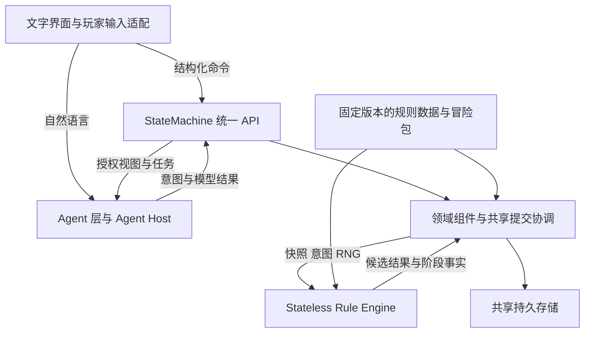

# Agentic TRPG 架构审查与组件接口契约草案

初始审查日期：2026-10-15。最新设计修订：2026-10-17，评审草案 v0.4。状态：供项目负责人评审的目标契约，不代表已经实现或已冻结新的跨仓库 ABI。

**v0.4 已确认的战斗认知决定：** 战斗内 NPC 按角色单回合（Turn）接收 Episode 聚合信号；战斗外 NPC 按整轮（Round）接收 Episode 聚合信号。机械 Event 不逐条生成认知信号，不为战斗认知另建逐动作感知证据链；既有范围与接收能力过滤继续适用。即时动作与反应由确定性 CombatPolicy、CombatHandler 和 RE 协作完成，认知通过已提交的策略参数影响后续决策。C07、C15～C18 与相关条款已同步更新；非战斗 Event 信号与独立阶段证据语义保留。NPC 使用按游戏时间限制的单一 Recent OB List；OB 只分 `pending`／`processed` 两种认知处理状态。每条新 OB 经 Cognition Gate 决定是否触发 EVA；不需要则标记 processed，但仍留在窗口内供后续 EVA 参考。触发则 pending，EVA 基于创建时冻结的近期 OB 快照及 Meta 评估。

本次仅更新设计契约；§1 与§13 的代码基线、实现状态及既有测试记录仍是 2026-10-15 审查快照，未因本次修订而重新验证或宣称新能力已实现。

建议保留当前 StateMachine、Rule Engine 与 Agent 层的总体分工，采用**进程内模块化游戏核心、显式组件组合、共享短事务、外部模型调用隔离**。持久存储是基础设施；领域模块拥有事实及写入责任，SQLite 提供物理持久化和原子提交。StateMachine 是统一 API 与组件装配入口，不应继续承担全部业务实现。

本轮应优先完成共同提交路径、状态归属及适配边界，不需要等待所有子系统功能完备，也不需要同时重构所有子系统。已经可修改同一事实的旧入口必须纳入约束；尚未接入的功能保持明确 unsupported。

## 1 审查基线与证据范围

| 对象 | 固定基线 | 本报告使用范围 |
|---|---|---|
| 顶层文档 main | `f9787e7b7742051d3f9d2fe63c774ac9db02c6e7` | MVP_SCOPE、MODULE_CONTRACTS v0.15、STATE_MACHINE_ARCHITECTURE、AGENT_ARCHITECTURE、WORLD_SUBSYSTEM_DESIGN、演进计划 |
| StateMachine main | `a8e7a6293b800a15256fa81971f43b1ee0d60553` | 已合并 World W1～W8；2026-10-15 19:32 后重新核对 |
| World W1～W8 源提交 | `52f89b9e2448c12b3a7e011e88b3e78c509cfd4e`，`feat/world-w1-w8` | 已合并；与最新 main 比较无文件差异，代码树完全相同 |
| SM 实际固定的 RE/SRD 依赖 | `675552406e67470bf3456fe90e88c4f1595bf324` | Evaluation `/23`、Snapshot `/17`、Availability `/13`；不能把 RE 新能力算作 SM 已接通 |
| RE main | `e5254a2ac7166a830a24c46eb35b2b1e0c4f4b80` | Evaluation `/24`、Evaluator `/37`、StageFacts `/2`，含 R34～R37 |
| RE 最新相关未合并分支 | `9b34b8dbf5cbc7f9df5bea03e075e27b5e9802cc`，`feat/re-r38-r41-effect-composition` | 核对 `/25`、Evaluator `/41` 及有限 Hold Person／Shield 组合的边界；不将其视为已合并或完成全部审阅 |
| Agent Host | 在本次可访问的组织仓库中未发现独立实现仓库 | 依据最新目标文档和 SM 的真实 JEV／EVA／视图接口拟定；不宣称完整 Host 已实现 |
| Evennia 运行仓库 | 组织中存在 `trpg-evennia-runtime`，检索元数据 size 为 0 | 不能据仓库名称推定已完成框架替换或集成 |

未推送的本地分支或工作区，包括此前讨论的 GC5，不属于本次代码证据。First Blush 原文未用于本轮研究，报告不推测其具体场景内容。

前一份草案记录的 World 复核结果为：新增相关测试 42 通过、3 项跨平台子进程路径失败；相关回归 263 通过；Ruff、格式检查及 diff 检查通过，全量收集 1259 项。上述为前次记录，本轮没有复跑这些测试。本轮重新核实远端分支 SHA、顶层规范、装配／提交／适配／阶段事实／NPC 模式与输出代码；结论属于架构及契约评审，不是合并验收。

## 2 产品目标与规则对架构的约束

产品基线是单玩家、单 PC、文字优先、没有常驻 AI 队友的完整冒险；NPC 保有独立认知、私有信息和宏观自主性。即时战术与规则反应不能等待认知 LLM。支持的机制必须能留下持久后果，并被后续世界互动、感知或规则消费。

规则基线固定为 D&D 2024 修订体系：PHB 2024、DMG 2024、MM 2025、SRD 5.2.1。本轮可直接核查的主要规则材料是官方 SRD 5.2.1 与官方 2024 Basic Rules；没有逐页核对三本商业规则书全文。它们提供游戏语义，下面的组件划分、字段名和事务协议是工程设计。

| 可核查的规则／产品特征 | 架构含义 |
|---|---|
| 社交、探索、战斗共享角色与世界，情境决定是否需要检定 | 不创建探索／战斗两份位置、HP 或物品所有权；普通世界操作可以确定性执行 |
| 时间受限时，物体互动有相应的回合与动作约束 | World 执行对象变化，Combat 与 RE 处理时机和支付；战斗接入不能只增加一个扣资源调用 |
| 专注和其他持续效果有各自结束条件 | 效果实例及生命周期跨操作保存；结束战斗不是删除全部效果的条件 |
| 休息、长耗时行为与旅行涉及时间和中断 | Activity 记录活动进度，统一世界时钟提供时间，RE 计算适用的恢复／中断规则 |
| 光照、感官与遮挡参与判断 | World 提供环境，Character／Effects 提供角色状态；机械规则仍使用其完整依赖。非战斗感知使用事件阶段证据，战斗感知使用 C15 的 Episode 级粗粒度过滤依据；可见性不等于 NPC 已察觉或相信 |
| 规则存在特例与组合 | 规则留在固定版本的 RE 与规则数据中，不能按每扇门、每个法术分别扩散 Handler 特例 |
| NPC 自主性和错误信念 | 世界事实、授权观察、主观 Belief 分开；LLM 不直接改骰点、HP、任务资格或世界事实 |

规则来源：[官方 SRD 及版本说明](https://www.dndbeyond.com/srd)、[SRD 5.2.1 PDF](https://media.dndbeyond.com/compendium-images/srd/5.2/SRD_CC_v5.2.1.pdf)（Playing the Game、Rules Glossary）、[2024 Playing the Game](https://www.dndbeyond.com/sources/dnd/br-2024/playing-the-game)、[2024 Rules Glossary](https://www.dndbeyond.com/sources/dnd/br-2024/rules-glossary)。

## 3 总体框架

### 3.1 建议采用的分层



这些是逻辑边界，不要求对应独立服务、独立数据库或相同数量的仓库。

| 部分 | 负责什么 | 权威边界 |
|---|---|---|
| Agent 角色 | Planner 理解情境和提议；Narrator 叙述授权已提交事实；NPC Agent 提议认知／宏观行动；JEV 完成受限判断 | 输出都需要对应接口验证；Narrator 没有写权限 |
| Agent Host | 模型调用、上下文、预算、工具传输、有限重试和诊断日志 | 可以持久保存调用日志；日志、缓存和 Context 不成为游戏事实来源 |
| StateMachine／游戏核心 | 入口、领域操作、流程协调、授权、事务、恢复和可靠工作 | 每项游戏事实由内部明确领域拥有，通过共享提交落盘 |
| Rule Engine | 对完整显式输入做规则计算，返回候选变化、事件、RNG 后继及适用阶段数据 | 不写 SM 数据库，不长期持有独立战斗权威状态；accepted 不等于 committed |
| 持久化 | SQLite WAL、迁移、事务、约束、快照备份和可靠记录 | 不选择游戏结果、不决定规则、不持有第二套领域逻辑 |
| 内容与定义 | 固定版本规则资产、Adventure Package、经过验证的配置 | 定义与实例状态分开；运行中改变对象不能偷偷改模板 |

**技术建议：** 沿用 Python、现有类型模型、SQLite WAL 和进程内接口；采用显式组合与窄接口。网络／MCP／HTTP 只是外部适配器。读模型可以按权限单独构建，当前事实仍按状态持久化，事件用于审计、观察与可靠交接；不要求先改成完整 Event Sourcing。

SQLite WAL 支持读写并行，但同一数据库同时只有一个写者；共享事务要求本地、同一数据库边界。因而将 LLM／长时间 RE 求值放到写事务外，比把每个领域拆成网络服务更符合当前规模。[SQLite WAL](https://sqlite.org/wal.html)、[事务语义](https://sqlite.org/lang_transaction.html)。

### 3.2 框架选择与取舍

| 方案 | 本项目建议 | 原因 |
|---|---|---|
| 显式组合的模块化单体 | 采用 | 复用已有正确性资产，同时让状态所有者、依赖和提交边界可检查 |
| 对象按能力组合 | 采用 | 开合、锁、容器、耐久、空间、光源可以组合，避免对象类型继承树不断增长 |
| 完整 ECS | 暂不作为前置 | 当前主要难点是状态归属、规则适配和可靠交接；有性能或批处理证据时再采用相关机制 |
| 微服务／每领域独立数据库 | 当前不采用 | 一次互动常跨多个领域，会引入当前并不需要的分布式一致性问题 |
| Evennia 等整体框架替换 | 保留可选研究 | 必须证明原生复用收益和单一状态权威的迁移方案；当前没有足以支持整体替换的集成证据 |
| 完全重写现有 SM／RE | 不建议 | 已有事务、幂等、权限、库存、NPC 生命周期和规则求值值得保留；采用逐边界迁移 |

Evennia 的 Typeclass 机制把类型行为与数据库模型结合，值得研究，但不是无成本的展示插件。[官方 Typeclasses 文档](https://www.evennia.com/docs/latest/Components/Typeclasses.html)。本报告不据此断言其他框架不可用。

## 4 StateMachine 的目标组件

### 4.1 领域子系统与按需扩展领域

逻辑子系统不强制有独立 Python 包或表。Facts／Records 是数据访问组件，Handler／Service 是业务组件；SQLite 才是实际存储。沿用此前 World、Combat、Activity、Event、Perception、Cognition、Session、Command 的职责划分；下表把 Character 与 Effects 的事实归属单独列明，§4.2 列出 Event、Command 等运行支持职责。这是明确职责层次，不要求为它们建立十几个独立服务。

| 子系统 | 权威内容与主要职责 | 当前实现 | 建议 |
|---|---|---|---|
| Session | 会话身份、玩家／Actor 控制关系、固定 Package／Ruleset 绑定、运行状态 | SessionAccess、创建／恢复接口 | 保留，缩减 service.py 中的装配外业务 |
| World | 场景、地形、对象实例、耐久、开合、锁、容器、物品实际位置、环境与世界时钟 | WorldHandler、WorldFacts、WorldObjectService 及能力服务 | 保留并补共同约束；避免形成新的超大 Handler |
| Character | Actor 身份关联、唯一实际位置、HP、基础机械属性、角色资源、装备绑定、当前机械状态 | CharacterFacts、mechanical_actors／components | 保留并按需拆组件；库存归属来自 World 投影 |
| Combat | 遭遇、参战关系、先攻／回合、决策边界、战斗计量与可靠推进 | CombatHandler、CombatRecords | 保留，移出通用非战斗检定协调；扩展必须有真实规则闭环 |
| Activity | 多步／长耗时活动、目标、步骤、执行游标、中断／取消／完成 | ActivityHandler／Records，当前主要是导航 | 保留；逐步承接休息、搜索、长施法等实际活动，不能预建空系统 |
| Effects | 持续效果实例、来源／目标、Condition 应用关系、专注关联、期限与应用进度 | 数据分散在角色机械组件和 RE CombatState 投影中；无完整独立服务 | 提取明确所有权及窄接口，先复用存储，不先扩写完整效果功能 |
| Perception／Observation | 候选发现、感官判定、授权观察、Inbox／Work、保留与处理进度 | 多个 Perception／Observation Runtime | 保留实际可靠语义，逐步显式组合；发展 EpisodeObservation |
| NPC Cognition | Personality／Memory／Belief／Relationship／Goal／Plan、认知版本、模式、Gate 与 EVA 资格 | npc_state／evaluation／results／modes／outputs | 保留；与模型 Runtime 分开，执行进度不要重复放在 Plan 中 |
| Quest／StoryProgress | 客观任务阶段、目标完成、奖励采用记录和剧本推进 | 场景 flags／Package 联动提供有限基础 | 按真实冒险需求增加；现阶段可在已有存储上建立窄边界，不建空任务平台 |

Session 是生命周期与身份子系统；NPC Cognition 是主观状态领域。NPC 自己的 Goal 不是客观 Quest。Scene 归 World，避免 Session、World 和 Combat 都可独立修改“当前场景”。

### 4.2 共享支持组件

| 支持组件 | 职责 |
|---|---|
| CommandCoordinator | 外部授权、分派、命令去重、准备／求值／提交协调、统一终结路径；不承接全部领域规则 |
| RulesAdapter／SnapshotBuilder／ResultApplier | 将各所有者事实组成完整 RE 输入；验证固定协议及结果；把封闭 Delta 分派回所有者 |
| SpatialQuery／Navigation | 查询客观几何／通行／位置；导航产生计划和步骤；不创建另一份当前位置 |
| WorldClock／Scheduler | 访问 World 唯一时钟、产生到期边界；持久业务进度仍由 Activity、Effects、Cognition 分别拥有 |
| EventCapture／EventPersistence／EpisodeRecorder | 非战斗阶段取证与事件身份、Episode 关联、战斗 Turn／Round 聚合及可靠发布；机械审计与认知信号分流，固定来源与采用的感知依据 |
| TriggerDispatcher | 执行受控 Package／机关／条件后果分支；不等于持续 Effects，不运行任意脚本 |
| AuthorizedQueries | GM／Player／Narrator／NPC 的受控投影，以及能力／可用性查询 |
| SqliteStore／UnitOfWork／Outbox | 同一事务、物理存储、回执及可靠工作；领域不自行 commit |

不要求为这些职责各创建一个空类。只有存在独立调用方、数据责任或测试需要时才拆文件／组件。显式内部调用优先于到处广播消息；异步事件适合已经提交后的感知、认知和展示。

### 4.3 必须明确的状态所有权

| 事实 | 唯一负责方 | 其他组件如何使用 |
|---|---|---|
| Actor 实际场景与位置 | Character | World／Combat／Navigation 引用同一位置；RE actor_zone 是快照投影 |
| 对象实际位置与父容器 | World | 从容器／携带者链解析有效位置；库存是投影 |
| 物品实例数量与充能 | World 物品实例组件为目标归属 | RE 提议消耗，World 应用；旧非便携机械条目逐步映射，不静默丢弃 |
| 角色装备／持握／调谐绑定 | Character | 引用真实实例；转移、消耗与解绑在同一操作中协调 |
| 角色 HP／法术位／特性资源 | Character | RE 计算，Combat／Activity 编排，其他领域受控读取 |
| Actor 当前动作／反应／移动预算 | Character 机械组件 | Combat 提供时机，RE 给出更新；避免另一份可修改预算 |
| 回合／先攻与移动计量记录 | Combat | 计量记录与预算是相关不同事实，RE 的同一结果共同更新；不另存位置 |
| 物体 HP／开合／锁／光源状态 | World | RE 或确定性对象操作产生变化；查询与感知消费 |
| 效果实例／来源／Condition 应用／专注关系 | Effects 为目标所有者 | Character 的有效 Conditions／专注引用是受控投影；先明确旧字段写入归属再迁移 |
| 固有免疫、感官和基本属性 | Character／固定定义 | Effects 的临时影响参与投影，不覆盖固有定义 |
| 活动执行游标 | Activity | NPC Plan 表达意图，不能自行推进执行游标 |
| 世界游戏时间 | WorldClock，经 WorldFacts 持久化 | 其他组件消费同一时间；不各建循环或可写时钟 |
| NPC 认知和有效 EVA | NPC Cognition | Host 读取授权输入、提交候选结果 |
| 察觉结果与观察保留／处理 | Perception／Observation 负责已察觉的 OB 及窗口保留；Cognition 负责 Gate 采用、`pending`／`processed` 转换与 EVA 覆盖 | Host 读过不改变状态；processed 仍可作为下一次 EVA 的历史上下文 |
| Event／Episode 来源及感知依据 | Event 负责记录／聚合；Combat 负责回合边界与参战关系；Perception 定义过滤策略 | 来源记录与机械提交关联；非战斗阶段证据和战斗 Episode 级依据分开，聚合发布只包含已提交来源 |
| 命令回执、RNG 权威状态、事件序号 | 共享提交设施 | RE 使用复制的 RNGContext；提交成功才采用后继 |
| 规则／Package 定义 | 固定版本内容仓库与 Loader | 不在运行中由 LLM 改写定义；新内容经验证后显式启用 |

RE DTO 中字段归入 CombatState 或 CharacterState，不决定它在 SM 内的所有权。例如 CombatState 中目前包含持续区域、效果时钟、物体和专注字段；SnapshotBuilder 应从各负责人投影它们，而不是因此把它们全部迁给 Combat。

## 5 历史实现的保留与调整

| 现有实现 | 判断 | 处理方式 |
|---|---|---|
| StateMachine 统一入口、现有 session／actor／object 身份 | 合理 | 保留外部身份与兼容入口 |
| SqliteStore 短事务、Facts 不 commit、幂等与版本检查 | 合理且已有实际价值 | 保留并覆盖所有提交路径 |
| World 能力组合和库存投影 | 合理 | 修复未知容量全局阻断；拓展真实消费方 |
| World／Character／Combat／Activity 显式装配 | 合理但未完成 | 继续按调用边界拆分，而非统一改名 |
| NPC／感知等大量 Mixin 与共享 `_conn` | 过渡实现 | 保留行为，逐步改为显式服务与所属存储访问；不一次重写 |
| 非战斗 Check 经 CombatHandler `_submit_dnd` | 职责混合 | 提取共享 RuleExecution／Commit 协调，Combat 只组织战斗流程 |
| 普通命令与检定结果各自收尾 | 已存在真实一致性缺口 | 统一必要提交不变量，所有来源都覆盖 |
| `CheckWorldEffects` 与 `PackageEffects` 命名 | 容易混淆持续 Effects | 内部按 ConditionalWorldConsequences／PackageTriggers 概念整理；外部旧字段通过版本兼容保留 |
| `mechanical_components` 同时保存库存、资源、施法、效果 | 可保留物理存储，所有权需明确 | 先分访问组件与字段写入责任；有必要时再迁表 |
| RE 专用的有限 Delta 白名单 | 当前必要防线 | 保留，逐能力扩展；不能直接替换为任意 JSON Patch |
| SyntheticEvaluator／MechanicalRuntime | 有测试价值 | 隔离为测试规则集和契约夹具，不能作为 D&D 功能的降级执行器 |
| Event-level OB 与可靠工作 | 当前可复用资产 | 建立到 EpisodeObservation 的明确兼容映射，不能删除历史或重复 EVA |
| 独立 Effects／完整 Episode／通用 Continuation | 不能根据文档名称认为已有 | 纳入目标能力表，按真实闭环建设 |

前次 World 复核记录了四项问题：检定后世界变化遗漏空间一致性检查；无关未知容器阻断取放；异步 World 支持声明与代码不符；三个恢复测试写死 Windows 路径分隔符。本轮静态核对再次确认普通命令与 `_submit_dnd` 收尾不同、async 入口限于三类 RE payload；其余复现结果沿用前次记录。本轮契约重点约束跨入口一致性与依赖范围，具体修复仍需针对性验收。

## 6 全部接口必须遵守的共同语义

1. **信任与数据分开。** principal／控制权限由可信适配层提供，模型 JSON 不携带可自行生效的权限。ID 或 source_ref 本身不是授权证明。
2. **事实只有一个写入负责人。** 其他组件通过负责人接口参与同一事务；共享数据库不表示可以任意写表。
3. **外部命令与内部变更分开。** 外部提交意图；内部可以传递经过验证的强类型变化，不重复包装公开命令，不递归开启事务。
4. **Schema、数据与求值器一起固定。** Package 摘要、ruleset_id、data_revision、evaluator_version 和消息版本均验证；旧版本不能靠补默认值装成新版本。
5. **读取无副作用。** Availability 不掷骰、不扣资源、不建立回执，也不保证稍后的执行必然成功；返回所依据版本。
6. **完整依赖先于裁剪。** RE 输入保留所支持规则需要的完整依赖；感知按 Signal 范围裁剪；不能拿感知裁剪规则构造机械快照。
7. **未知不等于零、false 或空集合。** 未知、未支持、不适用、已知为空分开表达；未知依赖只阻止需要该依赖的操作。
8. **幂等优先于重算。** `(session_id, command_id)` 相同内容返回旧回执；不同内容报冲突。创建 Session 用 `(principal_id, command_id)`。EVA 使用 evaluation_id，不另建 proposal_id。
9. **规则 accepted 不等于操作目标成功。** 合法未命中／检定失败可以 committed，并提交实际资源／时间／RNG；非法请求、未支持、版本冲突不产生这次动作的机械变化。
10. **事务内重验。** RE／模型等待不占写锁。提交前重验授权、任务资格、版本、依赖、原值、规则绑定及 RNG 输入；不将旧结果套在新状态上。
11. **一个不可分割操作一个原子提交。** 相关状态、投影、RNG、机械审计、适用事件／感知依据、触发记录、回执和可靠工作同成同败；后续 Episode 聚合、认知／行动是独立操作。跨命令的 Turn／Round 不能扩成一个长期事务。
12. **检查覆盖受影响依赖闭包。** 容器检查源／目标／祖先及相关内容；空间检查涉及区域和实体。全局结构完整性可以独立审计，不让无关未知字段阻断全部动作。
13. **感知精度按场景明确。** 非战斗事件证据在真实阶段捕获，不能统一用结束态替代。战斗主动采用 Turn／Round Episode 粗粒度感知，不要求逐机械 Event 的 Signal 或逐动作感知证据；按 C15 固定 Episode 的过滤依据，不声称重建逐动作视线。RE StageFacts 不是额外的状态写入指令。
14. **发布晚于提交。** 事务内记录 Outbox，提交后可靠投递。传输至少一次，消费方去重；不承诺网络恰好一次。
15. **恢复不补造事实。** 所选感知模型要求的历史依据缺失时保持缺口，不借当前状态回填；战斗模型本来不要求的逐动作感知证据不算缺失。活跃战斗若不能恢复受支持的机械状态及 Turn／Round 聚合进度，应明确暂停／不支持。
16. **版本化迁移。** 迁移显式检查来源版本、固定定义和可转换性；同一字段切换所有者时只有一个写路径，不长期双写两个权威。

建议补充冻结的版本语义：普通游戏命令只要提交游戏事实、活动／战斗进度或正式外显事件，world_version 每次提交递增一次；真正无变化且无事件的幂等 no-op 可保持不变。纯 NPC Meta 用 npc_state_version，投递游标／处理标记不用 world_version。event_seq 仅排序已提交事件。RNG 沿用当前 `version += int(state_changed)`，无随机消耗不制造掷骰。以上应通过兼容测试后落实，不在旧协议中静默改义。

## 7 对外接口契约

以下方法名是推荐的逻辑接口；已有方法能承担职责时应复用。新增字段／方法不是当前代码的完成声明。具体 wire schema 由实现方在下列语义下冻结，不另造一套与 RE `/23`～`/25` 并列竞争的规则协议。

### C01 玩家输入适配与 Agent 角色

**输入：** `session_id`、可信 player 身份、输入渠道类型、文本或结构化操作、可选客户端关联 ID。

来自授权 UI 的结构化操作经类型验证后直接进入 SM；自由文本进入 Planner。不能仅因用户文本“看起来像 JSON”就授予系统输入身份，也不需要额外 JEV Router。

**输出：** 合法 TypedCommand 候选、需补充的玩家选择、或叙事回复候选。Planner 可提出规则／Package 未固定情境的能力、技能、DC 及后果，必须在掷骰前固定并记录来源；不能提供最终骰点或任意 HP 覆盖。

NPC 宏观选择来自 NPC Agent；Planner 协调合法执行，不因剧情需要替它更换动机。Narrator 只消费已提交的 PlayerView／授权结果，不读取 GMView 或其他 NPC 私有认知。

### C02 Host／UI → StateMachine 命令与回执

```python
submit_command(command: TypedCommand, *, context: TrustedContext) -> CommandReceipt
get_command_receipt(session_id, command_id, *, context) -> CommandReceipt | None
```

实际 Python 接口当前还显式传入 package；目标可保留该参数，但必须验证它等于 Session 固定绑定，不能由调用者替换配置。

| 类型 | 必要内容 |
|---|---|
| TypedCommand | `schema_version`、`session_id`、`command_id`、`command_type`、`expected_world_version`、按操作联合定义的 `payload`；Actor 行动有真实 `actor_id` |
| TrustedContext | 适配层认证的 principal、Session／玩家关联、可控制 Actor 与受限权限；不信任模型自报 |
| CommandReceipt 目标 | session／command 关联、`status`、前后 world_version、事件引用、结构化 error、适用的 RNG 后继版本／选择引用 |
| 当前 CommandReceipt | `session_id`、`command_id`、`actor_id`、`status`、`world_version`、`event_seqs`、`error_code`；增加目标字段必须版本化 |

状态映射：规则 accepted 经成功提交为 committed；rejected／unsupported 为 rejected 并保留原因；过期输入为 conflict。只有真正实现选择协议时才返回 pending_choice；当前不支持的选择不得伪装为可恢复窗口。

公开世界指令、NPC 交接、规则后果、机关和系统触发都必须最终满足相同领域与提交约束。可信系统操作未来可有独立强类型无 Actor 分支，但不能伪造环境 Actor，也不能把现有 actor_id 全局改成无条件 Optional。

**同步／异步：** 目标可以有两种调用方式，但必须共用操作集合、授权和提交语义。当前 async 只支持特定 RE 路径；在实现统一分派前应明确声明此差异。

### C03 授权查询与能力查询

```python
get_scene_view(session_id, *, context) -> AuthorizedSceneView
get_object(session_id, actor_id, object_id, *, context) -> AuthorizedObjectView
query_world_action(session_id, actor_id, operation, *, context) -> Availability
query_action_availability(session_id, actor_id, payload, *, context) -> Availability
```

视图包含 Session／Actor 范围、`view_world_version`、允许字段及完整性／未知状态。GMView、PlayerView、NarratorView、NPCView 分开；不存在一个全量 Session JSON 让模型自行过滤。

Availability 返回 `available | unavailable | unknown` 及受控原因；unsupported 能力应与当前状态下不允许区分。内部具体原因可能涉及秘密，外部原因须按授权投影。查询只说明该快照下可执行性，不预留资源或保证执行。

新增一个轻量的 **CapabilityManifest** 逻辑查询：固定规则／数据／Package 绑定、已支持命令、可接收 Delta 家族、支持的规则 profile、非战斗阶段证据／战斗 Episode 聚合能力、恢复能力。它可以由已有允许列表派生，不必建新数据库。跨模块可用能力取 RE、Adapter、领域写入与所选感知模型必要依据／恢复能力的交集；schema 能解析不等于运行支持。

### C04 Package／规则内容 → Session 与领域初始化

**Package 输入：** schema、adventure_id、package_version、package_digest、ruleset_binding、场景／对象／PC 模板／NPC／通路／触发等受支持定义。

**创建输入：** command_id、选定 Package 身份与摘要、玩家及所选 PC 模板、显式允许的创建参数。创建前校验引用闭包、能力配置、初值、单玩家单 PC 限制与依赖版本。

**创建输出：** 稳定 session_id、实际 PC／玩家关联、固定绑定、初始版本与创建回执。同一创建键重试返回同一结果。

一次事务初始化所属 Facts／Records 与必要初始可靠工作。旧 Package 缺少新能力不能自动获得能力。Homebrew／扩展计入有效 data_revision；不能只记录一个不含实际配置的名称。

### C05 StateMachine → Rule Engine 求值

复用真实 `RuleEvaluationRequest` 语义：

| 字段 | 契约 |
|---|---|
| schema_version | Adapter 与固定 RE 明确共同支持的版本 |
| session_id／command_id | 与原命令关联，不另造第二个规则命令身份 |
| operation_kind／actor_id／payload | 封闭强类型联合，与操作身份匹配；不以自然语言执行规则 |
| state_snapshot | CombatSnapshot 或 NonCombatSnapshot；包含操作所需完整角色、资源、物品、效果、空间与流程依赖 |
| ruleset_binding | ruleset_id、data_revision、evaluator_version，来自固定 Session 配置 |
| rng_context | stream_id、version、显式可恢复 state；与 Snapshot 分离 |

RE 无数据库访问、回调权限或跨请求权威缓存。Snapshot 是分离的输入副本；临时计算状态与本次事件缓冲合法，但不能成为另一个长期世界。

**适配隔离：** World／Character 不直接以 RE Snapshot JSON 作为可独立写入的领域事实。SnapshotBuilder 负责字段投影与单位转换；缺失必需字段时返回明确缺口，不能填造空效果、零库存或默认坐标。

### C06 Rule Engine → StateMachine 结果与状态应用

| 字段 | 契约 |
|---|---|
| schema_version、session_id、command_id、input_world_version、input_ruleset_binding | 必须绑定原请求 |
| status | accepted／rejected／needs_choice／unsupported；传输／Schema／运行异常另报 |
| read_set | RE 读取依赖及版本；SM 另记录自己组装机械快照及适用感知输入的依赖，不为战斗粗粒度感知额外扩成逐阶段观察者全集 |
| state_delta | 封闭的类型化操作集合，含必要预期原值；禁止任意字段路径或整份世界覆盖 |
| proposed_events | 本次有序规则事件，无权威 event_id；可能只是机械审计 |
| rng_transition | 显式绑定输入流、输入版本与状态及 next_state；成功提交后采用 |
| stage_facts | `/24` 及后续结果的阶段覆盖数据，complete 或明确 uncovered；旧 `/23` 不具备相同字段契约 |
| choice／error | 按状态联合约束，不同时伪造 accepted 变化和拒绝结果 |

SM 必须严格反序列化、验证结果与原请求关联，并在事务中校验原值和依赖。不能仅因类型合法便允许未审计 Delta。阶段数据可用于机械审计、适用的非战斗取证或 Episode 内容来源，不再次应用 HP、资源或位置，也不自动触发 Signal／OB／JEV／EVA。

**Delta 负责人映射：** actor HP／资源／装备／预算交 Character；位置仍交 Character，并使用 World 几何约束；物品实际归属／数量／充能和物体变化交 World；turn／ledger／参战进度交 Combat；effect／专注／应用关系交 Effects；活动执行状态交 Activity。跨域复合 Delta 先验证完整组，再共同应用，不能拆成多次提交。

当前 SM 的真实 `_apply_dnd_changes` 仅覆盖受限 actor、combat、ledger、XP 路径；上述完整映射是目标，不能删除现有限制后声称通用结果应用已经完成。

### C07 确定性战斗策略、认知参数与选择窗口

CombatPolicy 是确定性的即时战术决策组件。它接收 `combat_id`、决策 Actor、版本、授权机械可知视图、已提交认知的受限策略参数及有界选择预算，返回 TypedIntent、受支持的 Reaction 选择或明确无可行动／等待结果。策略参数可以表达对玩家／势力的关系立场、获准目标与战斗意图；具体字段在有消费者时冻结。Policy 不读取完整 NPC 私有 Meta 或玩家秘密，不调用认知 LLM，不生成伤害、骰点等机械结果。

NPC Cognition 负责主观关系和目标，向 CombatPolicy 提供受控、带来源版本的参数投影；投影不成为第二份可独立修改的认知权威。机械状态仍随实际动作更新。当前 Turn 内的反应使用当时已生效的策略参数；该 Turn 引起的认知变化，只有在认知结果提交后才影响后续决策，不追溯修改已执行反应。

CombatHandler 组织 `initialize → await_decision → evaluate/commit → next_boundary → close`，协调 Policy／玩家选择、RE 求值和共同提交，实际状态名称可沿用现有代码。一次行动不自动结束 Turn；没有合法进展时退出而非无限重试。Turn／Round 完成时通过 C15 关闭相应 Episode、建立可靠感知工作；不在每个机械 Event 后启动认知管线。

例如友善 NPC 被玩家攻击：玩家 Turn 完成 → Turn Episode 聚合信号 → 过滤／察觉形成 OB → 按资格启动 EVA → 提交关系／目标更新 → 刷新策略参数 → NPC 后续 Turn 决策。采用认知判断时，不另加“受到攻击即无条件敌对”的并行关系写入路径。如果获准的关键认知任务必须影响该 NPC 紧接着的 Turn，则在其决策边界等待有效提交；等待释放数据库事务，失败或超时走明确恢复流程，不能暗中改成强制敌对或宣称任务已完成。普通 OB 不要求每个 NPC 每个 Turn 都运行 EVA。

即时 Reaction 由 CombatPolicy 根据已有参数与当前机械视图选择，CombatHandler／RE 验证并执行，不等待当前 Turn 的 OB 或认知 LLM。预先声明的 Reaction profile 与通用中途暂停选择是不同能力。后者未来必须有持久选择窗口：所属 command／combat、获准选择者、阶段／窗口序号、合法选项、输入版本、已提交前缀或未提交候选的明确状态、取消与恢复策略。公开响应使用新的幂等命令引用该窗口；仅系统拥有 continuation 数据。未完成该协议时保持 unsupported，不序列化 Python 栈或在事务中等待人／LLM。

## 8 内部领域协作契约

### C08 共享准备与提交

推荐内部形状如下；它是职责示意，不要求创建完整通用工作流框架：

```python
prepared = handler.prepare(read_scope, command, authorization)
result = await rules.evaluate(prepared.request) if prepared.needs_rules else None
with store.transaction(write=True) as uow:
    coordinator.recheck(prepared, result, authorization)
    applied = handler.apply(uow, prepared, result)
    coordinator.finalize(uow, applied)
return applied.receipt
```

`prepare` 对完整受支持输入做检查并记下依赖；不产生权威变化。纯世界操作可在同一短事务内直接准备并应用。`apply` 可以调用多个所属组件；非战斗阶段取证发生在实际变化阶段，战斗只保留规则执行／恢复与 Episode 内容所需的已提交记录，不要求逐动作感知证据。`finalize` 统一检查必要不变量、维护投影、按需分配正式事件身份、持久回执／RNG／可靠工作；战斗机械记录不自动产生感知信号。

**ApplyContext 最小语义：** 当前有效 UnitOfWork、session、命令关联、可信操作来源、适用授权、绑定与预期版本、适用记录通道（非战斗阶段取证或战斗审计／Episode 来源）、受影响实体／关系集合。它由运行层创建，不来自模型 JSON；出了事务不可复用。

领域返回受影响实体／关系、变化与事件阶段关联、需要更新的投影等类型化结果。不能返回任意 SQL／脚本。共同校验由所属领域提供，不在提交协调器里重写规则公式。

所有可写入口都应经过这一最终边界，包括普通 World、RE 结果、检定条件后果、机关、Package 联动、Activity 步骤、NPC 交接和系统时间推进。不同来源保留不同的操作资格：例如远程机关不是玩家伸手开门，但它也不能任意绕过锁具、目标范围和空间约束。

### C09 World 操作与空间查询

**查询：** ObjectView、Placement、ResolvedPosition、Contents、PassageState、SpatialProjection、Illumination，均带适用版本／已知性。

**写操作：** 已支持的开合、门闩、锁、取放、对象移动、灯光、机关及内部耐久结果应用。参数引用真实对象／物品／凭据身份，操作来源由 ApplyContext 提供。

World 验证对象能力、可达范围／操作侧、当前状态、包含关系、访问与容量、占地，以及相应引用。位置必须唯一，父关系不得成环。未知重量／容量只阻止依赖该信息的相应操作；移出未知容器也不能被无关容量检查永久锁死。

SpatialProjection 分别提供移动阻挡、视觉遮挡、掩护依据和光照；不能由 blocks_movement 推断另外三者。查询应包含 schema／坐标单位、scene、版本和明确未知部分。与规则相关的移动／碰撞特例由 RE 求值；World 的通用检查不能反过来禁止已支持规则中的合法特殊移动。

### C10 Character 与 World 物品／位置协作

Character 接收已验证的 PositionChange、HPChange、ResourceChange、EquipmentBindingChange 或适用封闭机械更新，保留 expected 值与 source 关联。不能对任意调用方开放“设置 HP”“消耗资源”的绕过入口。

普通探索移动由 Navigation／World 校验通路后调用同一位置写入接口；战斗移动由 RE 决定规则后调用它。二者共享坐标，不共享不适用的资源结算步骤。

物品转移必须共同处理：World 实际位置、实例状态、Character 装备／施法材料等绑定、库存投影与相关约束。不支持安全解绑时明确拒绝，不用清空全部装备或重置充能解决冲突。

### C11 Activity 与 World／Character／RE

ActivityRecord 最小语义：activity_id、actor／session、类型、目标引用、已接受计划／步骤、cursor、status、activity_version、开始／最近命令关联、中断原因及必要时间边界。计划位置只是预期，不是角色当前位置。

每步重新验证当前事实，调用对应领域操作并与游标推进共同提交。导航路径失效可 blocked／replan，不能执行旧路径直接穿过变化后的障碍。取消只取消未来步骤，不撤销已经提交的移动。

休息、搜索、制作、长施法只有在有实际消费者时扩展。Activity 负责“做了多久、是否中断”；RE 负责适用规则；持续法术的施法活动与施法完成后的 Effect 分别管理，不保存两份相同进度。

### C12 Effects 与规则／角色／世界

目标 EffectRecord 至少表达稳定完整身份、definition／ruleset 引用、source／caster、target、应用来源、生命周期状态、持续规则、所用时间域、已处理边界／去重记录、适用空间锚点，以及专注／Condition 应用关联。并非所有效果都需要所有字段，应按类型区分。

当前 RE 的效果身份依赖 `(target_id, id, origin)`；适配时必须保留完整身份及来源关系，不能只按法术名删除所有效果。

Effects 提供 `read_applicable`、`read_lifecycle_dependencies`、`apply_verified_lifecycle` 等窄接口。RE 计算建立、续期、豁免、结束和连锁；Effects 验证身份／引用与生命周期原值并持久化结果。World 负责空间实体与锚定位置，Effects 提供临时影响，空间查询组合读取。

Condition 多来源、专注结束、效果取消和区域移除需共同维护引用闭包。不要把同一 Condition 的来源抹掉后，在取消一个来源时错误清除其他来源。结束战斗／切换场景只触发适用规则，不默认全删效果。

第一阶段只给现有 effects_json 与相关记录建立明确访问边界；尚未支持的规则生命周期保持 unsupported。不能为了接口完整而在 World 写一份效果期限或复制 RE 的规则。

### C13 世界时间与调度

沿用唯一 game_tick；新增 TimeBinding 明确单位／精度和版本后再增加持续时间消费。当前 tick 编码不能未经迁移就改称秒。目标可选择整数秒作为基础尺度，但每种规则期限还需声明 world_time、turn_start、turn_end 等时间域。

输入：expected_tick、目标 tick／获准的时间推进量、来源命令、推进原因及适用流程上下文。输出：实际推进、到达的有界边界、已创建可靠工作和未完成边界。

一次大跨度推进必须按需要处理的确定性边界排序。若需要 RE、选择或外部等待，就在合法边界结束本次提交并保存继续所需进度，不能先跳到终点再异步补完本应影响中间结果的伤害／中断。

战斗内外共享世界时间：一整个 Round 约六个游戏秒，包含各 Actor 的 Turn；实际执行可能耗费几十秒或更久的墙钟时间。只有 TimeBinding 明确 `1 game_tick = 1 秒` 时，一轮才约为六个 tick。不能每个 Actor 的 Turn 都重复增加一整轮时长；同一生命周期边界只处理一次。Host 墙钟用于超时与性能，世界时间用于活动、燃料和观察生命周期。C15 的 Turn／Round 区分是认知交付粒度，不创建不同流速的世界时钟。

NPC 的认知评估调度归 Cognition；角色在世界里执行日程归 Activity／World。二者可以消费同一游戏时钟，但不是同一种任务。

### C14 条件后果／Package 触发／机关

声明最小内容：稳定定义／来源引用、受支持 trigger、前置条件、目标范围、白名单操作序列、一次性／重复策略和采用记录。

`CheckWorldEffects` 是预先声明的成功／失败世界后果，RE 只提供检定结果；`PackageEffects` 是剧本联动。建议内部使用不同名称，避免与持续 Effects 混同。

选中分支后通过相同 World 操作与共享提交执行。触发去重记录必须与结果共同提交；失败回滚不能留下“已经触发”的标记。禁止任意脚本、隐式新规则和无限事件级联；保留有界执行与明确超限错误。

如果规则需要“失败也消耗动作／时间”，由获准规则结果和后果定义共同表达，不能把事务错误解释成一次已执行失败的尝试。

## 9 事件 感知 认知与 Host 契约

### C15 事件、战斗聚合信号与 Episodic Observation

**目标：机械计算可以细，认知输入必须有界聚合。** 非战斗沿用 Event 产生 Signal、按实际察觉组成 Episodic OB 的机制。战斗改为 Episode 产生聚合 Signal：参与该战斗的 NPC 按角色 Turn 接收，未参与该战斗的 NPC 按 Round 接收。机械 Event 不逐条生成认知信号，不逐条触发候选判断、OB、JEV、Gate 或 EVA。

Turn 是一个角色的单回合，可以包含移动、多次动作及期间发生的 Reaction；一次 action／attack 不等于一个 Turn。Round 是所有参战者轮流行动的一整轮。整场战斗用 `combat_id` 关联，不再强制“一场战斗只有一个 CombatEpisode”。以下数据名是逻辑职责与字段语义，不要求同名类、独立表或新的服务。

| 数据 | 最小内容与语义 |
|---|---|
| MechanicalAudit | 原请求／结果、固定绑定、RNG 关联及规则执行／恢复所需步骤；与已提交机械变化关联，不直接投影为认知信号 |
| StagedOccurrence | 非战斗的来源命令、阶段、时间／空间、事件类型、受限 payload、Signals 与取证依据；尚无权威 event_seq。战斗机械 Event 不要求逐条转换成此记录 |
| Signal | 稳定 signal_id、类型化来源（非战斗 event 或战斗 episode）、channel、授权内容、类型化 scope／origin；机械作用范围与感知范围分开 |
| Evidence | 非战斗采用不可变阶段证据；战斗采用与 Episode／聚合策略绑定的过滤依据、所需范围与接收能力输入、版本及完整性状态，不要求逐动作视线快照 |
| CommittedWorldEvent | session、event_id／seq、source_command、world_version、发生时间、事件数据及适用 Signals／Evidence 引用；不是每条战斗机械记录的强制包装 |
| WorldEpisode | episode_id、类型、起止／状态、已提交来源引用及必要的真实顺序；可跨多个提交，不承担跨命令回滚 |
| Turn Episode | session／combat、稳定 Turn 身份与所属 Round、行动 Actor、关闭状态、已提交行为／结果来源、聚合信号与过滤依据；包含该 Turn 期间发生的反应 |
| Round Episode | session／combat、稳定 Round 身份、关闭状态、本轮已提交 Turn／机械记录来源、面向战斗外的聚合信号与过滤依据；复用来源，不拼接 NPC 私人 OB |
| EpisodeObservation | observer、episode、适用 revision／来源覆盖、实际察觉的聚合 signal 引用、授权内容、完整性与 retention；收到来源引用不等于得知完整 Episode |

**信号生成与交付边界：**

| 情境 | 信号来源与处理粒度 | 正常形成／交付时机 |
|---|---|---|
| 非战斗 | Event Signals，依据各事件的独立阶段证据形成 Episodic OB | 沿用既有非战斗 Episode 流程 |
| 已参与该 combat 的 NPC | 一个 Turn Episode 的聚合信号 | 该角色 Turn 完成后形成，供后续决策／认知处理；不按内部机械 Event 增量交付 |
| 未参与该 combat 的 NPC | 一个 Round Episode 的聚合信号 | 整轮结束后形成；战斗提前结束时关闭并发布最后一个未满轮的汇总 |

1. **主动采用粗粒度战斗感知。** 聚合器按已提交行为和结果概括“该 Turn／Round 发生了什么”，按受支持感官通道形成有界信号。保留规则、审计、恢复与内容来源所需记录即可；不另建逐动作感知证据链，也不要求补齐每个阶段的旁观者、光照或遮挡快照。RE StageFacts 可作为已有来源，不能因缺少逐动作感知资料而否定本模型，或在审计中重新要求逐 Event 生成信号。
2. **既有过滤继续有效。** Episode 聚合信号仍经范围与 NPC 接收能力过滤；模型不把所有参战者视为全知。聚合策略需要明确基本 scope／origin 的来源、授权内容表达和所需过滤输入，并绑定到可重试的 Episode 版本；具体范围算法在实现时冻结，不在本基线中伪装成逐动作精确感知。收到听觉信号不自动获得完整视觉事实、隐形目标或玩家秘密。
3. **按具体战斗的参与关系路由。** 对同一 combat，参与者接收 Turn 来源，非参与者接收 Round 来源。NPC 即使处于另一场战斗，对本场仍是外部观察者；不能只检查全局 `in_combat`。路由依据与来源覆盖需要固定，重试不得按最新参战状态重新解释旧投影。中途加入／退出的切换边界和去重覆盖须在实现时明确，不以双发 Turn 与 Round 的方式重复处理同一经历；本次未验证旧代码是否已有该能力。
4. **按 Episode 合批判断。** 同一 NPC、同一 Episode 的待判断感官信号作为一个逻辑批次，不按其中的机械 Event 拆分 JEV／Gate／EVA。确定性过滤能完成的判断无需模型。每个实际察觉到内容的 NPC 得到自己的 OB；没有察觉不创建空 OB。每个新 OB 进入单一 Recent OB List 后由 Cognition Gate 判断是否需要 EVA：不需要则 `processed`，需要则 `pending` 并依有效任务资格调度。OB 形成不自动启动 EVA，多个 pending OB 可被后续同一获准任务覆盖；processed OB 在游戏时间窗口内仍参与后续 EVA 的上下文推理。
5. **聚合与机械提交分开。** 只汇总已提交来源；未提交或回滚候选不进入 Episode 内容。Turn／Round 跨多个命令时，机械操作仍分别短事务提交；边界关闭、聚合完成及可靠工作必须有持久幂等身份，可在中断后恢复。Round 引用同一批已提交来源，不再次结算机械结果；不为提高“原子性”把整轮放入长事务。
6. **Reaction 不依赖 OB。** 当前 Turn 内反应由确定性 CombatPolicy、CombatHandler 与 RE 根据已有策略参数和当前机械事实处理，不等待本 Turn 的认知判断。Cognition 采用聚合 OB 后提交的新参数在后续决策中生效；关键任务需影响 NPC 下一 Turn 时按 C07 保存等待边界。
7. **非战斗与旧数据迁移保留。** 非战斗每个 Event 的阶段证据仍独立保存；历史 Event-level OB 与处理进度保留。先建立稳定来源／处理覆盖映射，再切换战斗消费入口并停止相同范围的旧逐 Event 感知任务。历史缺少所选协议必需的来源信息时标注缺口，不补造；不得在聚合或战后总结时重复创建 Meta／Action。非战斗确有增量观察时继续按 episode／observer／revision 或等价覆盖去重，不将其扩展为战斗的逐动作交付要求。

一整场战斗的长期记忆可以由 NPC Cognition 在获准 EVA 中结合本次触发 OB 与窗口内已处理的 Turn／Round OB 汇总形成；这不要求再发布一个包含全部战斗真相的总 OB。

### C16 Perception → Host JEV → Perception

流程：按 C15 选择事件／Episode 来源与接收者路由 → 按 Signal scope 和接收能力过滤 → 固定所选模型必需的依据 → 确定性判断 → 仅将受支持不确定判断交给 Host → 验证结果 → 保存察觉结果／观察／工作。非战斗使用事件阶段证据；战斗使用 Turn／Round Episode 级过滤输入，不重建逐机械 Event 的感知管线。

**JudgmentRequest：** observer、带类型的来源引用（非战斗事件／阶段，或战斗 combat／episode／Turn／Round）、待判断 signal_id 集合、授权 Signals、所需感知依据、模型／输入版本关联。战斗中同一 NPC 对一个 Episode 的多通道信号作为同一逻辑判断批次，不按内部 Event 拆请求。不能把所有 GM payload、完整机械日志或其他 NPC Meta 给 JEV，也不能伪造 event_id 来包装 Episode 来源。

**JudgmentResult：** 请求内每个 signal_id 恰好一次的判断；未请求 ID、缺漏、重复、格式错误或超时不能变成 false。JEV 只判断受限察觉问题，不生成世界状态、机械豁免或 NPC Memory。

所选感知模型必需的过滤输入缺失时维持 unresolved，不能用 LLM 猜缺失位置／接收能力。战斗模型没有要求的逐动作感知证据不算缺失；不能据此强制回退到逐 Event 取证。涉及攻击／Reaction 资格的机械判定来自可信规则路径，不依赖主观 JEV 解锁机械动作。

按观察者维护投影完成水位，不能越过该观察者较早的未完成候选；其他 NPC 的未完成工作不必阻塞所有人。没有察觉也要可靠记录判断完成，不创建空 OB 冒充观察。

### C17 NPC Cognition → Host EVA → Cognition

```python
create_npc_evaluation_task(...) -> NPCEvaluationTask
get_npc_evaluation_task(evaluation_id, *, context) -> NPCEvaluationInput
submit_npc_evaluation_result(evaluation_id, result, *, context) -> EvaluationReceipt
get_npc_evaluation_receipt(evaluation_id, *, context) -> EvaluationReceipt | None
```

| 数据 | 契约 |
|---|---|
| Task | evaluation_id、所属 Session／NPC、mode、reason、expected_npc_state_version、固定本次待处理 pending OB／Work 覆盖、冻结的 Recent OB 输入快照引用／版本、状态与有界预算 |
| Input | Task、完整授权 Meta、原始任务证据、创建任务时冻结的完整有界 Recent OB List（包括 processed 与本任务覆盖的 pending）、适用玩家输入／当前授权视图；明确哪些 OB 是本次处理对象、哪些只是历史上下文，恢复输入标明证据已过期 |
| Result | dialogue、memory_updates、belief_updates、relationship_updates、goal_updates、plan_updates、action_intents；允许合法全空 |
| Receipt | 逻辑 EVA 状态、提交的认知版本、Meta 错误或可靠 Dialogue／Action 交接状态；不能冒充行动已成功 |

同一 NPC 同时只有一个有效认知 EVA。Interactive 活跃期间不启动竞争 Background EVA；切换模式原子取消旧任务、使新任务有效。沿用最新文档及代码基于 Task 状态的资格撤销，不重新强制引入已取消的 proposal_id 或 mode_epoch。

Meta 整批验证并原子提交；错误 Belief 可以合法存在，结构／引用校验不等于语义真伪审核。首次合法 Result 被选定后不可替换；相同 Result 重试返回原回执。

Action Intent 非法可以独立拒绝，不回滚已经提交的合法 Meta。若需要重新提出行动，使用后续有效任务／命令，可以复用同一个 Interactive Context；不能修改同一已完成 EVA 的最终 Result。

SM 持久化稳定输出交接，行动获得独立 command_id 并按当前世界重新验证。交接完成、动作结果、模型读到反馈是不同阶段。

EVA 的合法提交只将本任务固定覆盖的 pending OB 标为 processed；快照中已 processed 的历史 OB 仅作推理上下文，不因此再次作为新待处理工作。新的 OB 在 EVA 运行中到达时仍进入同一 Recent OB List，需触发者维持 pending，由后续有效任务处理；不得偷偷修改在途 EVA 输入或同时为该 NPC 启动竞争 EVA。

战斗认知消费 C15 的聚合 OB。关系／目标／意图更新先按本契约提交，再投影为 C07 的受限 CombatPolicy 参数；LLM 不逐步选择即时战术动作或 Reaction。Task／回执应能关联其处理的 Episode 覆盖及已提交认知版本，防止重投 OB 重复改关系或发出行动。关键 EVA 是否阻塞某个后续 NPC Turn 必须由获准调度语义明确，不因普通观察出现就冻结全部战斗。

### C18 Observation Work Gate 与生命周期

NPC 维护**单一、有界的 Recent OB List**，按游戏时间窗口保存该 NPC 实际察觉的观察，顺序稳定。窗口的时长、截断规则和必要容量上限应在实现时固定；不要求另设 Pending／Historical OB List 或第三种 OB 处理状态。观察者感知投影水位仍按 C16 独立维护；读取列表、Host 添加 Context 均无处理副作用。

**OB 的 Cognition 处理状态只有 `pending` 和 `processed`：**

| 状态 | 含义与转换 |
|---|---|
| `pending` | 新 OB 的 Gate 判断尚未可靠完成，或 Gate 判定需要 EVA 而本次认知义务尚未由有效任务完成；失败、超时、模式竞争不可默认为 processed。 |
| `processed` | Gate 已可靠判定无需触发 EVA，**或**覆盖该 OB 的有效 EVA 已合法提交；表示当前没有未完成的认知处理义务，**不表示 LLM 一定读取过该 OB**。在游戏时间窗口内仍可被以后 EVA 读取为历史证据。 |

感知 JEV（C16）与 **Cognition Gate** 是不同职责：JEV 判断信号能否被察觉；Gate 判断新 OB 是否需要触发 NPC EVA。每条新 OB 在进入 Cognition 后都必须获得可靠的 Gate 决策；Gate 可以优先使用确定性策略，仅在设计明确需要时调用受限模型。现有 urgent／deferred／irrelevant／uncertain 等分类属于 Gate 的判断结果，不是额外 OB 状态；仅明确无需 EVA 的有效决策可置 `processed`，需要 EVA 则保持 `pending` 并依 Task 资格创建／排队，判断失败或尚未确定则维持 `pending` 并可靠重试。

创建 EVA Task 时固定本次覆盖的 pending OB／Work、认知版本，并冻结**当时整个仍在窗口内、授权且有界的 Recent OB List**（包含 processed 和 pending）作为输入。processed 历史 OB 可以改变 LLM 对当前新 OB 的理解，但再次出现在输入里不构成再次触发或再次消费。合法 EVA Result 只完成本任务固定覆盖的 pending OB；C17 的任务身份、结果幂等、Episode 覆盖和 Meta 原子提交继续适用。同一 NPC 同时只有一个有效 EVA；在途期间新来的 OB 继续接受 Gate 判断，需触发者 pending 并在后续有效任务处理，不修改旧任务的固定输入。

战斗 Gate 处理 C15 的 Turn／Round 聚合 OB，不退回机械 Event 级。一个 Episode 的 OB 不必对应一次 EVA；普通 OB 不暂停战斗。关键任务需要影响下一 NPC Turn 时依 C07 的获准等待边界处理。Gate 负责是否**现在需要认知更新**，而不是裁定 OB 是否有永远的记忆价值。

Recent OB List 按**游戏时间**滑动；到期的 processed OB 可以退出活跃窗口，但被有效 Task、回执、长期 Meta 引用或恢复流程必需的证据仍依相应保留策略保护。到期的 pending OB 也不得无条件删除或隐式置 processed；可从活跃列表移出并独立保护必要证据，直到处理或明确失败／恢复。Host 墙钟超时不推进游戏时间，重试必须保持冻结输入，不能用新的窗口内容覆盖旧 Task。

### C19 Agent Host 与模型适配器

Host 内部运行请求可包含 `invocation_id`、用途／角色、适用 evaluation／judgment 关联、授权输入、可复用 context 引用、输出 schema、允许工具、预算／超时、模型配置。Context／invocation 是运行元数据，不是 SM 提交凭证。

模型返回原始候选、格式结果或调用错误；Host 不决定领域 Task completed。超时／API 错误可在有效任务预算内重试；结果提交响应丢失先查询 SM，不盲目重新生成新结果。

Planner、Narrator、NPC、JEV 的 Context 和工具权限分别设置。首次／重建 NPC Context 依照既有目标提供完整授权 Meta；不能擅自加入语义检索、Memory Agent 或智能压缩改变本轮产品范围。预算不足明确报告，由现有任务／恢复机制处理。

## 10 存储 恢复 展示与扩展契约

### C20 领域组件 → 持久化与可靠投递

`transaction(write=True)` 创建唯一 UnitOfWork；领域 Repository／Facts 使用该上下文写入，不能自行提交或开启独立连接完成同一个操作。允许 savepoint 做操作失败回滚，外层负责最终回执与提交。

约束至少覆盖唯一键、外键、版本／原值匹配与必要图关系。SQL rollback 后不得继续暴露失败计算的可变缓存；读取返回分离结果，派生缓存必须可失效重建。

Outbox／工作记录与来源提交原子保存；投递发生在提交后。消费者以稳定业务键去重、保存进度并可在崩溃后恢复。不同类型的发送确认、投影完成、认知工作完成分别表达；不能因为某个全局 cursor 前进，就宣称所有 NPC 已处理。

恢复先验证数据库版本与 Package／Ruleset 绑定，再读取当前事实、未完成工作和原回执；不能依赖活着的 Python 对象或 Host Context。备份必须覆盖 SQLite 一致性状态，不能只复制正在写入的主文件后承诺完整存档。

活跃战斗精确恢复当前有明确限制；目标未来需保存选择窗口和必要机械流程依赖。该能力未通过独立进程恢复验收前，不宣称任意阶段可继续游玩。

### C21 展示端与内容扩展

展示端只读取 PlayerView／NarratorView、授权已提交变化、命令回执和合法选择提示；提交操作仍走 C02。展示状态可以本地缓存，不能拖动 Token 后直接写坐标或让 Narrator 宣布未提交的命中。

客观 Quest 进展按需要增加受控操作，复用条件、命令幂等与共享事务，奖励应用一次；NPC Goal／Belief 不自动变成 Quest 完成。

新的内容配置通过已支持 Schema 验证并显式启用；新增底层代码能力须独立开发、测试、版本固定和部署。不把 Coding Agent 生成物当作已经受信的运行时代码。MVP 不依赖自动剧本编译、热加载任意脚本或独立世界创建 Agent。

## 11 需要先冻结的协议与可以延后的内容

| 现在应明确并落实 | 可以随功能实现再细化 |
|---|---|
| 事实所有者、授权来源、公开命令与内部 Apply 边界 | 每一种天气、陷阱、法术和制作活动的详细字段 |
| 共享提交与全部写入来源的校验覆盖 | 完整通用 Continuation 的执行数据格式 |
| 真实 RE／Adapter／Schema／能力覆盖矩阵 | 多进程／远程 RE 部署以及未来数据分片 |
| 结果身份、固定规则集、RNG、原值与 OCC | 是否为性能引入完整 ECS 或细粒度 component_versions |
| 非战斗阶段证据、战斗 Episode 聚合与机械 Delta 的用途区分；Turn／Round 路由和固定参数生效边界 | 大范围世界感知分页与复杂声学算法 |
| 模型任务、结果、模式、工作完成和行动交接边界 | 智能记忆检索／压缩以及视觉引擎细节 |
| 旧接口兼容方式与明确 unsupported | 完整开放世界和全部 SRD 机制 |

这些延后项仍须遵守本草案共同语义。只有出现真实消费者才扩充 schema，不能先用不明含义的可选字段或任意 JSON 占位。

## 12 实施顺序与退出标准

| 阶段 | 具体交付 | 完成标准 |
|---|---|---|
| A 共同边界与当前缺陷 | 修复已确认四项问题；盘点全部 World 写入口；对齐文档与实际接口 | 同一非法空间变化从普通／检定／触发路径均不能提交；无关未知容器不阻断；Linux 恢复测试可运行 |
| B 提交与规则协调 | 提取共享 prepare／evaluate／apply／finalize 职责，非战斗检定不再依赖 Combat 业务职责 | 原公开行为兼容；失败、并发、响应丢失与 RNG 防重有实测证据；不复制规则 |
| C 状态归属与 Effects 边界 | 为现有机械组件建立明确读写负责人；保持唯一权威；按实际需要迁移 | 一项事实一个写路径；效果完整身份／来源关联不丢失；旧存档显式迁移或拒绝 |
| D RE 版本与实际结果接入 | 选择经审阅的固定 RE SHA，适配实际协议与能力；接通一个完整真实路径 | Request／Result 双向验证；机械审计／来源与最终提交一致；StageFacts 不再次应用状态，不为战斗强制增建逐阶段旁观者证据 |
| E 感知与 Episode | 保留非战斗 Event 证据；实现战斗 Turn／Round 聚合、参战关系路由及旧来源处理映射 | 内部按 Turn、外部按 Round；机械 Event 不生成独立认知工作；过滤有效；重投递不重复认知或动作 |
| F 最小 Host 纵向验证 | 接入实际模型，完成一个世界变化影响 NPC 观察、认知、行动的闭环 | 不等待完整 Host；能从受控意图到真实规则／世界提交，再到授权反馈与恢复 |

每阶段以可以运行的纵向能力收尾，按既有 batch／审阅节奏推进。无需先把全部子系统重写完，再第一次接入模型。这里的阶段是实施顺序建议，不是已执行的代码修改。

**关键契约测试矩阵：**

1. 普通命令、Check 后果、Package 触发、机关、Activity 与 NPC 交接产生同样世界变化时，适用不变量一致。
2. 版本过期、预期原值错误、权限撤销、结果错绑、数据版本不符、RNG 输入错绑均不提交。
3. 合法失败消耗正确；非法请求、未支持与事务故障不消耗；重试不重复执行。
4. 跨域物品转移与装备／库存／容器约束同成同败；无关未知事实不会阻断。
5. 伤害、专注与独立效果共同存在时，只处理适用完整身份；阶段数据不重复扣 HP／资源。
6. 世界时间跨到期／中断边界时顺序正确；效果离开战斗后仍按自身规则处理。
7. 非战斗 Event 与阶段 Evidence 原子保存，阶段变化不使用结束态重建；战斗固定 Episode 级来源与过滤依据，不伪称逐动作感知精度。真正缺少必需输入时保持 unresolved。
8. JEV／EVA 迟到、超时、模式切换、重复结果、Meta 非法和 Action 非法分别保持正确资格与回执。
9. Turn／Round 边界关闭、重投递、战斗提前结束及参战身份切换不重复 Work；NPC 只消费授权察觉内容，过期 pending 的必要证据可恢复。
10. Windows／Linux、真实旧版本数据库、新进程恢复、提交后响应丢失与投递重试均有针对性验证。
11. 同一 NPC 对同一战斗只消费其参与关系对应的 Turn／Round 来源；正在另一场战斗不等于参与本场。旧 Event-level 消费入口不得对同一来源继续重复投递。
12. 固定 NPC／Episode 和信号集合时，增加内部机械 Event 数量不增加独立感知工作或模型请求批次；同 Episode 的多通道不拆成逐 Event 调用，形成 OB 不强制触发 EVA。
13. 友善 NPC 被攻击后，合法 OB → 获准 EVA → 关系参数提交 → 后续 CombatPolicy 决策；没有并行“受击自动敌对”写入。当前 Turn 的 Reaction 使用既有效参数，所需关键认知等待不占写事务。
14. 连续 OB A、B 经 Gate 判定无需 EVA 后成为 processed，后续 OB C 触发 EVA：任务冻结含 A／B／C 的完整近期窗口，A／B 作为历史证据影响 Meta，但不再次触发或累计认知义务；合法提交仅完成任务覆盖的 pending。
15. Gate 失败／超时、EVA 运行中追加新 OB、窗口滑动及任务恢复：pending 不被误置 processed；同一 NPC 不创建竞争 EVA；同一任务重试不读取变化后的列表；超过窗口但仍被任务引用的证据得到保护。

## 13 核心代码索引

以下链接固定到本轮审查提交，便于将契约映射回实际实现。

| 主题 | 代码／文档 |
|---|---|
| 顶层目标契约 | [MODULE_CONTRACTS.md](https://github.com/agentic-trpg/agentic-trpg/blob/f9787e7b7742051d3f9d2fe63c774ac9db02c6e7/docs/MODULE_CONTRACTS.md) |
| 产品目标 | [MVP_SCOPE.md](https://github.com/agentic-trpg/agentic-trpg/blob/f9787e7b7742051d3f9d2fe63c774ac9db02c6e7/docs/MVP_SCOPE.md) |
| 装配与 Mixin 现状 | [service.py](https://github.com/agentic-trpg/trpg-state-machine/blob/a8e7a6293b800a15256fa81971f43b1ee0d60553/src/trpg_state_machine/service.py) |
| 事实归属与机械组件 | [domain_facts.py](https://github.com/agentic-trpg/trpg-state-machine/blob/a8e7a6293b800a15256fa81971f43b1ee0d60553/src/trpg_state_machine/domain_facts.py) |
| 公开命令与提交 | [commands.py](https://github.com/agentic-trpg/trpg-state-machine/blob/a8e7a6293b800a15256fa81971f43b1ee0d60553/src/trpg_state_machine/commands.py) |
| RE 调用与检定路径 | [combat_handler.py](https://github.com/agentic-trpg/trpg-state-machine/blob/a8e7a6293b800a15256fa81971f43b1ee0d60553/src/trpg_state_machine/combat_handler.py)、[rules_adapter.py](https://github.com/agentic-trpg/trpg-state-machine/blob/a8e7a6293b800a15256fa81971f43b1ee0d60553/src/trpg_state_machine/rules_adapter.py) |
| 条件后果与 Package 联动 | [dnd_checks.py](https://github.com/agentic-trpg/trpg-state-machine/blob/a8e7a6293b800a15256fa81971f43b1ee0d60553/src/trpg_state_machine/dnd_checks.py)、[package_effects.py](https://github.com/agentic-trpg/trpg-state-machine/blob/a8e7a6293b800a15256fa81971f43b1ee0d60553/src/trpg_state_machine/package_effects.py) |
| 活动 | [activity_handler.py](https://github.com/agentic-trpg/trpg-state-machine/blob/a8e7a6293b800a15256fa81971f43b1ee0d60553/src/trpg_state_machine/activity_handler.py) |
| 事件阶段与落盘 | [event_capture.py](https://github.com/agentic-trpg/trpg-state-machine/blob/a8e7a6293b800a15256fa81971f43b1ee0d60553/src/trpg_state_machine/event_capture.py)、[event_persistence.py](https://github.com/agentic-trpg/trpg-state-machine/blob/a8e7a6293b800a15256fa81971f43b1ee0d60553/src/trpg_state_machine/event_persistence.py) |
| 感知／EVA | [perception.py](https://github.com/agentic-trpg/trpg-state-machine/blob/a8e7a6293b800a15256fa81971f43b1ee0d60553/src/trpg_state_machine/perception.py)、[npc_results.py](https://github.com/agentic-trpg/trpg-state-machine/blob/a8e7a6293b800a15256fa81971f43b1ee0d60553/src/trpg_state_machine/npc_results.py)、[npc_modes.py](https://github.com/agentic-trpg/trpg-state-machine/blob/a8e7a6293b800a15256fa81971f43b1ee0d60553/src/trpg_state_machine/npc_modes.py) |
| 持久化 | [storage.py](https://github.com/agentic-trpg/trpg-state-machine/blob/a8e7a6293b800a15256fa81971f43b1ee0d60553/src/trpg_state_machine/storage.py) |
| RE 主线真实协议 | [evaluation_contracts.py](https://github.com/agentic-trpg/trpg-rules-engine/blob/e5254a2ac7166a830a24c46eb35b2b1e0c4f4b80/packages/dnd5e-engine/src/dnd5e_engine/evaluation_contracts.py)、[evaluation_state.py](https://github.com/agentic-trpg/trpg-rules-engine/blob/e5254a2ac7166a830a24c46eb35b2b1e0c4f4b80/packages/dnd5e-engine/src/dnd5e_engine/evaluation_state.py) |
| RE 阶段事实与 SM 接入缺口 | [event-stage-sm-handoff.md](https://github.com/agentic-trpg/trpg-rules-engine/blob/e5254a2ac7166a830a24c46eb35b2b1e0c4f4b80/docs/dev/event-stage-sm-handoff.md) |
| RE 未合并效果组合 | [evaluation_effect_ownership.py](https://github.com/agentic-trpg/trpg-rules-engine/blob/9b34b8dbf5cbc7f9df5bea03e075e27b5e9802cc/packages/dnd5e-engine/src/dnd5e_engine/evaluation_effect_ownership.py) |

本草案应作为更新现有 MODULE_CONTRACTS 及各模块文档的依据；不要长期保留两份互相竞争的“最高契约”。先确认并实施具体边界，再把相应内容合入现有规范及代码，不重复开展无交付的架构重命名。

## 14 接口注册表与失败策略

本表用于后续实现逐项核对生产者、消费者和提交边界。名称表示职责，不要求新增 21 个服务。

| 契约 | 生产者 → 消费者 | 请求／输入 → 响应／输出 | 权威写入与一致性边界 |
|---|---|---|---|
| C01 | 输入适配 → Planner／SM | 带可信渠道的玩家输入 → 命令／选择候选 | 解析本身不写游戏事实 |
| C02 | Host／UI → SM | TypedCommand → CommandReceipt | 按 command_id 幂等，一次普通游戏操作的原子边界 |
| C03 | Host／Policy／UI → 查询组件 | 受限 Query → AuthorizedView／Availability／CapabilityManifest | 只读，返回输入版本与覆盖，不预留资源 |
| C04 | 内容 Loader → Session／领域 | 固定 Package＋创建选择 → CreationResult | 创建键幂等，全部初始事实共同提交 |
| C05 | SnapshotBuilder／Adapter → RE | RuleEvaluationRequest → 异步候选结果 | 只计算，不持有数据库事务 |
| C06 | RE／Adapter → ResultApplier／领域 | 已验证 RuleEvaluationResult → 受控领域变化 | 采用前重验身份、绑定、依赖、原值及 RNG |
| C07 | Combat／Cognition 参数投影 → Policy／玩家选择适配 | 机械视图＋已生效策略参数／窗口 → TypedIntent／Reaction 选择 | Policy 确定性决策、不写认知或机械事实；实际应用走命令提交 |
| C08 | 操作 Handler → 协调器／Facts | PreparedOperation＋ApplyContext → AppliedOperation／回执 | 同一 UnitOfWork，统一终结检查 |
| C09 | Handler／Navigation／Perception → World | 受限对象／空间请求 → 事实视图或 WorldChange | 所有对象来源使用受控写路径 |
| C10 | World／Combat／RE 应用 → Character | 已验证角色变化 → 角色变化及投影依赖 | 与相关 World／Combat 变化同事务 |
| C11 | Activity → World／Character／RE | Step／Cancel／TimeBoundary → ActivityStepResult | 已执行一步与 cursor 同成同败 |
| C12 | 编排器／RE 应用 → Effects | 生命周期依赖／已验证更新 → EffectView／LifecycleChange | 完整身份、来源、时钟和应用引用共同更新 |
| C13 | 时间推进协调 → Clock／订阅领域 | AdvanceTime／Boundary → 已处理边界与进度 | 不跳过需要处理的机械边界；可在决策点分段 |
| C14 | Check／Package／机关 → TriggerDispatcher | 预声明条件与白名单后果 → WorldChange／采用记录 | 采用记录与变化同事务，有界级联 |
| C15 | 领域／RE 已提交来源＋Combat 边界 → Event／Episode 记录 | 非战斗阶段记录；战斗 Turn／Round 来源 → 适用 Signal／OB 工作 | 非战斗阶段证据随源提交；战斗机械与聚合分开，关闭／发布幂等，不逐 Event 发信号 |
| C16 | Perception → Host JEV → Perception | JudgmentRequest → JudgmentResult | 模型调用在写锁外；采用固定感知依据，战斗按 NPC／Episode 合批 |
| C17 | Cognition → Host EVA → Cognition | Task／Input → Result／EvaluationReceipt | 任务资格＋整批 Meta＋结果／交接同事务 |
| C18 | Observation／Cognition ↔ Host | 单一有界 Recent OB List／Gate／状态报告 → `pending`／`processed` 与获准 Task | Gate 不触发则 processed 且留作历史；触发则 pending；EVA 冻结全部近期 OB 输入，读取不改变状态 |
| C19 | Host → 模型适配器 | InvocationRequest → Candidate／InvocationError | 只有运行日志，不能自行推进游戏状态 |
| C20 | 所有 Facts／Records → Store／Outbox | 类型化存储操作 → 持久记录／投递进度 | 单一连接事务、稳定幂等键、提交后投递 |
| C21 | SM → 展示；内容扩展 → Loader | AuthorizedDelta／View；ValidatedExtension | 展示无权威写入；扩展按版本验证启用 |

### 14.1 共享值类型

| 值类型 | 目标约束 |
|---|---|
| EntityRef | 按 actor／object／scene／effect／activity 等封闭类型引用，带 Session 范围；不能仅凭同名 slug 指向实例 |
| DefinitionRef | 内容类型、稳定定义 ID、固定数据／Package 修订；与实例 ID 分离 |
| Position | scene 与受支持坐标表示；网格 cell 解析与单位统一，携带／包含关系单独表示 |
| Quantity | 明确数值精度和单位；重量／体积不能不经迁移混用单位或舍入为零，旧整数限制需在支持范围中声明 |
| KnownValue | 已知值、未知、不适用、未支持分别表达；具体类型允许的分支由 schema 限定 |
| Dependency | 读取对象／组件标识、预期版本或不可变内容摘要；必要时加具体预期原值 |
| SourceReference | 受控定义／命令／阶段／观察来源引用，必须验证存在性与授权；引用不是任意执行权限 |
| Error | 稳定 code、类别、受权原因、允许的恢复方式；不把内部秘密或数据库错误直接给 NPC |

### 14.2 错误与重试行为

| 情况 | 对外语义 | 后续动作 |
|---|---|---|
| 输入类型错误、权限不足、目标不合法 | validation／authorization 错误或受控 rejected；不泄漏未授权对象存在性 | 修正输入／权限；改变命令内容须新 command_id |
| 正常规则不允许 | rejected，保留规则错误 code | 可重新选择意图，不重放已经拒绝的不同内容 |
| 规则／领域／Adapter 无此能力 | rejected＋unsupported 原因 | 不自动降级为 synthetic 或 LLM 直接改状态 |
| 合法检定失败／攻击未命中 | committed，结果表明未达目标 | 使用真实失败结果及成本，不当作请求错误重试掷骰 |
| 世界／NPC 版本已变化 | conflict／对应版本错误 | 重新读取和规划；改变意图用新命令／获准新 EVA |
| 相同键不同内容 | idempotency_conflict | 不覆盖原请求或原回执 |
| RE／模型调用失败，尚未提交 | 调用错误，未产生权威机械结果 | 在同一有效请求／任务及预算中重试；不能伪造 rejected 规则结果 |
| 结果与请求错绑或不变量不成立 | invalid_result／相应领域错误，回滚 | 作为实现／集成问题处理，不自动改骰或补事实 |
| 提交响应丢失、提交是否成功未知 | 提交状态未知 | 先查询持久回执；确认未提交后才能按同一请求安全重试 |
| 已提交后投递失败 | 保留 committed | 重试 Outbox／交接，不重做世界操作 |
| JEV 缺证据、格式错误或超时 | unresolved／未完成工作 | 保留证据；不转成未察觉或 irrelevant |
| EVA 已完成／取消后返回不同新结果 | 已完成结果冲突／任务无效 | 读取原回执；如有新工作，重新授权任务 |

公开错误编码优先沿用已有 code；本表固定错误类别和恢复语义，不要求一次重命名所有异常。具体业务错误不能因为实现方便全部包装成可重试内部错误。

## 15 本轮建议确定的架构边界

### 15.1 保留已有八类职责并补明两个事实领域

| 现有讨论中的子系统 | 结论 | 应承担的职责 | 不再承担的职责 |
|---|---|---|---|
| World | 保留 | 场景、空间、对象能力与实际物品关系；为探索、战斗、感知提供同一组世界事实 | 全部人物属性、NPC 信念、完整法术规则 |
| Combat | 保留 | 遭遇流程、战术策略调用、回合与选择进度、RE 行动协调 | 长期复制 HP／位置／背包，通用非战斗检定 |
| Activity | 保留 | 执行已接受的多步计划、导航、时间和中断进度 | NPC 主观目标及与执行无关的记忆管理 |
| Event | 保留并补 Episode | 非战斗阶段证据、战斗 Turn／Round 聚合信号、来源关联与可靠发布 | 根据文本重算规则，逐机械 Event 启动感知，或自行调用认知模型 |
| Perception | 保留 | 候选筛选、确定性察觉／JEV 请求、观察与处理／保留状态 | 因为拿到了事件 ID 就认定 NPC 理解整个事件 |
| Cognition | 保留 | NPC Meta、任务资格、模式、Gate 领域策略与结果采用 | HTTP 模型请求、Token/KV 管理、机械规则结算 |
| Session | 保留 | 固定内容绑定、身份与控制关系、创建／恢复 | 另一份角色场景、世界时钟或世界状态 |
| Command | 保留并收敛 | 公共准入、分派、幂等、准备与提交协调 | 全部游戏业务逻辑，直接代替领域负责人写任何字段 |
| Character | 明确为独立事实边界 | 复用现有 CharacterFacts，管理 PC／NPC 共用的角色机械事实 | 把 PC 和 NPC 拆成两套战斗状态 |
| Effects | 明确为独立事实边界 | 复用已有存储，收拢效果完整身份、来源、应用、期限与集中关联 | 把长期效果全部绑死在 Combat 生命周期 |

Character／Effects 可以先作为显式组件落地，是否独立 Python 包由实际调用决定。Event 是可独立说明的子系统，也是提交路径共享的服务。它不必与 World、Combat 具有完全相同的类层次。

Quest／StoryProgress 在具体冒险需要客观进展、一次性奖励时增加；当前不新建庞大的任务平台。Spatial、Navigation、Clock、RulesAdapter、SnapshotBuilder、ResultApplier 是有明确消费者的支持组件。持久化位于基础设施层。

### 15.2 框架方案的最终建议

沿用 Python 的模块化单体：StateMachine 为 Facade 与 Composition Root；业务用显式对象组合；公开接口使用严格类型；领域访问封装在 Facts／Records；同一次操作使用一个 SQLite UnitOfWork。RE 保持独立可测试的确定性函数边界，Host 保持可替换模型适配层。

采用 ECS 的“能力组合”思想即可：门、箱子、火把共享 Openable、Lockable、Container、Light 等适用能力；这不要求把所有持久事实搬入 ECS World 并通过帧循环刷新。完整 ECS 的 Entity／Component／System 是另一种运行组织方案，现阶段缺少必须切换的性能或功能证据。[Bevy 官方 ECS 说明](https://bevy.org/learn/quick-start/getting-started/ecs/)

Evennia 的 Typeclass 与数据库对象紧密结合，整体采用会改变对象生命周期和持久化边界。当前代码已有可复用的事务与 NPC 协议，故不建议为采用框架而迁移。未来若用 Evennia，须先明确它是输入／展示适配器，还是经过独立迁移验收的新世界负责人，不能同时权威写相同位置或 HP。[Evennia Typeclasses](https://www.evennia.com/docs/latest/Components/Typeclasses.html)

不强制新增 Agent 编排框架。首先用窄 Host 接口跑通真实 NPC 调用；将来采用模型工作流库时，其 checkpoint 只保存运行上下文，不能替代游戏任务、认知版本或命令回执。

## 16 关键消息字段与调用规则

本节补足 C01～C21 的实现交接细节。字段为目标契约；现有 RE 消息直接复用固定版本模型，其他新增字段须在同一契约变更中更新生产者、消费者和存档迁移。不要把以下草案直接发送给当前 Adapter。

### 16.1 身份和版本

| 字段或类型 | 定义 | 校验与使用 |
|---|---|---|
| session_id | 一次运行世界的身份 | 所有对象引用限定在 Session 内；跨 Session 引用拒绝 |
| command_id | 一次有明确输入的命令身份 | 同键同内容重放原回执；不同内容报冲突；改变 expected_world_version 也改变请求内容 |
| evaluation_id | 一次获准 NPC 认知任务身份 | 首次合法结果被选定后固定；不再添加 proposal_id |
| invocation_id | 一次物理模型调用身份 | 由 Host 管理；同一 evaluation 可以有多次有界 invocation；不是提交资格 |
| world_version | 当前共享游戏事实的并发版本 | 初期继续 Session 级 OCC；组件版本仅作为经过验证的后续优化 |
| npc_state_version | 单个 NPC Meta 的并发版本 | Meta 提交只修改该 NPC 版本；不因一次模型日志写入修改世界版本 |
| event_seq | 已提交事件顺序 | 不等于游戏时间，也不要求每个命令恰好一个事件 |
| game_tick 与 TimeBinding | 游戏时间值及其单位／转换约定 | 与 world_version、event_seq、Host 墙钟分开 |
| ruleset_binding | ruleset_id、data_revision、evaluator_version | 固定有效规则及实现；校验完整绑定 |
| package_digest | 实际采用的冒险定义摘要 | 运行对象状态与静态定义分开 |

当前 RNG 采用显式 `stdlib-mt19937/1` 状态：624 个 32-bit words、index、gaussian，附 stream_id 和 version。继续复用现有编码与输入验证；不要换成只传 seed，也不要在 World／Host 各自创建影响游戏结果的全局随机源。RNGTransition 绑定完整输入与后继，拒绝／冲突不采用后继。

### 16.2 公共命令和查询

| 消息 | 必需逻辑字段 | 接收方保证 |
|---|---|---|
| TypedCommand | schema_version、session_id、command_id、command_type、适用 actor_id、expected_world_version、判别联合 payload | 身份、控制权、内容绑定、当前执行情境和能力均重验 |
| TrustedContext | 认证 principal、Session 范围、Actor 控制或受限系统权限 | 由可信适配器构造；不能从模型 JSON 反序列化得到授权 |
| CommandReceipt | session_id、command_id、status、world_version_before／after、event_refs、适用 rng_version_after、结构化 error／选择引用 | 回执持久化；响应丢失可按原命令查询 |
| AuthorizedQuery | session_id、有限查询类型、Actor／对象范围、分页游标与有界 limit | 读取不创建事件、消耗资源、推进 RNG 或完成观察工作 |
| AuthorizedView | view_type、授权 subject、world_version、适用 npc_state_version／感知水位、有限内容、next_cursor | GM、玩家、Narrator、NPC 的字段范围不同；不把秘密交给模型自行忽略 |
| CapabilityManifest | 消息版本集合、规则绑定、允许操作和组合 profile、可采用 Delta、所选感知模型及恢复能力 | 返回真实交集；区分非战斗阶段证据与战斗聚合支持，不能由 LLM 宣称支持 |

原 CommandReceipt 只有一个 world_version 和 event_seqs。增加 before／after 等字段应采用版本化扩展；不能同时保留两个含义矛盾的 version 字段。当前同步／异步入口能力不同；统一外部 API 时，先统一分派，不能简单把所有请求送进只接收 RE payload 的 async 方法。

可执行能力按路径评估：

**系统可用能力 = 领域输入能力 ∩ RE 的受测规则能力 ∩ Adapter 的结果采用能力 ∩ 该路径所选感知模型必需依据与恢复能力。** 战斗粗粒度感知不以逐动作视线证据为准入条件；机械规则要求的空间、反应和效果依赖仍须完整。

普通开合等没有 D&D 机械求值要求的操作无需强行套 RE；路径是否需要 RE，由可信命令编排依据实际情境决定。客户端不能通过自报“非战斗”绕开战斗预算或资格。

### 16.3 RE 与领域应用

直接复用 §7 C05／C06 的 RuleEvaluationRequest／Result。首先选定一个已审阅 RE SHA；由该模型导出 Request／Result JSON Schema，SM 和 RE 双方使用同一 fixture 进行往返及拒绝测试。不要人工复制一份同名但字段不同的模型。

| 逻辑接口 | 参数 | 返回 | 允许的副作用 |
|---|---|---|---|
| SnapshotBuilder.build | 一致读取范围、原命令、固定定义、预期版本 | 完整所需 Snapshot、准备阶段依赖 | 无持久写入 |
| RulesAdapter.evaluate | 固定版本 Request | 固定版本 Result 或调用错误 | 无权威持久写入；写锁外求值 |
| ResultValidator.verify | 原 Request、Result、已支持 profile | 已验证的强类型候选 | 无状态采用 |
| ResultApplier.apply | 有效 UnitOfWork、已验证候选、ApplyContext | 各领域变化、适用审计／事件／Episode 来源、受影响引用 | 只调用字段所有者；不自行 COMMIT，不逐机械 Event 触发认知 |
| CommitCoordinator.finalize | 本次全部领域结果与上下文 | 持久回执 | 校验闭包、版本、RNG、事件、证据和可靠工作共同提交 |

SnapshotBuilder 必须收齐规则依赖。将“只取被攻击者”当作默认裁剪策略会漏掉反应、光照或效果依赖。RE 的 read_set 不能替代 SM 准备阶段的 World 与所选感知模型依赖；不额外要求战斗每个机械阶段的完整观察者快照。初期用同一 Session 的 world_version 保护完整读取，比过早实施不完整 component_versions 更稳妥。

单位转换属于 Adapter：场景单位、格距、坐标原点、Actor 足迹及 RE cell／zone 对应必须明确。不能把数组索引直接当英尺，也不能把不支持的动态门障碍静默删去。

### 16.4 内部世界操作

建议将现有低层操作收敛为如下逻辑形状，保留既有类型名称时可建立明确映射：

| 内部数据 | 必需内容 | 约束 |
|---|---|---|
| ApplyContext | 有效 UoW、session、source_command、可信 source_kind、受控授权、固定绑定、预期版本、适用审计／事件来源收集器 | 仅可信进程内代码构造，事务外不可复用；不强制逐动作感知取证 |
| WorldOperation | 明确操作类型、真实实例 ID、参数、必要预期状态 | Open／Unlock／Transfer 等是不同联合分支，禁止任意属性赋值 |
| ResolvedWorldAction | 原始意图关联、相关依赖、适用机械结果引用、封闭 WorldOperation | 战斗动作的成本、时序、反应和实际世界变化须属于同一获准求值流程 |
| Placement | ground(scene, cell) 或 carried(actor) 或 contained(container) | 每个实例恰好一种直接位置；附着只在引入独立受支持分支后启用 |
| WorldChange | 受影响实体、前后状态引用、派生投影更新需求、阶段外显事实 | 所有变化随源操作共同提交；不携带任意 SQL |

探索中，已支持的确定性 WorldOperation 可直接进入所属操作。战斗中，不能先独立提交“已扣 Action”，再用另一事务开门；也不能先开门再补算反应。Combat 组织整次动作，RE 计算其受支持的资格／成本／时序，World 执行经验证的对象变化，各负责人共同提交。

为避免循环依赖，Character／World 的 Facts 层只依赖存储和窄查询端口；跨领域编排放在 Handler 或 InventoryProjection 服务。CharacterFacts 当前持有 WorldFacts 引用可以作为迁移期实现，不继续增加互相调用的隐式写入环。

### 16.5 Episode Observation 与主观理解

| 消息 | 推荐逻辑字段 | 语义 |
|---|---|---|
| StageEvidence | source_command、stage_ref、world_version、game_tick、逐 Signal 的范围与候选、冻结事实、coverage／缺口 | 用于非战斗事件阶段；不能作为战斗粗粒度认知的逐动作必需输入 |
| EpisodeFilterBasis | episode 引用、感知策略版本、scope／origin 来源、过滤所需的范围与接收能力输入、版本／完整性 | 战斗 Episode 级依据；重试固定，具体聚合范围策略实现时冻结，不要求重建阶段视线 |
| WorldEpisode | episode_id、kind、status、开始／结束边界、已提交来源引用；战斗另有 combat／Round／适用 Turn 与行动 Actor | Turn 供本场参与者，Round 供外部；组织已发生内容，不是跨整轮的数据库事务 |
| EpisodeObservation | observation_id、observer_id、episode_id、适用 revision／来源覆盖、perceived_signals、授权感官内容、完整性与 retention | 只能包含这个 NPC 实际察觉的聚合内容；战斗默认在 Turn／Round 关闭后交付 |
| JudgmentRequest | 请求关联键、observer、类型化来源与固定感知依据、请求内 signal_ids、schema | 战斗按 NPC／Episode 合批；不伪造 Event 身份；重投使用同一依据 |
| JudgmentResult | 请求关联、每个 signal_id 的 Boolean 判断 | 完整、无重复、无新增；异常不当作 false |
| ObservationWork | 既有 work_id、观察引用／revision、认知处理状态 `pending`／`processed`、游戏时间窗口／必要证据保留、适用 Task 关联 | 只有两种 OB 认知状态；processed 仍可在 Recent OB List 中作历史上下文，保留规则不产生第三状态 |

**收到 Signal 不等于识别了整个 Event／Episode。** NPC 听到爆响，可以得到“门外传来爆响”的观察；不能仅因内部追溯到某个火球结果，就把“某法师施放火球且击杀两人”写入其上下文。source_event／episode／机械记录引用可用于服务端追溯，但不授予读取完整来源的权限，也不证明角色理解了类别、原因或结果。主观解释进入 Belief，并保留其依据及不确定性。

战斗只按 C15 的 Turn／Round 生成聚合信号。同一场战斗的机械记录可以同时为内部 Turn 汇总和外部 Round 汇总提供来源，但同一接收者的相同经历不重复形成认知工作。范围与接收能力过滤采用明确的 Episode 级抽象，不要求逐动作精确裁剪。即时 Reaction 使用当前生效策略参数与机械规则，认知更新在合法提交后供后续决策使用。

Event／Episode／适用 Evidence 与机械来源保留在磁盘数据库，按引用读取；NPC Inbox 保存引用及有界内容。默认按 observer／cursor 分页，不要求历史日志、EE 和 OB 长驻内存。聚合只需读取本 Turn／Round 的必要来源，不把整场累计日志重复作为每个 NPC 的模型输入。长期 Meta 引用、未完成任务和待完成聚合来源受保留保护，清理不得破坏恢复与追溯。

### 16.6 NPC 任务和 Host

| 接口 | 输入 | 输出 | 状态责任 |
|---|---|---|---|
| Cognition.authorize_evaluation | 模式、reason、固定 pending OB／Work 覆盖、冻结的有界 Recent OB List、NPC 当前版本 | NPCEvaluationTask | Cognition 建立唯一有效任务，固定处理覆盖与输入快照 |
| Host.invoke | invocation_id、用途、任务引用、授权输入、schema、模型预算 | 候选结果或调用错误 | Host 记录调用与上下文 |
| Cognition.submit_result | evaluation_id、结构化 Meta／Dialogue／Action 候选 | EvaluationReceipt | Meta、唯一结果、完成记录及可靠交接共同提交 |
| OutputDispatcher.dispatch | 已持久化 evaluation_id 与输出 ordinal | Action CommandReceipt 或对白发布引用 | 采用现有稳定交接身份，重试不重建命令 |
| Host.resume_context | 原任务／交接回执及授权反馈 | 后续调用 | 上下文复用不赋予旧任务新的提交权 |

任务至少有 running、completed、cancelled、failed 的等价状态。模式切换在同一事务取消旧 running 任务并建立新的有效资格；旧结果返回时根据任务状态拒绝。当前代码已这样处理，不重新要求 mode_epoch。结果已选定后的重试必须内容相同；Meta 校验失败且任务仍有效时，可以按剩余预算修正结果。

Dialogue 是 NPC 的表达候选。若表达在世界中发生，需要经可靠交接留下已提交的发言来源，随后其他角色才能按各自感知得知它；“NPC 结果含有一句话”不等于所有旁观者已听到。非战斗走既有发言 Event 信号链；战斗中的发言归入相应 Turn／Round 聚合，不另开逐发言感知管线。对白、行动和 Meta 的结果分别返回，不能由 Narrator 宣称未提交的行动成功。

Host 可以技术上并行执行不同 NPC 的获准任务，并管理 API 重试／超时；Cognition 决定某 NPC 是否应该评估、当前哪次评估有效、哪些观察已经处理。二者不能各维护一套任务完成事实。

### 16.7 选择窗口和时间推进的首版范围

首版只开放能够在实际掷骰和资源支付前确定选项的 needs_choice。保存 PendingOperation 后释放事务，玩家或策略通过新的 choice.respond 命令选择；重验资格及新鲜事实后再完整求值。该原命令的 pending_choice 回执保持不可变，最终选择命令产生自己的回执，并引用原操作。

真正的中途打断、已提交前缀、可恢复续算属于后续 Continuation 能力。必须明确前缀是否已发生、已消耗 RNG、可选范围和恢复点；在此能力受测前保持 unsupported。不能遇到选择就重跑已掷骰的动作，或在写锁内等用户。

统一 WorldClock 的 TimeBinding 必须定义 game_tick 单位、到期比较和战斗映射。官方规则一轮约六秒；具体用哪个已提交战斗边界推进一次世界时钟，是项目调度策略。[SRD 5.2.1 Combat](https://media.dndbeyond.com/compendium-images/srd/5.2/SRD_CC_v5.2.1.pdf#page=13) 效果仍保留 turn_start／turn_end 等离散触发，不一律折算为毫秒 TTL。首版可继续当前 tick 编码，但未知转换的旧存档不能自动获得“精确秒数”。

## 17 端到端契约检查场景

这些是后续实现的验收场景，本轮未运行。

| 场景 | 组件交接与提交点 | 必须观察到的结果 |
|---|---|---|
| 非战斗开门 | Command → World → WorldFacts／EventCapture → 同一提交 | 门及通路变化一致；证据对应开门阶段；重发命令不重复事件 |
| 战斗移动触发反应 | CombatPolicy 已生效参数 → Combat／RE → Character／Combat／Effects → 同一获准规则操作提交 | 移动、反应资格、伤害、预算和 RNG 顺序一致；不等待本 Turn 的 OB 或认知 LLM |
| 拾取容器中的物品 | World → 容器访问校验 → 实际 Placement 与 Character 库存投影 → 同一提交 | 实例身份／充能不变；装备约束有效；无关未知容器不阻断 |
| 非战斗中有时间差的法术事态 | 实际发生阶段各自 EE → Perception → 同 Episode 聚合 | 中途离开的 NPC 只得到离开前察觉部分；不得用最终位置补过去证据；不把该精度要求推广到战斗 |
| Background EVA 被交互打断 | Cognition 模式事务 → 取消旧任务 → Host 返回迟到结果 → 资格校验 | 旧 Meta／Action 不提交；新任务可继续；不依赖 Host 是否成功取消网络请求 |
| 一个 Turn 含多次攻击与反应 | 多个已提交机械结果 → 关闭 Turn Episode → 聚合 Signals → 本场 NPC 过滤／合批判断 | 不产生逐机械 Event 的感知工作；不需逐动作感知证据；OB 内容受范围与接收能力约束 |
| 战斗外 NPC 观察一轮交锋 | 同 combat 的本轮来源 → Round Episode → 外部观察者过滤 | 外部不逐 Turn 接收；在另一战斗中的 NPC 仍算本场外部；重试和身份切换不重复处理 |
| 友善 NPC 受攻击后改变立场 | 玩家 Turn OB → 获准 EVA → 关系提交／参数投影 → NPC 后续 Turn Policy | 不并行自动设敌对；当前 Turn 反应不等 EVA；关键认知等待有明确边界且不占写锁 |
| 战斗提前结束或聚合重试 | 当前 Turn／Round 已提交范围 → 边界关闭／可靠工作 → 恢复或重投 | 未满轮也能发布外部汇总；不重算机械结果，不重复生成 OB／认知／行动 |

例：一次开门命令提交了世界版本 40→41，产生两个正式事件；随后感知任务形成观察，NPC EVA 更新认知版本 7→8，并交接一个新的移动命令。这里有多个明确的短事务。不能声称从开门到未来移动整条链是一个原子事务，也不能因为移动被拒绝而撤销早已发生的开门或合法记忆。

## 18 契约的落地与版本管理

最终规范仍归现有顶层 MODULE_CONTRACTS.md。采用本草案时，把确认的职责、消息和兼容说明归并进去；本文件作为评审记录，不建立第二个长期权威规范。

机械消息继续以 RE 的版本化类型模型和导出 Schema 为权威；公开 SM／Host 消息在共同契约目录保存 Schema 与固定 fixtures，独立标注版本。Schema 改动、Adapter 支持、数据库迁移、能力表和跨仓库测试必须作为同一接口变更交付。接口实现保持少量窄端口，不为 21 条逻辑契约建立 21 个微服务。

优先完成三项可核验交付：

1. **共同提交闭环**：普通命令、检定后果、Activity、NPC 输出、机关调用适用的相同终结检查；不修改操作授权范围。
2. **一个真实 RE 版本闭环**：固定 SHA，双向 Schema 验证，单一状态采用路径，已提交机械审计／来源与适用感知模型衔接；不强制补全战斗逐阶段外部观察者证据；未支持 profile 明确返回。
3. **一个真实 NPC 闭环**：世界变化 → 授权观察 → 获准 EVA → 合法 Meta／可靠输出 → 新命令回执；战斗额外验证 Turn／Round 路由、受击关系更新与后续确定性 Policy 参数采用，覆盖重复、迟到、冲突和进程恢复。

由这三个纵向结果检验架构，再扩充法术、对象和任务能力。无需先迁完全部 Mixin，也不应以规则目录中“有定义”代替运行支持。
